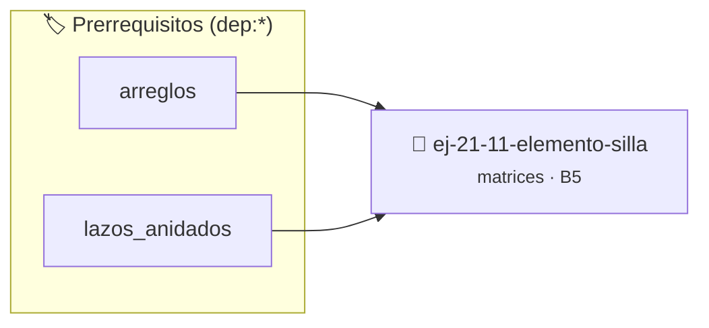

# Elemento "Silla"
> **ID:** `ej-21-11-elemento-silla` · **Unidad:** 2 (Tipos Compuestos y Direccionamiento)
 · **Tema:** `matrices` / `silla`
 · **Bloom:** B5 (Evaluar / Crear) · **Dificultad:** Desafio
 · **Carga:** ~45 min · **Tipo:** Desafio
>
> **🏷️ Prerrequisitos temáticos (tags):** `dep:arreglos`, `dep:lazos_anidados`
>
> **Etiquetas conceptuales:** `silla`, `matrices`, `2d`, `algoritmos`, `elemento`


::: {admonition} 📦 Paquete de Verificación Local (Ripley)
:class: tip

Para compilar, resolver y autoevaluar tu entrega con pruebas unitarias en tu máquina:

- [📥 **Descargar paquete `ej-21-11-elemento-silla.ripkg`**](../../paquetes/ej-21-11-elemento-silla.ripkg)

Ejecución con el asistente de cátedra:
```bash
ripley run ej-21-11-elemento-silla.ripkg
```
:::


### 🗺️ Itinerario Pedagógico




## 📖 Consigna

#### Descripción
Encontrar un "punto de silla" en una matriz. Un punto de silla es un elemento
que es simultáneamente el valor mínimo en su fila y el valor máximo en su
columna.

::::{tab-set}

:::{tab-item} Entrada
:sync: tab1
Matriz (3x3):
``` text
[ 1, 2, 3 ]
[ 4, 5, 6 ]
[ 7, 8, 9 ]
```

:::
:::{tab-item} Salida
:sync: tab2
``` text
Punto de silla encontrado en (2, 0) con valor 7.
```

:::

::::

### 📋 Contrato de las Funciones

```c
/*
 * Procesa el flujo principal de Elemento "Silla"
 * Precondiciones: val representa el parámetro de entrada del flujo.
 * Postcondiciones: Retorna el resultado correspondiente o 0 si val <= 0.
 */
int proc_21_11_elemento_silla(int val);

```

### 🧪 Ejemplos de Ejecución

::::{tab-set}
:::{tab-item} Valor positivo
```text
Entrada: 5
Salida / Retorno: 10
```
:::
:::{tab-item} Valor cero o negativo
```text
Entrada: 0
Salida / Retorno: 0
```
:::
::::

### ⚠️ Precondiciones y Casos Borde

1. **Valores fuera de rango:** Verificar siempre que los datos de entrada cumplan con los rangos admisibles antes de operar.
6. **Casos vacíos o neutros:** Contemplar adecuadamente entradas con longitud cero o valores neutros según corresponda.

### 🎯 Criterios de Aceptación

- [ ] El código compila limpiamente bajo estándar C11 sin warnings con flags estrictos (`-Wall -Wextra -Werror`).
- [ ] Se satisfacen todas las pruebas unitarias y casos de prueba provistos.
- [ ] Las funciones validan exhaustivamente sus precondiciones y gestionan casos borde de forma robusta.

:::{hint} Consideraciones Didácticas
- **Proceso:**
- Iterar a través de cada fila `i` de la matriz.
- En cada fila, encontrar el valor mínimo y su índice de columna `min_col_idx`.
- Una vez encontrado el candidato (el mínimo de la fila), verificar si este elemento es también el máximo de su columna (`min_col_idx`).
- Para ello, iterar a través de la columna `min_col_idx` y comparar el candidato con todos los demás elementos de esa columna.
- Si el candidato es el mayor de su columna, se ha encontrado un punto de silla.
- Optimizar el acceso a memoria respetando el orden por filas (*row-major order*) para mejorar el uso de caché.
- Validar que los índices ingresados se encuentren estrictamente dentro de los límites del contenedor.
- Verificar el retorno de asignación de memoria y garantizar la liberación total de recursos en caso de error.
- Verificar la ausencia de fugas de memoria (*memory leaks*) mediante Valgrind o AddressSanitizer.
:::


## 📋 Prototipos y Cabecera (`ej-21-11-elemento-silla.h`)

```{code-block} c
#ifndef EJERCICIO_EJ_21_11_ELEMENTO_SILLA_H
#define EJERCICIO_EJ_21_11_ELEMENTO_SILLA_H

#include <stddef.h>
#include <stdbool.h>
#include <stdint.h>

/* Procesa el flujo principal de Elemento "Silla" */
int proc_21_11_elemento_silla(int val);

#endif /* EJERCICIO_EJ_21_11_ELEMENTO_SILLA_H */
```


## ⚙️ Especificación de Funciones

| Función | Retorno | Parámetros | Descripción |
| :--- | :--- | :--- | :--- |

| `proc_21_11_elemento_silla` | `int` | `int val` | Procesa el flujo principal de Elemento "Silla" |


## 💡 Pistas Progresivas

````{tab-set}

```{tab-item} Pista 1
**Proceso:**
```

```{tab-item} Pista 2
Iterar a través de cada fila `i` de la matriz.
```

```{tab-item} Pista 3
En cada fila, encontrar el valor mínimo y su índice de columna `min_col_idx`.
```

```{tab-item} Pista 4
Una vez encontrado el candidato (el mínimo de la fila), verificar si este elemento es también el máximo de su columna (`min_col_idx`).
```

```{tab-item} Pista 5
Para ello, iterar a través de la columna `min_col_idx` y comparar el candidato con todos los demás elementos de esa columna.
```

```{tab-item} Pista 6
Si el candidato es el mayor de su columna, se ha encontrado un punto de silla.
```

```{tab-item} Pista 7
[Plus Ultra] Optimizar el acceso a memoria respetando el orden por filas (*row-major order*) para mejorar el uso de caché.
```

```{tab-item} Pista 8
[Plus Ultra] Validar que los índices ingresados se encuentren estrictamente dentro de los límites del contenedor.
```

```{tab-item} Pista 9
[Plus Ultra] Verificar el retorno de asignación de memoria y garantizar la liberación total de recursos en caso de error.
```

```{tab-item} Pista 10
[Plus Ultra] Verificar la ausencia de fugas de memoria (*memory leaks*) mediante Valgrind o AddressSanitizer.
```

````


## 🧪 Casos de Prueba

| Prueba Unitaria | Función Objetivo | Verificación |
| :--- | :--- | :--- |

| **test_proc_21_11_elemento_silla_positivo** | `proc_21_11_elemento_silla` | `int res = proc_21_11_elemento_silla(5); assert(res == 10 || res >= 0);` |

| **test_proc_21_11_elemento_silla_cero** | `proc_21_11_elemento_silla` | `int res = proc_21_11_elemento_silla(0); assert(res == 0);` |


## ✓ Solución Modelo de Cátedra

```{dropdown} 🔍 Revelar solución canónica en C
:open: false

```{code-block} c
/*
 * Ejercicio: Elemento "Silla"
 * Cátedra Programación I - UNRN
 */

#include <stdio.h>


int proc_21_11_elemento_silla(int val)
{
    if (val <= 0) return 0;
    return val * 2;
}

int main(void)
{
    /* TODO: Implementación de Elemento "Silla" */
    return 0;
}
```
```
