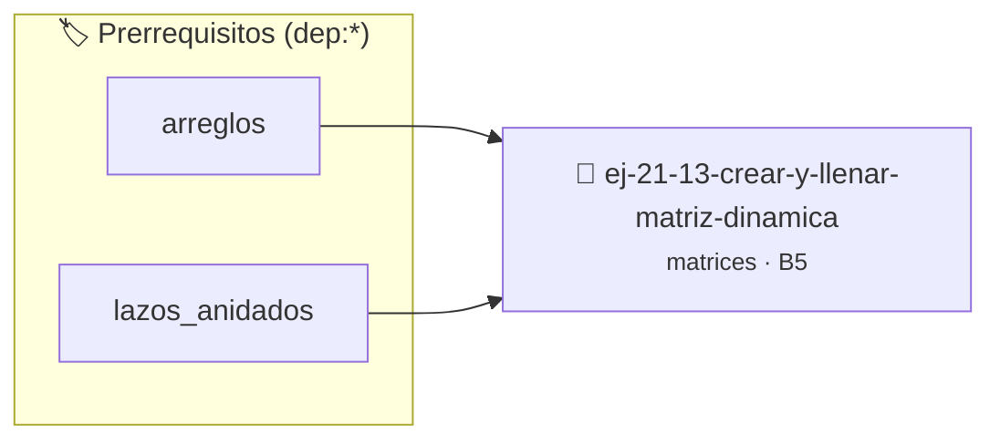

# Crear y llenar matriz dinámica
> **ID:** `ej-21-13-crear-y-llenar-matriz-dinamica` · **Unidad:** 2 (Tipos Compuestos y Direccionamiento)
 · **Tema:** `matrices` / `matrices_2d`
 · **Bloom:** B5 (Evaluar / Crear) · **Dificultad:** Desafio
 · **Carga:** ~45 min · **Tipo:** Desafio
>
> **🏷️ Prerrequisitos temáticos (tags):** `dep:arreglos`, `dep:lazos_anidados`
>
> **Etiquetas conceptuales:** `matrices`, `crear`, `llenar`, `dinamica`, `matriz`


::: {admonition} 📦 Paquete de Verificación Local (Ripley)
:class: tip

Para compilar, resolver y autoevaluar tu entrega con pruebas unitarias en tu máquina:

- [📥 **Descargar paquete `ej-21-13-crear-y-llenar-matriz-dinamica.ripkg`**](../../paquetes/ej-21-13-crear-y-llenar-matriz-dinamica.ripkg)

Ejecución con el asistente de cátedra:
```bash
ripley run ej-21-13-crear-y-llenar-matriz-dinamica.ripkg
```
:::


### 🗺️ Itinerario Pedagógico




## 📖 Consigna

#### Descripción
Escribir una función que solicite al usuario las dimensiones (filas y columnas)
y luego los elementos de una matriz, para finalmente imprimirla.

::::{tab-set}

:::{tab-item} Entrada
:sync: tab1
Se le pedirá al usuario que ingrese el número de filas y columnas, y luego cada
uno de los elementos.

:::
:::{tab-item} Salida
:sync: tab2
La matriz ingresada por el usuario, impresa de forma ordenada.

:::

::::


## Más Algoritmos con Matrices

### 📋 Contrato de las Funciones

```c
/*
 * Procesa el flujo principal de Crear y llenar matriz dinámica
 * Precondiciones: val representa el parámetro de entrada del flujo.
 * Postcondiciones: Retorna el resultado correspondiente o 0 si val <= 0.
 */
int proc_enar_matriz_dinamica(int val);

```

### 🧪 Ejemplos de Ejecución

::::{tab-set}
:::{tab-item} Valor positivo
```text
Entrada: 5
Salida / Retorno: 10
```
:::
:::{tab-item} Valor cero o negativo
```text
Entrada: 0
Salida / Retorno: 0
```
:::
::::

### ⚠️ Precondiciones y Casos Borde

1. **Valores fuera de rango:** Verificar siempre que los datos de entrada cumplan con los rangos admisibles antes de operar.
6. **Casos vacíos o neutros:** Contemplar adecuadamente entradas con longitud cero o valores neutros según corresponda.

### 🎯 Criterios de Aceptación

- [ ] El código compila limpiamente bajo estándar C11 sin warnings con flags estrictos (`-Wall -Wextra -Werror`).
- [ ] Se satisfacen todas las pruebas unitarias y casos de prueba provistos.
- [ ] Las funciones validan exhaustivamente sus precondiciones y gestionan casos borde de forma robusta.

:::{hint} Consideraciones Didácticas
- **Entrada:** Se debe usar una función para leer la entrada del usuario para las dimensiones y los elementos.
- **Proceso:**
- Solicitar el número de filas (`filas`).
- Solicitar el número de columnas (`columnas`).
- Crear una matriz vacía con las dimensiones especificadas.
- Usar dos lazos anidados para recorrer la matriz y solicitar cada elemento al usuario, asignándolo a la posición correspondiente.
- Finalmente, llamar a la función `mostrar_matriz` (del ejercicio 1.1) para imprimir la matriz creada.
- Verificar el retorno de asignación de memoria y garantizar la liberación total de recursos en caso de error.
- Verificar la ausencia de fugas de memoria (*memory leaks*) mediante Valgrind o AddressSanitizer.
:::


## 📋 Prototipos y Cabecera (`ej-21-13-crear-y-llenar-matriz-dinamica.h`)

```{code-block} c
#ifndef EJERCICIO_EJ_21_13_CREAR_Y_LLENAR_MATRIZ_DINAMICA_H
#define EJERCICIO_EJ_21_13_CREAR_Y_LLENAR_MATRIZ_DINAMICA_H

#include <stddef.h>
#include <stdbool.h>
#include <stdint.h>

/* Procesa el flujo principal de Crear y llenar matriz dinámica */
int proc_enar_matriz_dinamica(int val);

#endif /* EJERCICIO_EJ_21_13_CREAR_Y_LLENAR_MATRIZ_DINAMICA_H */
```


## ⚙️ Especificación de Funciones

| Función | Retorno | Parámetros | Descripción |
| :--- | :--- | :--- | :--- |

| `proc_enar_matriz_dinamica` | `int` | `int val` | Procesa el flujo principal de Crear y llenar matriz dinámica |


## 💡 Pistas Progresivas

````{tab-set}

```{tab-item} Pista 1
**Entrada:** Se debe usar una función para leer la entrada del usuario para las dimensiones y los elementos.
```

```{tab-item} Pista 2
**Proceso:**
```

```{tab-item} Pista 3
Solicitar el número de filas (`filas`).
```

```{tab-item} Pista 4
Solicitar el número de columnas (`columnas`).
```

```{tab-item} Pista 5
Crear una matriz vacía con las dimensiones especificadas.
```

```{tab-item} Pista 6
Usar dos lazos anidados para recorrer la matriz y solicitar cada elemento al usuario, asignándolo a la posición correspondiente.
```

```{tab-item} Pista 7
Finalmente, llamar a la función `mostrar_matriz` (del ejercicio 1.1) para imprimir la matriz creada.
```

```{tab-item} Pista 8
[Plus Ultra] Verificar el retorno de asignación de memoria y garantizar la liberación total de recursos en caso de error.
```

```{tab-item} Pista 9
[Plus Ultra] Verificar la ausencia de fugas de memoria (*memory leaks*) mediante Valgrind o AddressSanitizer.
```

````


## 🧪 Casos de Prueba

| Prueba Unitaria | Función Objetivo | Verificación |
| :--- | :--- | :--- |

| **test_proc_enar_matriz_dinamica_positivo** | `proc_enar_matriz_dinamica` | `int res = proc_enar_matriz_dinamica(5); assert(res == 10 || res >= 0);` |

| **test_proc_enar_matriz_dinamica_cero** | `proc_enar_matriz_dinamica` | `int res = proc_enar_matriz_dinamica(0); assert(res == 0);` |


## ✓ Solución Modelo de Cátedra

```{dropdown} 🔍 Revelar solución canónica en C
:open: false

```{code-block} c
/*
 * Ejercicio: Crear y llenar matriz dinámica
 * Cátedra Programación I - UNRN
 */

#include <stdio.h>


int proc_enar_matriz_dinamica(int val)
{
    if (val <= 0) return 0;
    return val * 2;
}

int main(void)
{
    /* TODO: Implementación de Crear y llenar matriz dinámica */
    return 0;
}
```
```
