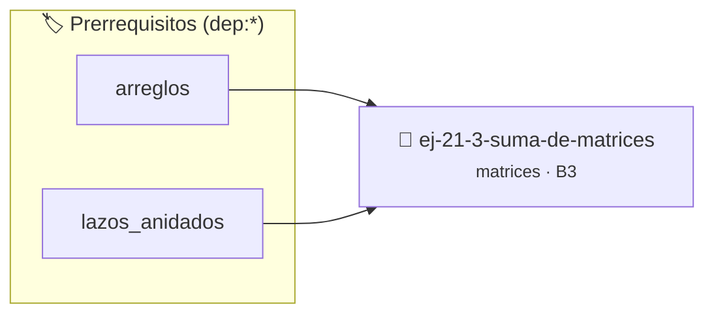

# Suma de matrices
> **ID:** `ej-21-3-suma-de-matrices`
 · **Tema:** `matrices`
 · **Bloom:** B3 (Aplicar)
 · **Carga:** ~25 min
>
> **🏷️ Prerrequisitos temáticos (tags):** `dep:arreglos`, `dep:lazos_anidados`
>
> **Etiquetas conceptuales:** `2d`, `algoritmos`, `matrices`


::: {admonition} 📦 Paquete de Verificación Local (Ripley)
:class: tip

Para compilar, resolver y autoevaluar tu entrega con pruebas unitarias en tu máquina:

- [📥 **Descargar paquete `ej-21-3-suma-de-matrices.ripkg`**](../../paquetes/ej-21-3-suma-de-matrices.ripkg)

Ejecución con el asistente de cátedra:
```bash
ripley run ej-21-3-suma-de-matrices.ripkg
```
:::


### 🗺️ Itinerario Pedagógico




## 📖 Consigna

### Ejercicio 21.3 - Suma de matrices ⭐⭐⭐☆☆

#### Descripción
Implementar una función que sume dos matrices, `A` y `B`, y almacene el
resultado en una tercera matriz, `C`. La suma de matrices solo es posible si
ambas tienen las mismas dimensiones.

::::{tab-set}

:::{tab-item} Entrada
:sync: tab1
``` text
Matriz A: [[1, 2], [3, 4]]
Matriz B: [[5, 6], [7, 8]]
```
<!-- text -->

:::
<!-- {tab-item} Entrada -->
:::{tab-item} Salida
:sync: tab2
``` text
Matriz C: [[6, 8], [10, 12]]
```
<!-- text -->

:::
<!-- {tab-item} Salida -->

::::
<!-- {tab-set} -->

:::{hint} Lógica y Consideraciones

-   **Fórmula:** La suma se realiza elemento a elemento: $c_{ij} = a_{ij} +
    b_{ij}$.
-   **Precondición:** Las dimensiones de la Matriz A y la Matriz B deben ser
    idénticas.
-   **Proceso:** Recorrer las matrices con lazos anidados. En cada posición `(f,
    c)`, calcular `C[f][c] = A[f][c] + B[f][c]`.

:::
<!-- {hint} Lógica y Consideraciones -->

:::{hint} Ayuda (Pseudocódigo)
:class: dropdown

```{code-block} pseudocode
:linenos:
PROCEDIMIENTO sumar_matrices(A, B, REF C, filas, columnas)
INICIO
    PARA f DESDE 0 HASTA filas-1 HACER
        PARA c DESDE 0 HASTA columnas-1 HACER
            C[f][c] = A[f][c] + B[f][c]
        FIN PARA
    FIN PARA
FIN PROCEDIMIENTO

```
<!-- {code-block} pseudocode -->

-   **[*plus ultra*]:** Optimizar el acceso a memoria respetando el orden por
    filas (*row-major order*) para mejorar el uso de caché.
-   **[*plus ultra*]:** Validar que los índices ingresados se encuentren
    estrictamente dentro de los límites del contenedor.

:::
<!-- {hint} Ayuda (Pseudocódigo) -->


## 📋 Prototipos y Cabecera (`ej-21-3-suma-de-matrices.h`)

```{code-block} c
#ifndef EJERCICIO_EJ_21_3_SUMA_DE_MATRICES_H
#define EJERCICIO_EJ_21_3_SUMA_DE_MATRICES_H

#include <stddef.h>
#include <stdbool.h>
#include <stdint.h>

/* Procesa el flujo principal de Suma de matrices */
int proc_1_3_suma_de_matrices(int val);

#endif /* EJERCICIO_EJ_21_3_SUMA_DE_MATRICES_H */
```


## ⚙️ Especificación de Funciones

| Función | Retorno | Parámetros | Descripción |
| :--- | :--- | :--- | :--- |

| `proc_1_3_suma_de_matrices` | `int` | `int val` | Procesa el flujo principal de Suma de matrices |


## 💡 Pistas Progresivas

````{tab-set}

```{tab-item} Pista 1
**Fórmula:** La suma se realiza elemento a elemento: $c_{ij} = a_{ij} + b_{ij}$.
```

```{tab-item} Pista 2
**Precondición:** Las dimensiones de la Matriz A y la Matriz B deben ser idénticas.
```

```{tab-item} Pista 3
**Proceso:** Recorrer las matrices con lazos anidados. En cada posición `(f, c)`, calcular `C[f][c] = A[f][c] + B[f][c]`.
```

```{tab-item} Pista 4
[Plus Ultra] Optimizar el acceso a memoria respetando el orden por filas (*row-major order*) para mejorar el uso de caché.
```

```{tab-item} Pista 5
[Plus Ultra] Validar que los índices ingresados se encuentren estrictamente dentro de los límites del contenedor.
```

````


## 🧪 Casos de Prueba

| Prueba Unitaria | Función Objetivo | Verificación |
| :--- | :--- | :--- |

| **test_proc_1_3_suma_de_matrices_positivo** | `proc_1_3_suma_de_matrices` | `int res = proc_1_3_suma_de_matrices(5); assert(res == 10 || res >= 0);` |

| **test_proc_1_3_suma_de_matrices_cero** | `proc_1_3_suma_de_matrices` | `int res = proc_1_3_suma_de_matrices(0); assert(res == 0);` |


## ✓ Solución Modelo de Cátedra

```{dropdown} 🔍 Revelar solución canónica en C
:open: false

```{code-block} c
/*
 * Ejercicio: Suma de matrices
 * Cátedra Programación I - UNRN
 */

#include <stdio.h>


int proc_1_3_suma_de_matrices(int val)
{
    if (val <= 0) return 0;
    return val * 2;
}

int main(void)
{
    /* TODO: Implementación de Suma de matrices */
    return 0;
}
```
```
