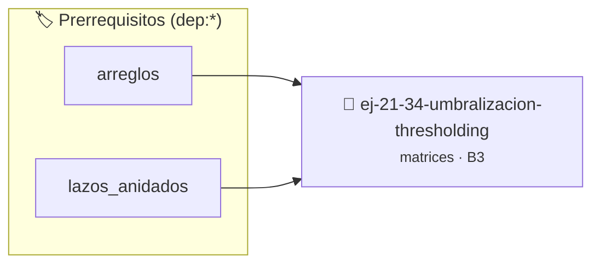

# Umbralización (Thresholding)
> **ID:** `ej-21-34-umbralizacion-thresholding`
 · **Tema:** `matrices`
 · **Bloom:** B3 (Aplicar)
 · **Carga:** ~25 min
>
> **🏷️ Prerrequisitos temáticos (tags):** `dep:arreglos`, `dep:lazos_anidados`
>
> **Etiquetas conceptuales:** `matrices`, `umbralizacion`, `thresholding`, `2d`, `algoritmos`


::: {admonition} 📦 Paquete de Verificación Local (Ripley)
:class: tip

Para compilar, resolver y autoevaluar tu entrega con pruebas unitarias en tu máquina:

- [📥 **Descargar paquete `ej-21-34-umbralizacion-thresholding.ripkg`**](../../paquetes/ej-21-34-umbralizacion-thresholding.ripkg)

Ejecución con el asistente de cátedra:
```bash
ripley run ej-21-34-umbralizacion-thresholding.ripkg
```
:::


### 🗺️ Itinerario Pedagógico




## 📖 Consigna

### Ejercicio 21.34 - Umbralización (Thresholding) ⭐⭐☆☆☆

Convertir una imagen en escala de grises a binaria (solo 0 y 255) usando un
umbral.


:::{hint} Lógica y Consideraciones

-   **[*plus ultra*]:** Validar estrictamente los datos de entrada para manejar
    valores fuera de rango o tipos inválidos.
-   **[*plus ultra*]:** Permitir el procesamiento interactivo continuo mediante
    un lazo hasta que el usuario elija finalizar.

:::
<!-- {hint} Lógica y Consideraciones -->

``` c
void umbralizar(int **imagen, int filas, int cols, int umbral);
```
<!-- c -->

**Algoritmo:** Si `pixel >= umbral`, asignar 255, sino asignar 0.


## 📋 Prototipos y Cabecera (`ej-21-34-umbralizacion-thresholding.h`)

```{code-block} c
#ifndef EJERCICIO_EJ_21_34_UMBRALIZACION_THRESHOLDING_H
#define EJERCICIO_EJ_21_34_UMBRALIZACION_THRESHOLDING_H

#include <stddef.h>
#include <stdbool.h>
#include <stdint.h>

/* Procesa el flujo principal de Umbralización (Thresholding) */
int proc_izacion_thresholding(int val);

#endif /* EJERCICIO_EJ_21_34_UMBRALIZACION_THRESHOLDING_H */
```


## ⚙️ Especificación de Funciones

| Función | Retorno | Parámetros | Descripción |
| :--- | :--- | :--- | :--- |

| `proc_izacion_thresholding` | `int` | `int val` | Procesa el flujo principal de Umbralización (Thresholding) |


## 💡 Pistas Progresivas

````{tab-set}

```{tab-item} Pista 1
[Plus Ultra] Validar estrictamente los datos de entrada para manejar valores fuera de rango o tipos inválidos.
```

```{tab-item} Pista 2
[Plus Ultra] Permitir el procesamiento interactivo continuo mediante un lazo hasta que el usuario elija finalizar.
```

````


## 🧪 Casos de Prueba

| Prueba Unitaria | Función Objetivo | Verificación |
| :--- | :--- | :--- |

| **test_proc_izacion_thresholding_positivo** | `proc_izacion_thresholding` | `int res = proc_izacion_thresholding(5); assert(res == 10 || res >= 0);` |

| **test_proc_izacion_thresholding_cero** | `proc_izacion_thresholding` | `int res = proc_izacion_thresholding(0); assert(res == 0);` |


## ✓ Solución Modelo de Cátedra

```{dropdown} 🔍 Revelar solución canónica en C
:open: false

```{code-block} c
/*
 * Ejercicio: Umbralización (Thresholding)
 * Cátedra Programación I - UNRN
 */

#include <stdio.h>


int proc_izacion_thresholding(int val)
{
    if (val <= 0) return 0;
    return val * 2;
}

int main(void)
{
    /* TODO: Implementación de Umbralización (Thresholding) */
    return 0;
}
```
```
