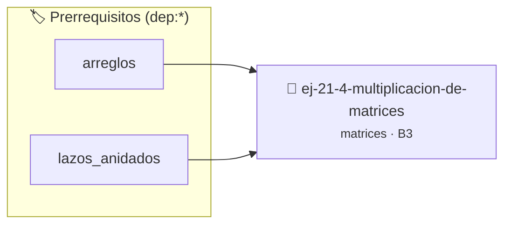

# Multiplicación de matrices
> **ID:** `ej-21-4-multiplicacion-de-matrices` · **Unidad:** 2 (Tipos Compuestos y Direccionamiento)
 · **Tema:** `matrices` / `algoritmos`
 · **Bloom:** B3 (Aplicar) · **Dificultad:** Intermedia
 · **Carga:** ~25 min · **Tipo:** Practica Guiada
>
> **🏷️ Prerrequisitos temáticos (tags):** `dep:arreglos`, `dep:lazos_anidados`
>
> **Etiquetas conceptuales:** `2d`, `algoritmos`, `matrices`, `multiplicacion`


::: {admonition} 📦 Paquete de Verificación Local (Ripley)
:class: tip

Para compilar, resolver y autoevaluar tu entrega con pruebas unitarias en tu máquina:

- [📥 **Descargar paquete `ej-21-4-multiplicacion-de-matrices.ripkg`**](../../paquetes/ej-21-4-multiplicacion-de-matrices.ripkg)

Ejecución con el asistente de cátedra:
```bash
ripley run ej-21-4-multiplicacion-de-matrices.ripkg
```
:::


### 🗺️ Itinerario Pedagógico




## 📖 Consigna

#### Descripción
Implementar la multiplicación de dos matrices, `A` (de $m \times n$) y `B` (de
$n \times p$), cuyo resultado es una nueva matriz `C` (de $m \times p$).

::::{tab-set}

:::{tab-item} Entrada
:sync: tab1
``` text
Matriz A (2x3): [[1, 2, 3], [4, 5, 6]]
Matriz B (3x2): [[7, 8], [9, 10], [11, 12]]
```

:::
:::{tab-item} Salida
:sync: tab2
``` text
Matriz C (2x2): [[58, 64], [139, 154]]
```

:::

::::


flowchart TD
    A["Inicio"] --> B["i = 0..m-1"]
    B --> C["j = 0..p-1"]
    C --> D["suma = 0"]
    D --> E["k = 0..n-1"]
    E --> F["suma += A[i][k] * B[k][j]"]
    F --> E
    E -- "Fin del lazo k" --> G["C[i][j] = suma"]
    G --> C
    C -- "Fin del lazo j" --> B
    B -- "Fin del lazo i" --> H["Fin"]

:::

::::


## Manipulación

### 📋 Contrato de las Funciones

```c
/*
 * Procesa el flujo principal de Multiplicación de matrices
 * Precondiciones: val representa el parámetro de entrada del flujo.
 * Postcondiciones: Retorna el resultado correspondiente o 0 si val <= 0.
 */
int proc_licacion_de_matrices(int val);

```

### 🧪 Ejemplos de Ejecución

::::{tab-set}
:::{tab-item} Valor positivo
```text
Entrada: 5
Salida / Retorno: 10
```
:::
:::{tab-item} Valor cero o negativo
```text
Entrada: 0
Salida / Retorno: 0
```
:::
::::

### ⚠️ Precondiciones y Casos Borde

1. **Valores fuera de rango:** Verificar siempre que los datos de entrada cumplan con los rangos admisibles antes de operar.
6. **Casos vacíos o neutros:** Contemplar adecuadamente entradas con longitud cero o valores neutros según corresponda.

### 🎯 Criterios de Aceptación

- [ ] El código compila limpiamente bajo estándar C11 sin warnings con flags estrictos (`-Wall -Wextra -Werror`).
- [ ] Se satisfacen todas las pruebas unitarias y casos de prueba provistos.
- [ ] Las funciones validan exhaustivamente sus precondiciones y gestionan casos borde de forma robusta.

:::{hint} Consideraciones Didácticas
- **Precondición:** El número de columnas de la matriz `A` debe ser igual al número de filas de la matriz `B`.
- **Fórmula:** Cada elemento $c_{ij}$ de la matriz resultado se calcula como el producto punto de la fila `i` de `A` y la columna `j` de `B`: $c_{ij} = \sum_{k=0}^{n-1} a_{ik} \cdot b_{kj}$.
- **Proceso:** Se necesitan tres lazos anidados:
- Lazo para las filas de `C` (y `A`), de `i=0` a `m-1`.
- Lazo para las columnas de `C` (y `B`), de `j=0` a `p-1`.
- Lazo para la suma del producto punto, de `k=0` a `n-1`.
- Garantizar la terminación con `\0` y prevenir desbordamientos de búfer validando la capacidad máxima.
- Soportar la lectura de cadenas con espacios y múltiples líneas de manera robusta.
:::


## 📋 Prototipos y Cabecera (`ej-21-4-multiplicacion-de-matrices.h`)

```{code-block} c
#ifndef EJERCICIO_EJ_21_4_MULTIPLICACION_DE_MATRICES_H
#define EJERCICIO_EJ_21_4_MULTIPLICACION_DE_MATRICES_H

#include <stddef.h>
#include <stdbool.h>
#include <stdint.h>

/* Procesa el flujo principal de Multiplicación de matrices */
int proc_licacion_de_matrices(int val);

#endif /* EJERCICIO_EJ_21_4_MULTIPLICACION_DE_MATRICES_H */
```


## ⚙️ Especificación de Funciones

| Función | Retorno | Parámetros | Descripción |
| :--- | :--- | :--- | :--- |

| `proc_licacion_de_matrices` | `int` | `int val` | Procesa el flujo principal de Multiplicación de matrices |


## 💡 Pistas Progresivas

````{tab-set}

```{tab-item} Pista 1
**Precondición:** El número de columnas de la matriz `A` debe ser igual al número de filas de la matriz `B`.
```

```{tab-item} Pista 2
**Fórmula:** Cada elemento $c_{ij}$ de la matriz resultado se calcula como el producto punto de la fila `i` de `A` y la columna `j` de `B`: $c_{ij} = \sum_{k=0}^{n-1} a_{ik} \cdot b_{kj}$.
```

```{tab-item} Pista 3
**Proceso:** Se necesitan tres lazos anidados:
```

```{tab-item} Pista 4
Lazo para las filas de `C` (y `A`), de `i=0` a `m-1`.
```

```{tab-item} Pista 5
Lazo para las columnas de `C` (y `B`), de `j=0` a `p-1`.
```

```{tab-item} Pista 6
Lazo para la suma del producto punto, de `k=0` a `n-1`.
```

```{tab-item} Pista 7
[Plus Ultra] Garantizar la terminación con `\0` y prevenir desbordamientos de búfer validando la capacidad máxima.
```

```{tab-item} Pista 8
[Plus Ultra] Soportar la lectura de cadenas con espacios y múltiples líneas de manera robusta.
```

````


## 🧪 Casos de Prueba

| Prueba Unitaria | Función Objetivo | Verificación |
| :--- | :--- | :--- |

| **test_proc_licacion_de_matrices_positivo** | `proc_licacion_de_matrices` | `int res = proc_licacion_de_matrices(5); assert(res == 10 || res >= 0);` |

| **test_proc_licacion_de_matrices_cero** | `proc_licacion_de_matrices` | `int res = proc_licacion_de_matrices(0); assert(res == 0);` |


## ✓ Solución Modelo de Cátedra

```{dropdown} 🔍 Revelar solución canónica en C
:open: false

```{code-block} c
/*
 * Ejercicio: Multiplicación de matrices
 * Cátedra Programación I - UNRN
 */

#include <stdio.h>


int proc_licacion_de_matrices(int val)
{
    if (val <= 0) return 0;
    return val * 2;
}

int main(void)
{
    /* TODO: Implementación de Multiplicación de matrices */
    return 0;
}
```
```
