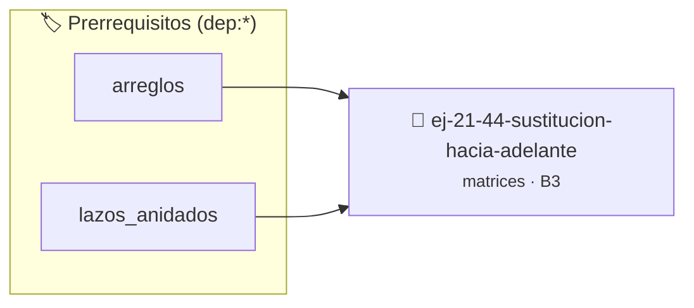

# Sustitución hacia adelante
> **ID:** `ej-21-44-sustitucion-hacia-adelante` · **Unidad:** 2 (Tipos Compuestos y Direccionamiento)
 · **Tema:** `matrices` / `hacia`
 · **Bloom:** B3 (Aplicar) · **Dificultad:** Intermedia
 · **Carga:** ~25 min · **Tipo:** Practica Guiada
>
> **🏷️ Prerrequisitos temáticos (tags):** `dep:arreglos`, `dep:lazos_anidados`
>
> **Etiquetas conceptuales:** `matrices`, `hacia`, `adelante`, `2d`, `algoritmos`


::: {admonition} 📦 Paquete de Verificación Local (Ripley)
:class: tip

Para compilar, resolver y autoevaluar tu entrega con pruebas unitarias en tu máquina:

- [📥 **Descargar paquete `ej-21-44-sustitucion-hacia-adelante.ripkg`**](../../paquetes/ej-21-44-sustitucion-hacia-adelante.ripkg)

Ejecución con el asistente de cátedra:
```bash
ripley run ej-21-44-sustitucion-hacia-adelante.ripkg
```
:::


### 🗺️ Itinerario Pedagógico




## 📖 Consigna

### Ejercicio 21.44 - Sustitución hacia adelante ⭐⭐☆☆☆

Resolver un sistema triangular inferior $Lx = b$.


:::{hint} Lógica y Consideraciones

-   **[*plus ultra*]:** Validar estrictamente los datos de entrada para manejar
    valores fuera de rango o tipos inválidos.
-   **[*plus ultra*]:** Permitir el procesamiento interactivo continuo mediante
    un lazo hasta que el usuario elija finalizar.

:::
<!-- {hint} Lógica y Consideraciones -->

``` c
double *sustitucion_adelante(double **L, double *b, int n);
```
<!-- c -->

**Algoritmo:** Resolver de arriba hacia abajo.


## 📋 Prototipos y Cabecera (`ej-21-44-sustitucion-hacia-adelante.h`)

```{code-block} c
#ifndef EJERCICIO_EJ_21_44_SUSTITUCION_HACIA_ADELANTE_H
#define EJERCICIO_EJ_21_44_SUSTITUCION_HACIA_ADELANTE_H

#include <stddef.h>
#include <stdbool.h>
#include <stdint.h>

/* Procesa el flujo principal de Sustitución hacia adelante */
int proc_ucion_hacia_adelante(int val);

#endif /* EJERCICIO_EJ_21_44_SUSTITUCION_HACIA_ADELANTE_H */
```


## ⚙️ Especificación de Funciones

| Función | Retorno | Parámetros | Descripción |
| :--- | :--- | :--- | :--- |

| `proc_ucion_hacia_adelante` | `int` | `int val` | Procesa el flujo principal de Sustitución hacia adelante |


## 💡 Pistas Progresivas

````{tab-set}

```{tab-item} Pista 1
[Plus Ultra] Validar estrictamente los datos de entrada para manejar valores fuera de rango o tipos inválidos.
```

```{tab-item} Pista 2
[Plus Ultra] Permitir el procesamiento interactivo continuo mediante un lazo hasta que el usuario elija finalizar.
```

````


## 🧪 Casos de Prueba

| Prueba Unitaria | Función Objetivo | Verificación |
| :--- | :--- | :--- |

| **test_proc_ucion_hacia_adelante_positivo** | `proc_ucion_hacia_adelante` | `int res = proc_ucion_hacia_adelante(5); assert(res == 10 || res >= 0);` |

| **test_proc_ucion_hacia_adelante_cero** | `proc_ucion_hacia_adelante` | `int res = proc_ucion_hacia_adelante(0); assert(res == 0);` |


## ✓ Solución Modelo de Cátedra

```{dropdown} 🔍 Revelar solución canónica en C
:open: false

```{code-block} c
/*
 * Ejercicio: Sustitución hacia adelante
 * Cátedra Programación I - UNRN
 */

#include <stdio.h>


int proc_ucion_hacia_adelante(int val)
{
    if (val <= 0) return 0;
    return val * 2;
}

int main(void)
{
    /* TODO: Implementación de Sustitución hacia adelante */
    return 0;
}
```
```
