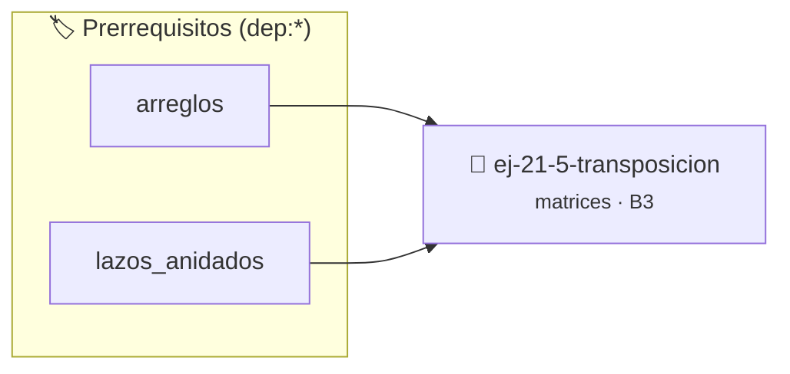

# Transposición
> **ID:** `ej-21-5-transposicion` · **Unidad:** 2 (Tipos Compuestos y Direccionamiento)
 · **Tema:** `matrices` / `transposicion`
 · **Bloom:** B3 (Aplicar) · **Dificultad:** Intermedia
 · **Carga:** ~25 min · **Tipo:** Practica Guiada
>
> **🏷️ Prerrequisitos temáticos (tags):** `dep:arreglos`, `dep:lazos_anidados`
>
> **Etiquetas conceptuales:** `2d`, `transposicion`, `algoritmos`, `matrices`


::: {admonition} 📦 Paquete de Verificación Local (Ripley)
:class: tip

Para compilar, resolver y autoevaluar tu entrega con pruebas unitarias en tu máquina:

- [📥 **Descargar paquete `ej-21-5-transposicion.ripkg`**](../../paquetes/ej-21-5-transposicion.ripkg)

Ejecución con el asistente de cátedra:
```bash
ripley run ej-21-5-transposicion.ripkg
```
:::


### 🗺️ Itinerario Pedagógico




## 📖 Consigna

#### Descripción
Calcular la transpuesta $A^T$ de una matriz $A$. La transposición se obtiene
intercambiando las filas por las columnas.

::::{tab-set}

:::{tab-item} Entrada
:sync: tab1
``` text
Matriz A (2x3): `[[1, 2, 3], [4, 5, 6]]`
```

:::
:::{tab-item} Salida
:sync: tab2
Matriz $A^T$ (3x2):
``` text
[ 1, 4 ]
[ 2, 5 ]
[ 3, 6 ]
```

:::

::::

### 📋 Contrato de las Funciones

```c
/*
 * Procesa el flujo principal de Transposición
 * Precondiciones: val representa el parámetro de entrada del flujo.
 * Postcondiciones: Retorna el resultado correspondiente o 0 si val <= 0.
 */
int ejecutar_ej_21_5_transposicion(int val);

```

### 🧪 Ejemplos de Ejecución

::::{tab-set}
:::{tab-item} Valor positivo
```text
Entrada: 5
Salida / Retorno: 10
```
:::
:::{tab-item} Valor cero o negativo
```text
Entrada: 0
Salida / Retorno: 0
```
:::
::::

### ⚠️ Precondiciones y Casos Borde

1. **Valores fuera de rango:** Verificar siempre que los datos de entrada cumplan con los rangos admisibles antes de operar.
6. **Casos vacíos o neutros:** Contemplar adecuadamente entradas con longitud cero o valores neutros según corresponda.

### 🎯 Criterios de Aceptación

- [ ] El código compila limpiamente bajo estándar C11 sin warnings con flags estrictos (`-Wall -Wextra -Werror`).
- [ ] Se satisfacen todas las pruebas unitarias y casos de prueba provistos.
- [ ] Las funciones validan exhaustivamente sus precondiciones y gestionan casos borde de forma robusta.

:::{hint} Consideraciones Didácticas
- **Fórmula:** $(A^T)_{ij} = A_{ji}$.
- **Dimensiones:** Si la matriz original es $m \times n$, su transpuesta será $n \times m$.
- **Proceso:** Recorrer la matriz original `A` con lazos anidados. En cada posición `(i, j)`, copiar el elemento `A[i][j]` a la posición `(j, i)` de la nueva matriz transpuesta.
- Optimizar el acceso a memoria respetando el orden por filas (*row-major order*) para mejorar el uso de caché.
- Validar que los índices ingresados se encuentren estrictamente dentro de los límites del contenedor.
:::


## 📋 Prototipos y Cabecera (`ej-21-5-transposicion.h`)

```{code-block} c
#ifndef EJERCICIO_EJ_21_5_TRANSPOSICION_H
#define EJERCICIO_EJ_21_5_TRANSPOSICION_H

#include <stddef.h>
#include <stdbool.h>
#include <stdint.h>

/* Procesa el flujo principal de Transposición */
int ejecutar_ej_21_5_transposicion(int val);

#endif /* EJERCICIO_EJ_21_5_TRANSPOSICION_H */
```


## ⚙️ Especificación de Funciones

| Función | Retorno | Parámetros | Descripción |
| :--- | :--- | :--- | :--- |

| `ejecutar_ej_21_5_transposicion` | `int` | `int val` | Procesa el flujo principal de Transposición |


## 💡 Pistas Progresivas

````{tab-set}

```{tab-item} Pista 1
**Fórmula:** $(A^T)_{ij} = A_{ji}$.
```

```{tab-item} Pista 2
**Dimensiones:** Si la matriz original es $m \times n$, su transpuesta será $n \times m$.
```

```{tab-item} Pista 3
**Proceso:** Recorrer la matriz original `A` con lazos anidados. En cada posición `(i, j)`, copiar el elemento `A[i][j]` a la posición `(j, i)` de la nueva matriz transpuesta.
```

```{tab-item} Pista 4
[Plus Ultra] Optimizar el acceso a memoria respetando el orden por filas (*row-major order*) para mejorar el uso de caché.
```

```{tab-item} Pista 5
[Plus Ultra] Validar que los índices ingresados se encuentren estrictamente dentro de los límites del contenedor.
```

````


## 🧪 Casos de Prueba

| Prueba Unitaria | Función Objetivo | Verificación |
| :--- | :--- | :--- |

| **test_ejecutar_ej_21_5_transposicion_positivo** | `ejecutar_ej_21_5_transposicion` | `int res = ejecutar_ej_21_5_transposicion(5); assert(res == 10 || res >= 0);` |

| **test_ejecutar_ej_21_5_transposicion_cero** | `ejecutar_ej_21_5_transposicion` | `int res = ejecutar_ej_21_5_transposicion(0); assert(res == 0);` |


## ✓ Solución Modelo de Cátedra

```{dropdown} 🔍 Revelar solución canónica en C
:open: false

```{code-block} c
/*
 * Ejercicio: Transposición
 * Cátedra Programación I - UNRN
 */

#include <stdio.h>


int ejecutar_ej_21_5_transposicion(int val)
{
    if (val <= 0) return 0;
    return val * 2;
}

int main(void)
{
    /* TODO: Implementación de Transposición */
    return 0;
}
```
```
