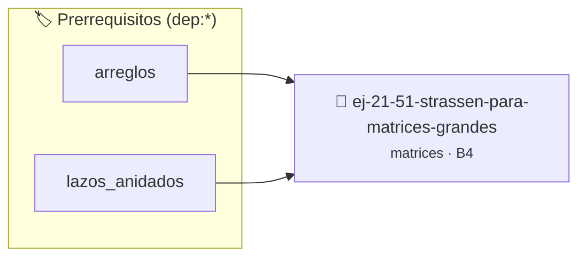

# Strassen para matrices grandes
> **ID:** `ej-21-51-strassen-para-matrices-grandes` · **Unidad:** 2 (Tipos Compuestos y Direccionamiento)
 · **Tema:** `matrices` / `grandes`
 · **Bloom:** B4 (Analizar) · **Dificultad:** Avanzada
 · **Carga:** ~35 min · **Tipo:** Practica Guiada
>
> **🏷️ Prerrequisitos temáticos (tags):** `dep:arreglos`, `dep:lazos_anidados`
>
> **Etiquetas conceptuales:** `grandes`, `matrices`, `strassen`, `2d`, `algoritmos`


::: {admonition} 📦 Paquete de Verificación Local (Ripley)
:class: tip

Para compilar, resolver y autoevaluar tu entrega con pruebas unitarias en tu máquina:

- [📥 **Descargar paquete `ej-21-51-strassen-para-matrices-grandes.ripkg`**](../../paquetes/ej-21-51-strassen-para-matrices-grandes.ripkg)

Ejecución con el asistente de cátedra:
```bash
ripley run ej-21-51-strassen-para-matrices-grandes.ripkg
```
:::


### 🗺️ Itinerario Pedagógico




## 📖 Consigna

Implementar el algoritmo de Strassen para multiplicación rápida de matrices
grandes.


``` c
double **strassen(double **A, double **B, int n);
```

**Complejidad:** $O(n^{2.807})$ vs $O(n^3)$ del método tradicional.

Creá una matriz 3×3, inicializala con valores del 1 al 9, y mostrala.

**Orientación:**
- `int matriz[3][3];`
- Lazos anidados para llenar: `matriz[i][j] = contador++`
- Lazos anidados para mostrar con formato


---

Calculá la suma de todos los elementos de una matriz.

**Orientación:**
- Recorré con lazos anidados
- Acumulá suma en variable
- `suma += matriz[i][j]`


---

Encontrá el elemento mayor y menor de una matriz, junto con sus posiciones.

**Orientación:**
- Inicializá `max` y `min` con `matriz[0][0]`
- Recorré comparando
- Guardá posiciones (i, j) cuando actualizás max/min


---

Generá una matriz identidad de tamaño N×N (1s en diagonal, 0s en el resto).

**Orientación:**
- `matriz[i][j] = (i == j) ? 1 : 0;`
- O con `if`: `matriz[i][j] = 1` si `i == j`, sino 0


---

Calculá la transpuesta de una matriz (intercambiar filas por columnas).

**Orientación:**
- Matriz original: M×N
- Transpuesta: N×M
- `transpuesta[j][i] = original[i][j]`
- Creá nueva matriz para el resultado


---

Mostrá y sumá los elementos de la diagonal principal de una matriz cuadrada.

**Orientación:**
- Diagonal principal: elementos donde `i == j`
- Lazo de 0 a N-1: `suma += matriz[i][i]`


---

Mostrá y sumá los elementos de la diagonal secundaria.

**Orientación:**
- Diagonal secundaria: elementos donde `i + j == N - 1`
- O directamente: `matriz[i][N-1-i]` para i de 0 a N-1


---

Verificá si una matriz es simétrica (igual a su transpuesta).

**Orientación:**
- Matriz simétrica: `matriz[i][j] == matriz[j][i]` para todo i, j
- Solo necesitás verificar una mitad (triángulo superior vs inferior)
- Si encontrás diferencia, `return false` inmediatamente


---

Sumá dos matrices del mismo tamaño.

**Orientación:**
- Verificá que tengan las mismas dimensiones
- `resultado[i][j] = A[i][j] + B[i][j]`
- Creá matriz resultado


---

Multiplicá todos los elementos de una matriz por un escalar.

**Orientación:**
- Leé el escalar
- `resultado[i][j] = matriz[i][j] * escalar`
- Podés modificar in-place o crear nueva matriz


---

Buscá un valor en la matriz. Si lo encontrás, mostrá su posición (fila,
columna).

**Orientación:**
- Recorré con lazos anidados
- Al encontrar: guardá posición, `break` del lazo interno
- Usá flag para `break` del lazo externo también


---

Calculá la suma de cada fila y la suma de cada columna.

**Orientación:**
- Array para sumas de filas: `suma_filas[M]`
- Array para sumas de columnas: `suma_cols[N]`
- Lazo por filas: suma cada fila
- Lazo por columnas: suma cada columna


---

Mostrá solo los elementos del borde de una matriz.

**Orientación:**
- Primera fila completa: `i == 0`
- Última fila completa: `i == M-1`
- Primera columna: `j == 0`
- Última columna: `j == N-1`
- Usá condición: `if (i == 0 || i == M-1 || j == 0 || j == N-1)`


---

Rotá una matriz cuadrada 90° en sentido horario.

**Orientación:**
- Para matriz N×N:
- Transponer primero: `temp[j][i] = matriz[i][j]`
- Luego invertir cada fila: `resultado[i][j] = temp[i][N-1-j]`
- O directamente: `resultado[j][N-1-i] = matriz[i][j]`


---

Multiplicá dos matrices (A de M×N y B de N×P, resultado M×P).

**Algoritmo:**


```
C[i][j] = suma de A[i][k] * B[k][j] para k = 0..N-1
```

**Orientación:**
- Tres lazos anidados:
  - i: filas de A
  - j: columnas de B
  - k: suma de productos
- Verificá dimensiones compatibles (columnas de A = filas de B)

---

Llenó una matriz en forma de espiral (desde afuera hacia adentro).

**Ejemplo 4×4:**


```
 1  2  3  4
12 13 14  5
11 16 15  6
10  9  8  7
```

**Orientación:**
- Usá cuatro límites: arriba, abajo, izquierda, derecha
- Recorré en orden: derecha, abajo, izquierda, arriba
- Ajustá límites después de cada lado
- Repetí hasta llenar todos los elementos

---

Verificá si una fila de un Sudoku es válida (números 1-9 sin repetir).

**Orientación:**
- Array booleano `visto[10]` (índices 1-9)
- Recorré la fila
- Si `visto[numero]` es true: número repetido, inválido
- Marca `visto[numero] = true`
- Al final, todos los 1-9 deben estar vistos


---

Transponé una matriz cuadrada sin usar matriz auxiliar completa.

**Orientación:**
- Solo intercambiá elementos por encima de la diagonal
- `for (i = 0; i < N; i++)`
  - `for (j = i+1; j < N; j++)`
    - Intercambiá `matriz[i][j]` con `matriz[j][i]`


---

Dadas N ciudades con coordenadas (x, y), calculá matriz de distancias entre
todas.

**Orientación:**
- Matriz de distancias D[i][j] = distancia de ciudad i a ciudad j
- Distancia euclidiana: `sqrt((x2-x1)² + (y2-y1)²)`
- Diagonal es 0 (distancia de ciudad a sí misma)
- Matriz es simétrica: `D[i][j] = D[j][i]`


---

Implementá una generación del Juego de la Vida de Conway.

**Reglas:**
1. Celda viva con 2-3 vecinos vivos: sobrevive
2. Celda muerta con exactamente 3 vecinos vivos: nace
3. Otras: muere o permanece muerta

**Orientación:**
- Matriz actual y matriz siguiente
- Función para contar vecinos vivos (8 direcciones)
- Aplicá reglas para cada celda
- Copiá matriz siguiente a actual para próxima generación
- Vecinos: (i-1,j-1), (i-1,j), (i-1,j+1), (i,j-1), (i,j+1), (i+1,j-1), (i+1,j),
  (i+1,j+1)
- Cuidado con bordes


---

### 📋 Contrato de las Funciones

```c
/*
 * Procesa el flujo principal de Strassen para matrices grandes
 * Precondiciones: val representa el parámetro de entrada del flujo.
 * Postcondiciones: Retorna el resultado correspondiente o 0 si val <= 0.
 */
int proc_ara_matrices_grandes(int val);

```

### 🧪 Ejemplos de Ejecución

::::{tab-set}
:::{tab-item} Valor positivo
```text
Entrada: 5
Salida / Retorno: 10
```
:::
:::{tab-item} Valor cero o negativo
```text
Entrada: 0
Salida / Retorno: 0
```
:::
::::

### ⚠️ Precondiciones y Casos Borde

1. **Valores fuera de rango:** Verificar siempre que los datos de entrada cumplan con los rangos admisibles antes de operar.
6. **Casos vacíos o neutros:** Contemplar adecuadamente entradas con longitud cero o valores neutros según corresponda.

### 🎯 Criterios de Aceptación

- [ ] El código compila limpiamente bajo estándar C11 sin warnings con flags estrictos (`-Wall -Wextra -Werror`).
- [ ] Se satisfacen todas las pruebas unitarias y casos de prueba provistos.
- [ ] Las funciones validan exhaustivamente sus precondiciones y gestionan casos borde de forma robusta.

:::{hint} Consideraciones Didácticas
- Garantizar la terminación con `\0` y prevenir desbordamientos de búfer validando la capacidad máxima.
- Soportar la lectura de cadenas con espacios y múltiples líneas de manera robusta.
- Garantizar la terminación con `\0` y prevenir desbordamientos de búfer validando la capacidad máxima.
- Soportar la lectura de cadenas con espacios y múltiples líneas de manera robusta.
- Optimizar el acceso a memoria respetando el orden por filas (*row-major order*) para mejorar el uso de caché.
- Validar que los índices ingresados se encuentren estrictamente dentro de los límites del contenedor.
- Optimizar el acceso a memoria respetando el orden por filas (*row-major order*) para mejorar el uso de caché.
- Validar que los índices ingresados se encuentren estrictamente dentro de los límites del contenedor.
- Optimizar el acceso a memoria respetando el orden por filas (*row-major order*) para mejorar el uso de caché.
- Validar que los índices ingresados se encuentren estrictamente dentro de los límites del contenedor.
- Optimizar el acceso a memoria respetando el orden por filas (*row-major order*) para mejorar el uso de caché.
- Validar que los índices ingresados se encuentren estrictamente dentro de los límites del contenedor.
- Garantizar la terminación con `\0` y prevenir desbordamientos de búfer validando la capacidad máxima.
- Soportar la lectura de cadenas con espacios y múltiples líneas de manera robusta.
- Garantizar la terminación con `\0` y prevenir desbordamientos de búfer validando la capacidad máxima.
- Soportar la lectura de cadenas con espacios y múltiples líneas de manera robusta.
- Optimizar el acceso a memoria respetando el orden por filas (*row-major order*) para mejorar el uso de caché.
- Validar que los índices ingresados se encuentren estrictamente dentro de los límites del contenedor.
- Optimizar el acceso a memoria respetando el orden por filas (*row-major order*) para mejorar el uso de caché.
- Validar que los índices ingresados se encuentren estrictamente dentro de los límites del contenedor.
- Optimizar el acceso a memoria respetando el orden por filas (*row-major order*) para mejorar el uso de caché.
- Validar que los índices ingresados se encuentren estrictamente dentro de los límites del contenedor.
- Garantizar la terminación con `\0` y prevenir desbordamientos de búfer validando la capacidad máxima.
- Soportar la lectura de cadenas con espacios y múltiples líneas de manera robusta.
- Optimizar el acceso a memoria respetando el orden por filas (*row-major order*) para mejorar el uso de caché.
- Validar que los índices ingresados se encuentren estrictamente dentro de los límites del contenedor.
- Garantizar la terminación con `\0` y prevenir desbordamientos de búfer validando la capacidad máxima.
- Soportar la lectura de cadenas con espacios y múltiples líneas de manera robusta.
- Optimizar el acceso a memoria respetando el orden por filas (*row-major order*) para mejorar el uso de caché.
- Validar que los índices ingresados se encuentren estrictamente dentro de los límites del contenedor.
- Optimizar el acceso a memoria respetando el orden por filas (*row-major order*) para mejorar el uso de caché.
- Validar que los índices ingresados se encuentren estrictamente dentro de los límites del contenedor.
- Optimizar el acceso a memoria respetando el orden por filas (*row-major order*) para mejorar el uso de caché.
- Validar que los índices ingresados se encuentren estrictamente dentro de los límites del contenedor.
- Optimizar el acceso a memoria respetando el orden por filas (*row-major order*) para mejorar el uso de caché.
- Validar que los índices ingresados se encuentren estrictamente dentro de los límites del contenedor.
- Optimizar el acceso a memoria respetando el orden por filas (*row-major order*) para mejorar el uso de caché.
- Validar que los índices ingresados se encuentren estrictamente dentro de los límites del contenedor.
- Optimizar el acceso a memoria respetando el orden por filas (*row-major order*) para mejorar el uso de caché.
- Validar que los índices ingresados se encuentren estrictamente dentro de los límites del contenedor.
- Optimizar el acceso a memoria respetando el orden por filas (*row-major order*) para mejorar el uso de caché.
- Validar que los índices ingresados se encuentren estrictamente dentro de los límites del contenedor.
- Validar estrictamente los datos de entrada para manejar valores fuera de rango o tipos inválidos.
- Permitir el procesamiento interactivo continuo mediante un lazo hasta que el usuario elija finalizar.
:::


## 📋 Prototipos y Cabecera (`ej-21-51-strassen-para-matrices-grandes.h`)

```{code-block} c
#ifndef EJERCICIO_EJ_21_51_STRASSEN_PARA_MATRICES_GRANDES_H
#define EJERCICIO_EJ_21_51_STRASSEN_PARA_MATRICES_GRANDES_H

#include <stddef.h>
#include <stdbool.h>
#include <stdint.h>

/* Procesa el flujo principal de Strassen para matrices grandes */
int proc_ara_matrices_grandes(int val);

#endif /* EJERCICIO_EJ_21_51_STRASSEN_PARA_MATRICES_GRANDES_H */
```


## ⚙️ Especificación de Funciones

| Función | Retorno | Parámetros | Descripción |
| :--- | :--- | :--- | :--- |

| `proc_ara_matrices_grandes` | `int` | `int val` | Procesa el flujo principal de Strassen para matrices grandes |


## 💡 Pistas Progresivas

````{tab-set}

```{tab-item} Pista 1
[Plus Ultra] Garantizar la terminación con `\0` y prevenir desbordamientos de búfer validando la capacidad máxima.
```

```{tab-item} Pista 2
[Plus Ultra] Soportar la lectura de cadenas con espacios y múltiples líneas de manera robusta.
```

```{tab-item} Pista 3
[Plus Ultra] Garantizar la terminación con `\0` y prevenir desbordamientos de búfer validando la capacidad máxima.
```

```{tab-item} Pista 4
[Plus Ultra] Soportar la lectura de cadenas con espacios y múltiples líneas de manera robusta.
```

```{tab-item} Pista 5
[Plus Ultra] Optimizar el acceso a memoria respetando el orden por filas (*row-major order*) para mejorar el uso de caché.
```

```{tab-item} Pista 6
[Plus Ultra] Validar que los índices ingresados se encuentren estrictamente dentro de los límites del contenedor.
```

```{tab-item} Pista 7
[Plus Ultra] Optimizar el acceso a memoria respetando el orden por filas (*row-major order*) para mejorar el uso de caché.
```

```{tab-item} Pista 8
[Plus Ultra] Validar que los índices ingresados se encuentren estrictamente dentro de los límites del contenedor.
```

```{tab-item} Pista 9
[Plus Ultra] Optimizar el acceso a memoria respetando el orden por filas (*row-major order*) para mejorar el uso de caché.
```

```{tab-item} Pista 10
[Plus Ultra] Validar que los índices ingresados se encuentren estrictamente dentro de los límites del contenedor.
```

```{tab-item} Pista 11
[Plus Ultra] Optimizar el acceso a memoria respetando el orden por filas (*row-major order*) para mejorar el uso de caché.
```

```{tab-item} Pista 12
[Plus Ultra] Validar que los índices ingresados se encuentren estrictamente dentro de los límites del contenedor.
```

```{tab-item} Pista 13
[Plus Ultra] Garantizar la terminación con `\0` y prevenir desbordamientos de búfer validando la capacidad máxima.
```

```{tab-item} Pista 14
[Plus Ultra] Soportar la lectura de cadenas con espacios y múltiples líneas de manera robusta.
```

```{tab-item} Pista 15
[Plus Ultra] Garantizar la terminación con `\0` y prevenir desbordamientos de búfer validando la capacidad máxima.
```

```{tab-item} Pista 16
[Plus Ultra] Soportar la lectura de cadenas con espacios y múltiples líneas de manera robusta.
```

```{tab-item} Pista 17
[Plus Ultra] Optimizar el acceso a memoria respetando el orden por filas (*row-major order*) para mejorar el uso de caché.
```

```{tab-item} Pista 18
[Plus Ultra] Validar que los índices ingresados se encuentren estrictamente dentro de los límites del contenedor.
```

```{tab-item} Pista 19
[Plus Ultra] Optimizar el acceso a memoria respetando el orden por filas (*row-major order*) para mejorar el uso de caché.
```

```{tab-item} Pista 20
[Plus Ultra] Validar que los índices ingresados se encuentren estrictamente dentro de los límites del contenedor.
```

```{tab-item} Pista 21
[Plus Ultra] Optimizar el acceso a memoria respetando el orden por filas (*row-major order*) para mejorar el uso de caché.
```

```{tab-item} Pista 22
[Plus Ultra] Validar que los índices ingresados se encuentren estrictamente dentro de los límites del contenedor.
```

```{tab-item} Pista 23
[Plus Ultra] Garantizar la terminación con `\0` y prevenir desbordamientos de búfer validando la capacidad máxima.
```

```{tab-item} Pista 24
[Plus Ultra] Soportar la lectura de cadenas con espacios y múltiples líneas de manera robusta.
```

```{tab-item} Pista 25
[Plus Ultra] Optimizar el acceso a memoria respetando el orden por filas (*row-major order*) para mejorar el uso de caché.
```

```{tab-item} Pista 26
[Plus Ultra] Validar que los índices ingresados se encuentren estrictamente dentro de los límites del contenedor.
```

```{tab-item} Pista 27
[Plus Ultra] Garantizar la terminación con `\0` y prevenir desbordamientos de búfer validando la capacidad máxima.
```

```{tab-item} Pista 28
[Plus Ultra] Soportar la lectura de cadenas con espacios y múltiples líneas de manera robusta.
```

```{tab-item} Pista 29
[Plus Ultra] Optimizar el acceso a memoria respetando el orden por filas (*row-major order*) para mejorar el uso de caché.
```

```{tab-item} Pista 30
[Plus Ultra] Validar que los índices ingresados se encuentren estrictamente dentro de los límites del contenedor.
```

```{tab-item} Pista 31
[Plus Ultra] Optimizar el acceso a memoria respetando el orden por filas (*row-major order*) para mejorar el uso de caché.
```

```{tab-item} Pista 32
[Plus Ultra] Validar que los índices ingresados se encuentren estrictamente dentro de los límites del contenedor.
```

```{tab-item} Pista 33
[Plus Ultra] Optimizar el acceso a memoria respetando el orden por filas (*row-major order*) para mejorar el uso de caché.
```

```{tab-item} Pista 34
[Plus Ultra] Validar que los índices ingresados se encuentren estrictamente dentro de los límites del contenedor.
```

```{tab-item} Pista 35
[Plus Ultra] Optimizar el acceso a memoria respetando el orden por filas (*row-major order*) para mejorar el uso de caché.
```

```{tab-item} Pista 36
[Plus Ultra] Validar que los índices ingresados se encuentren estrictamente dentro de los límites del contenedor.
```

```{tab-item} Pista 37
[Plus Ultra] Optimizar el acceso a memoria respetando el orden por filas (*row-major order*) para mejorar el uso de caché.
```

```{tab-item} Pista 38
[Plus Ultra] Validar que los índices ingresados se encuentren estrictamente dentro de los límites del contenedor.
```

```{tab-item} Pista 39
[Plus Ultra] Optimizar el acceso a memoria respetando el orden por filas (*row-major order*) para mejorar el uso de caché.
```

```{tab-item} Pista 40
[Plus Ultra] Validar que los índices ingresados se encuentren estrictamente dentro de los límites del contenedor.
```

```{tab-item} Pista 41
[Plus Ultra] Optimizar el acceso a memoria respetando el orden por filas (*row-major order*) para mejorar el uso de caché.
```

```{tab-item} Pista 42
[Plus Ultra] Validar que los índices ingresados se encuentren estrictamente dentro de los límites del contenedor.
```

```{tab-item} Pista 43
[Plus Ultra] Validar estrictamente los datos de entrada para manejar valores fuera de rango o tipos inválidos.
```

```{tab-item} Pista 44
[Plus Ultra] Permitir el procesamiento interactivo continuo mediante un lazo hasta que el usuario elija finalizar.
```

````


## 🧪 Casos de Prueba

| Prueba Unitaria | Función Objetivo | Verificación |
| :--- | :--- | :--- |

| **test_proc_ara_matrices_grandes_positivo** | `proc_ara_matrices_grandes` | `int res = proc_ara_matrices_grandes(5); assert(res == 10 || res >= 0);` |

| **test_proc_ara_matrices_grandes_cero** | `proc_ara_matrices_grandes` | `int res = proc_ara_matrices_grandes(0); assert(res == 0);` |


## ✓ Solución Modelo de Cátedra

```{dropdown} 🔍 Revelar solución canónica en C
:open: false

```{code-block} c
/*
 * Ejercicio: Strassen para matrices grandes
 * Cátedra Programación I - UNRN
 */

#include <stdio.h>


int proc_ara_matrices_grandes(int val)
{
    if (val <= 0) return 0;
    return val * 2;
}

int main(void)
{
    /* TODO: Implementación de Strassen para matrices grandes */
    return 0;
}
```
```
