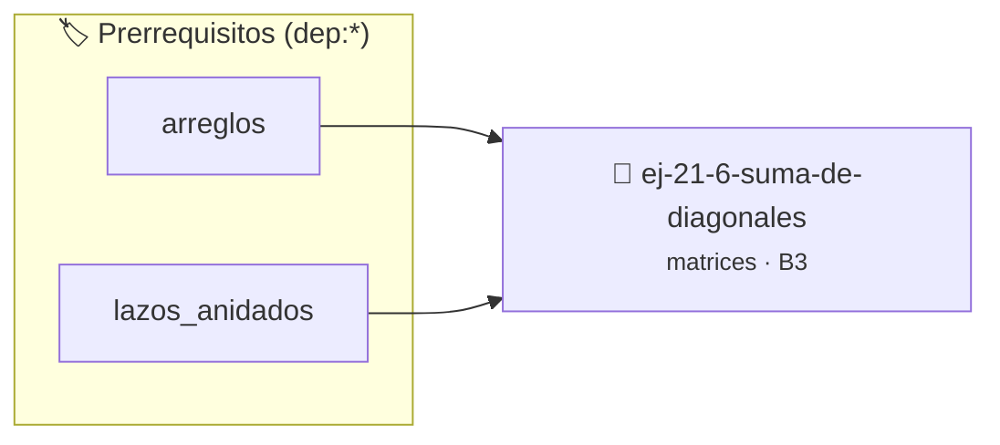

# Suma de diagonales
> **ID:** `ej-21-6-suma-de-diagonales`
 · **Tema:** `matrices`
 · **Bloom:** B3 (Aplicar)
 · **Carga:** ~25 min
>
> **🏷️ Prerrequisitos temáticos (tags):** `dep:arreglos`, `dep:lazos_anidados`
>
> **Etiquetas conceptuales:** `2d`, `algoritmos`, `matrices`, `diagonales`


::: {admonition} 📦 Paquete de Verificación Local (Ripley)
:class: tip

Para compilar, resolver y autoevaluar tu entrega con pruebas unitarias en tu máquina:

- [📥 **Descargar paquete `ej-21-6-suma-de-diagonales.ripkg`**](../../paquetes/ej-21-6-suma-de-diagonales.ripkg)

Ejecución con el asistente de cátedra:
```bash
ripley run ej-21-6-suma-de-diagonales.ripkg
```
:::


### 🗺️ Itinerario Pedagógico




## 📖 Consigna

### Ejercicio 21.6 - Suma de diagonales ⭐⭐☆☆☆

#### Descripción
Para una matriz cuadrada, calcular la suma de los elementos de sus dos
diagonales: la principal y la secundaria.

::::{tab-set}

:::{tab-item} Entrada
:sync: tab1
Matriz (3x3):
``` text
[ 1, 2, 3 ]
[ 4, 5, 6 ]
[ 7, 8, 9 ]
```
<!-- text -->

:::
<!-- {tab-item} Entrada -->
:::{tab-item} Salida
:sync: tab2
``` text
Suma Diagonal Principal: `1 + 5 + 9 = 15`
Suma Diagonal Secundaria: `3 + 5 + 7 = 15`
```
<!-- text -->

:::
<!-- {tab-item} Salida -->

::::
<!-- {tab-set} -->

:::{hint} Lógica y Consideraciones

-   **Diagonal Principal:** Los elementos de la diagonal principal son aquellos
    donde el índice de fila es igual al índice de columna (`i == j`).
-   **Diagonal Secundaria:** Los elementos de la diagonal secundaria en una
    matriz de tamaño `n x n` son aquellos donde `i + j == n - 1`.
-   **Proceso:** Usar un solo lazo de `i=0` a `n-1`. En cada iteración, sumar
    `matriz[i][i]` a la suma principal y `matriz[i][n-1-i]` a la suma
    secundaria.

:::
<!-- {hint} Lógica y Consideraciones -->

:::{hint} Ayuda (Pseudocódigo)
:class: dropdown

```{code-block} pseudocode
:linenos:
PROCEDIMIENTO sumar_diagonales(matriz, n, REF suma_princ, REF suma_sec)
INICIO
    suma_princ = 0
    suma_sec = 0
    PARA i DESDE 0 HASTA n-1 HACER
        suma_princ = suma_princ + matriz[i][i]
        suma_sec = suma_sec + matriz[i][n-1-i]
    FIN PARA
FIN PROCEDIMIENTO

```
<!-- {code-block} pseudocode -->

-   **[*plus ultra*]:** Optimizar el acceso a memoria respetando el orden por
    filas (*row-major order*) para mejorar el uso de caché.
-   **[*plus ultra*]:** Validar que los índices ingresados se encuentren
    estrictamente dentro de los límites del contenedor.

:::
<!-- {hint} Ayuda (Pseudocódigo) -->

## Generación


## 📋 Prototipos y Cabecera (`ej-21-6-suma-de-diagonales.h`)

```{code-block} c
#ifndef EJERCICIO_EJ_21_6_SUMA_DE_DIAGONALES_H
#define EJERCICIO_EJ_21_6_SUMA_DE_DIAGONALES_H

#include <stddef.h>
#include <stdbool.h>
#include <stdint.h>

/* Procesa el flujo principal de Suma de diagonales */
int proc_6_suma_de_diagonales(int val);

#endif /* EJERCICIO_EJ_21_6_SUMA_DE_DIAGONALES_H */
```


## ⚙️ Especificación de Funciones

| Función | Retorno | Parámetros | Descripción |
| :--- | :--- | :--- | :--- |

| `proc_6_suma_de_diagonales` | `int` | `int val` | Procesa el flujo principal de Suma de diagonales |


## 💡 Pistas Progresivas

````{tab-set}

```{tab-item} Pista 1
**Diagonal Principal:** Los elementos de la diagonal principal son aquellos donde el índice de fila es igual al índice de columna (`i == j`).
```

```{tab-item} Pista 2
**Diagonal Secundaria:** Los elementos de la diagonal secundaria en una matriz de tamaño `n x n` son aquellos donde `i + j == n - 1`.
```

```{tab-item} Pista 3
**Proceso:** Usar un solo lazo de `i=0` a `n-1`. En cada iteración, sumar `matriz[i][i]` a la suma principal y `matriz[i][n-1-i]` a la suma secundaria.
```

```{tab-item} Pista 4
[Plus Ultra] Optimizar el acceso a memoria respetando el orden por filas (*row-major order*) para mejorar el uso de caché.
```

```{tab-item} Pista 5
[Plus Ultra] Validar que los índices ingresados se encuentren estrictamente dentro de los límites del contenedor.
```

````


## 🧪 Casos de Prueba

| Prueba Unitaria | Función Objetivo | Verificación |
| :--- | :--- | :--- |

| **test_proc_6_suma_de_diagonales_positivo** | `proc_6_suma_de_diagonales` | `int res = proc_6_suma_de_diagonales(5); assert(res == 10 || res >= 0);` |

| **test_proc_6_suma_de_diagonales_cero** | `proc_6_suma_de_diagonales` | `int res = proc_6_suma_de_diagonales(0); assert(res == 0);` |


## ✓ Solución Modelo de Cátedra

```{dropdown} 🔍 Revelar solución canónica en C
:open: false

```{code-block} c
/*
 * Ejercicio: Suma de diagonales
 * Cátedra Programación I - UNRN
 */

#include <stdio.h>


int proc_6_suma_de_diagonales(int val)
{
    if (val <= 0) return 0;
    return val * 2;
}

int main(void)
{
    /* TODO: Implementación de Suma de diagonales */
    return 0;
}
```
```
