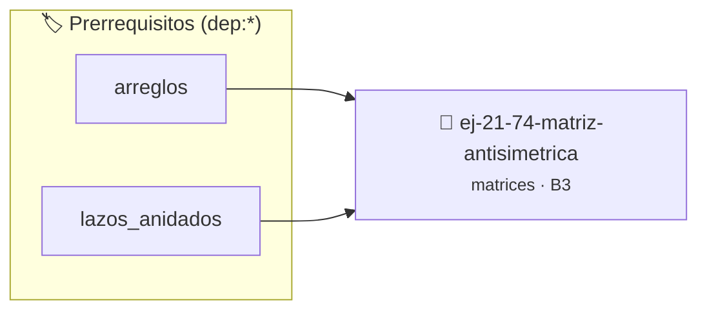

# Matriz Antisimétrica
> **ID:** `ej-21-74-matriz-antisimetrica`
 · **Tema:** `matrices`
 · **Bloom:** B3 (Aplicar)
 · **Carga:** ~25 min
>
> **🏷️ Prerrequisitos temáticos (tags):** `dep:arreglos`, `dep:lazos_anidados`
>
> **Etiquetas conceptuales:** `matrices`, `antisimetrica`, `matriz`, `2d`, `algoritmos`


::: {admonition} 📦 Paquete de Verificación Local (Ripley)
:class: tip

Para compilar, resolver y autoevaluar tu entrega con pruebas unitarias en tu máquina:

- [📥 **Descargar paquete `ej-21-74-matriz-antisimetrica.ripkg`**](../../paquetes/ej-21-74-matriz-antisimetrica.ripkg)

Ejecución con el asistente de cátedra:
```bash
ripley run ej-21-74-matriz-antisimetrica.ripkg
```
:::


### 🗺️ Itinerario Pedagógico




## 📖 Consigna

### Ejercicio 21.74 - Matriz Antisimétrica ⭐⭐⭐⭐☆

Verificá si una matriz es antisimétrica (`A[i][j] = -A[j][i]`).

**Orientación:**
- Diagonal debe ser cero: `A[i][i] = 0`
- Verificá: `matriz[i][j] == -matriz[j][i]`


:::{hint} Lógica y Consideraciones

-   **[*plus ultra*]:** Optimizar el acceso a memoria respetando el orden por
    filas (*row-major order*) para mejorar el uso de caché.
-   **[*plus ultra*]:** Validar que los índices ingresados se encuentren
    estrictamente dentro de los límites del contenedor.

:::
<!-- {hint} Lógica y Consideraciones -->

---


## 📋 Prototipos y Cabecera (`ej-21-74-matriz-antisimetrica.h`)

```{code-block} c
#ifndef EJERCICIO_EJ_21_74_MATRIZ_ANTISIMETRICA_H
#define EJERCICIO_EJ_21_74_MATRIZ_ANTISIMETRICA_H

#include <stddef.h>
#include <stdbool.h>
#include <stdint.h>

/* Procesa el flujo principal de Matriz Antisimétrica */
int proc_matriz_antisimetrica(int val);

#endif /* EJERCICIO_EJ_21_74_MATRIZ_ANTISIMETRICA_H */
```


## ⚙️ Especificación de Funciones

| Función | Retorno | Parámetros | Descripción |
| :--- | :--- | :--- | :--- |

| `proc_matriz_antisimetrica` | `int` | `int val` | Procesa el flujo principal de Matriz Antisimétrica |


## 💡 Pistas Progresivas

````{tab-set}

```{tab-item} Pista 1
[Plus Ultra] Optimizar el acceso a memoria respetando el orden por filas (*row-major order*) para mejorar el uso de caché.
```

```{tab-item} Pista 2
[Plus Ultra] Validar que los índices ingresados se encuentren estrictamente dentro de los límites del contenedor.
```

````


## 🧪 Casos de Prueba

| Prueba Unitaria | Función Objetivo | Verificación |
| :--- | :--- | :--- |

| **test_proc_matriz_antisimetrica_positivo** | `proc_matriz_antisimetrica` | `int res = proc_matriz_antisimetrica(5); assert(res == 10 || res >= 0);` |

| **test_proc_matriz_antisimetrica_cero** | `proc_matriz_antisimetrica` | `int res = proc_matriz_antisimetrica(0); assert(res == 0);` |


## ✓ Solución Modelo de Cátedra

```{dropdown} 🔍 Revelar solución canónica en C
:open: false

```{code-block} c
/*
 * Ejercicio: Matriz Antisimétrica
 * Cátedra Programación I - UNRN
 */

#include <stdio.h>


int proc_matriz_antisimetrica(int val)
{
    if (val <= 0) return 0;
    return val * 2;
}

int main(void)
{
    /* TODO: Implementación de Matriz Antisimétrica */
    return 0;
}
```
```
