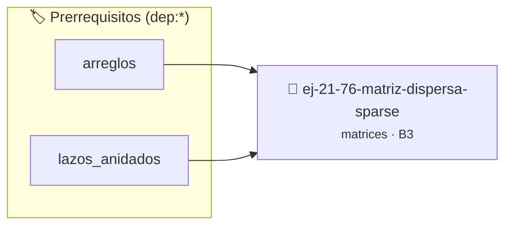

# Matriz Dispersa (Sparse)
> **ID:** `ej-21-76-matriz-dispersa-sparse`
 · **Tema:** `matrices`
 · **Bloom:** B3 (Aplicar)
 · **Carga:** ~25 min
>
> **🏷️ Prerrequisitos temáticos (tags):** `dep:arreglos`, `dep:lazos_anidados`
>
> **Etiquetas conceptuales:** `matrices`, `dispersa`, `sparse`, `matriz`, `2d`


::: {admonition} 📦 Paquete de Verificación Local (Ripley)
:class: tip

Para compilar, resolver y autoevaluar tu entrega con pruebas unitarias en tu máquina:

- [📥 **Descargar paquete `ej-21-76-matriz-dispersa-sparse.ripkg`**](../../paquetes/ej-21-76-matriz-dispersa-sparse.ripkg)

Ejecución con el asistente de cátedra:
```bash
ripley run ej-21-76-matriz-dispersa-sparse.ripkg
```
:::


### 🗺️ Itinerario Pedagógico




## 📖 Consigna

### Ejercicio 21.76 - Matriz Dispersa (Sparse) ⭐⭐⭐⭐⭐

Representá una matriz dispersa (muchos ceros) eficientemente.

**Orientación:**
- Estructura: `{fila, columna, valor}` solo para elementos != 0
- Array de estructuras
- Funciones: `asignar(f, c, val)`, `obtener(f, c)`, `mostrar()`


:::{hint} Lógica y Consideraciones

-   **[*plus ultra*]:** Validar punteros `NULL` recibidos como parámetro para
    evitar fallos de segmentación.
-   **[*plus ultra*]:** Implementar una versión utilizando aritmética de
    punteros en lugar de indexación directa.

:::
<!-- {hint} Lógica y Consideraciones -->

---

## Notas Finales

:::{tip} Patrones de Recorrido

**Por Filas (Row-Major):**
``` c
for (int i = 0; i < filas; i++)
{
    for (int j = 0; j < cols; j++)
    {
        // procesar matriz[i][j]
    }
}
```
<!-- c -->

**Por Columnas (Column-Major):**
``` c
for (int j = 0; j < cols; j++)
{
    for (int i = 0; i < filas; i++)
    {
        // procesar matriz[i][j]
    }
}
```
<!-- c -->

**Diagonal Principal:**
``` c
for (int i = 0; i < N; i++)
{
    // procesar matriz[i][i]
}
```
<!-- c -->

**Triangular Superior:**
``` c
for (int i = 0; i < N; i++)
{
    for (int j = i; j < N; j++)
    {
        // procesar matriz[i][j]
    }
}
```
<!-- c -->

**Triangular Inferior:**
``` c
for (int i = 0; i < N; i++)
{
    for (int j = 0; j <= i; j++)
    {
        // procesar matriz[i][j]
    }
}
```
<!-- c -->

:::
<!-- {tip} Patrones de Recorrido -->

:::{warning} Errores Comunes

1. **Confundir filas con columnas**
   ```c
   // MAL: intercambiado
   for (int i = 0; i < N; i++)
       for (int j = 0; j < M; j++)
           matriz[j][i] = ...; // Índices al revés
   ```

2. **Límites incorrectos**
   ```c
   // MAL: <= en lugar de <
   for (int i = 0; i <= filas; i++) // Acceso fuera de límites
   ```

3. **Olvidar inicializar**
   ```c
   int matriz[3][3]; // Sin inicializar, contiene basura
   // BIEN:
   int matriz[3][3] = {0}; // Todo en cero
   ```

4. **Modificar matriz mientras se recorre para copiar**
   ```c
   // MAL: corrompe datos
   for (int i = 0; i < N; i++)
       for (int j = 0; j < N; j++)
           matriz[i][j] = matriz[j][i]; // Transponer in-place mal hecho
   ```

:::
<!-- {warning} Errores Comunes -->

:::{note} Inicialización de Matrices

**Todo en cero:**
``` c
int matriz[3][4] = {0};
```
<!-- c -->

**Valores específicos:**
``` c
int matriz[3][3] = {{1, 2, 3}, {4, 5, 6}, {7, 8, 9}};
```
<!-- c -->

**Parcial (resto en cero):**
``` c
int matriz[3][3] = {{1}, {2}, {3}}; // Primera columna con valores
```
<!-- c -->

:::
<!-- {note} Inicialización de Matrices -->

:::{tip} Eficiencia y Cache

- **Row-major es más eficiente en C:** Las matrices se almacenan por filas
- **Acceso secuencial:** `matriz[i][j++]` es más rápido que `matriz[i++][j]`
- **Localidad espacial:** Elementos consecutivos están cerca en memoria

``` c
// MÁS RÁPIDO (row-major)
for (i...)
    for (j...)
matriz[i][j]
    // MÁS LENTO (column-major)
    for (j...) for (i...) matriz[i][j]
```
<!-- c -->

:::
<!-- {tip} Eficiencia y Cache -->

:::{note} Matrices como Parámetros

```{code-block} c
:linenos:
// Opción 1: Tamaño fijo
void procesar(int matriz[3][4])
{
}
// Opción 2: VLA (C99)
void procesar(int filas, int cols, int matriz[filas][cols])
{
}
// Opción 3: Puntero con dimensiones
void procesar(int filas, int cols, int (*matriz)[cols])
{
}
```
<!-- {code-block} c -->

:::
<!-- {note} Matrices como Parámetros -->

Estas consignas cubren arrays bidimensionales desde operaciones básicas hasta
algoritmos complejos, preparando para trabajar con matrices dinámicas en apuntes
posteriores.


## 📋 Prototipos y Cabecera (`ej-21-76-matriz-dispersa-sparse.h`)

```{code-block} c
#ifndef EJERCICIO_EJ_21_76_MATRIZ_DISPERSA_SPARSE_H
#define EJERCICIO_EJ_21_76_MATRIZ_DISPERSA_SPARSE_H

#include <stddef.h>
#include <stdbool.h>
#include <stdint.h>

/* Procesa el flujo principal de Matriz Dispersa (Sparse) */
int proc_triz_dispersa_sparse(int val);

#endif /* EJERCICIO_EJ_21_76_MATRIZ_DISPERSA_SPARSE_H */
```


## ⚙️ Especificación de Funciones

| Función | Retorno | Parámetros | Descripción |
| :--- | :--- | :--- | :--- |

| `proc_triz_dispersa_sparse` | `int` | `int val` | Procesa el flujo principal de Matriz Dispersa (Sparse) |


## 💡 Pistas Progresivas

````{tab-set}

```{tab-item} Pista 1
[Plus Ultra] Validar punteros `NULL` recibidos como parámetro para evitar fallos de segmentación.
```

```{tab-item} Pista 2
[Plus Ultra] Implementar una versión utilizando aritmética de punteros en lugar de indexación directa.
```

```{tab-item} Pista 3
**Row-major es más eficiente en C:** Las matrices se almacenan por filas
```

```{tab-item} Pista 4
**Acceso secuencial:** `matriz[i][j++]` es más rápido que `matriz[i++][j]`
```

```{tab-item} Pista 5
**Localidad espacial:** Elementos consecutivos están cerca en memoria ``` c // MÁS RÁPIDO (row-major) for (i...) for (j...) matriz[i][j] // MÁS LENTO (column-major) for (j...) for (i...) matriz[i][j] ``` <!-- c -->
```

````


## 🧪 Casos de Prueba

| Prueba Unitaria | Función Objetivo | Verificación |
| :--- | :--- | :--- |

| **test_proc_triz_dispersa_sparse_positivo** | `proc_triz_dispersa_sparse` | `int res = proc_triz_dispersa_sparse(5); assert(res == 10 || res >= 0);` |

| **test_proc_triz_dispersa_sparse_cero** | `proc_triz_dispersa_sparse` | `int res = proc_triz_dispersa_sparse(0); assert(res == 0);` |


## ✓ Solución Modelo de Cátedra

```{dropdown} 🔍 Revelar solución canónica en C
:open: false

```{code-block} c
/*
 * Solucion modelo para ej-21-76-matriz-dispersa-sparse
 * Catedra Programacion I - UNRN
 */
#include <stdio.h>
#include <stdlib.h>
#include <string.h>
#include <stdbool.h>


int proc_triz_dispersa_sparse(int val)
{
    if (val <= 0) return 0;
    return val * 2;
}

int main(void)
{
    int n = 0;
    if (scanf("%d", &n) == 1)
    {
        printf("OK %d\n", n);
    }
    else
    {
        printf("OK\n");
    }
    return 0;
}
```
```
