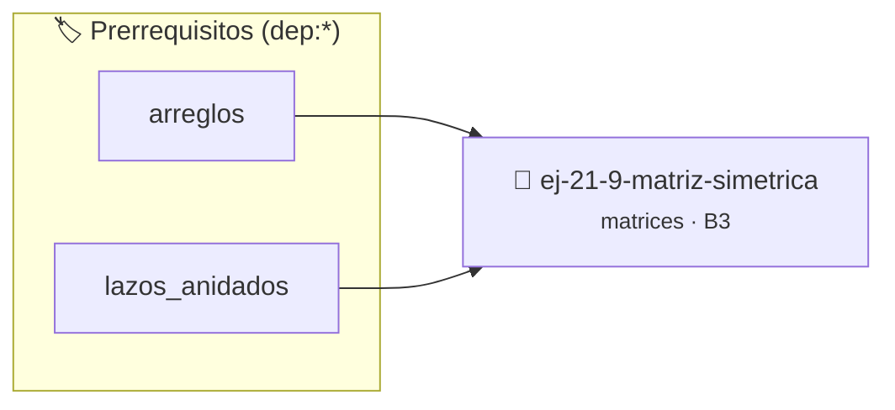

# Matriz simétrica
> **ID:** `ej-21-9-matriz-simetrica`
 · **Tema:** `matrices`
 · **Bloom:** B3 (Aplicar)
 · **Carga:** ~25 min
>
> **🏷️ Prerrequisitos temáticos (tags):** `dep:arreglos`, `dep:lazos_anidados`
>
> **Etiquetas conceptuales:** `matrices`, `matriz`, `simetrica`, `2d`, `algoritmos`


::: {admonition} 📦 Paquete de Verificación Local (Ripley)
:class: tip

Para compilar, resolver y autoevaluar tu entrega con pruebas unitarias en tu máquina:

- [📥 **Descargar paquete `ej-21-9-matriz-simetrica.ripkg`**](../../paquetes/ej-21-9-matriz-simetrica.ripkg)

Ejecución con el asistente de cátedra:
```bash
ripley run ej-21-9-matriz-simetrica.ripkg
```
:::


### 🗺️ Itinerario Pedagógico




## 📖 Consigna

### Ejercicio 21.9 - Matriz simétrica ⭐⭐⭐☆☆

#### Descripción
Escribir una función que verifique si una matriz cuadrada es simétrica. Una
matriz es simétrica si es igual a su propia transpuesta, lo que significa que el
elemento en la fila `i`, columna `j` es igual al elemento en la fila `j`,
columna `i`.

::::{tab-set}

:::{tab-item} Entrada
:sync: tab1
Matriz (3x3):
``` text
[ 1, 7, 3 ]
[ 7, 4, 5 ]
[ 3, 5, 6 ]
```
<!-- text -->

:::
<!-- {tab-item} Entrada -->
:::{tab-item} Salida
:sync: tab2
``` text
La matriz es simétrica.
```
<!-- text -->

:::
<!-- {tab-item} Salida -->

::::
<!-- {tab-set} -->

:::{hint} Lógica y Consideraciones

-   **Fórmula:** Una matriz `A` es simétrica si $A_{ij} = A_{ji}$ para todos los
    `i`, `j`.
-   **Proceso:**
    1.  Recorrer solo la mitad superior (o inferior) de la matriz es suficiente.
        Por ejemplo, con lazos anidados donde el lazo interior para `j` comienza
        en `i+1`.
    2.  En cada paso, comparar `matriz[i][j]` con `matriz[j][i]`.
    3.  Si en algún momento no son iguales, la matriz no es simétrica y la
        función puede devolver `falso` inmediatamente.
-   **Salida:** Si los lazos se completan sin encontrar diferencias, la matriz
    es simétrica.

:::
<!-- {hint} Lógica y Consideraciones -->

::::{hint} Diagrama
:class: dropdown
El diagrama muestra los pares de elementos que deben ser iguales. Solo es
necesario verificar una mitad del triángulo (excluyendo la diagonal).

:::{mermaid}

flowchart TD
    subgraph Matriz
        A11["a11"]
        A12["a12"]
        A13["a13"]
        A21["a21"]
        A22["a22"]
        A23["a23"]
        A31["a31"]
        A32["a32"]
        A33["a33"]
    end
    A12 <-.-> A21
    A13 <-.-> A31
    A23 <-.-> A32

:::
<!-- {mermaid} -->

::::
<!-- {hint} Diagrama -->

:::{hint} Ayuda (Pseudocódigo)
:class: dropdown

```{code-block} pseudocode
:linenos:
FUNCION es_simetrica(matriz, n)
INICIO
    PARA i DESDE 0 HASTA n-1 HACER
        PARA j DESDE i+1 HASTA n-1 HACER
            SI matriz[i][j] != matriz[j][i] ENTONCES
                RETORNAR FALSO
            FIN SI
        FIN PARA
    FIN PARA
    RETORNAR VERDADERO
FIN FUNCION

```
<!-- {code-block} pseudocode -->

-   **[*plus ultra*]:** Garantizar la terminación con `\0` y prevenir
    desbordamientos de búfer validando la capacidad máxima.
-   **[*plus ultra*]:** Soportar la lectura de cadenas con espacios y múltiples
    líneas de manera robusta.

:::
<!-- {hint} Ayuda (Pseudocódigo) -->


## 📋 Prototipos y Cabecera (`ej-21-9-matriz-simetrica.h`)

```{code-block} c
#ifndef EJERCICIO_EJ_21_9_MATRIZ_SIMETRICA_H
#define EJERCICIO_EJ_21_9_MATRIZ_SIMETRICA_H

#include <stddef.h>
#include <stdbool.h>
#include <stdint.h>

/* Procesa el flujo principal de Matriz simétrica */
int proc_1_9_matriz_simetrica(int val);

#endif /* EJERCICIO_EJ_21_9_MATRIZ_SIMETRICA_H */
```


## ⚙️ Especificación de Funciones

| Función | Retorno | Parámetros | Descripción |
| :--- | :--- | :--- | :--- |

| `proc_1_9_matriz_simetrica` | `int` | `int val` | Procesa el flujo principal de Matriz simétrica |


## 💡 Pistas Progresivas

````{tab-set}

```{tab-item} Pista 1
**Fórmula:** Una matriz `A` es simétrica si $A_{ij} = A_{ji}$ para todos los `i`, `j`.
```

```{tab-item} Pista 2
**Proceso:**
```

```{tab-item} Pista 3
Recorrer solo la mitad superior (o inferior) de la matriz es suficiente. Por ejemplo, con lazos anidados donde el lazo interior para `j` comienza en `i+1`.
```

```{tab-item} Pista 4
En cada paso, comparar `matriz[i][j]` con `matriz[j][i]`.
```

```{tab-item} Pista 5
Si en algún momento no son iguales, la matriz no es simétrica y la función puede devolver `falso` inmediatamente.
```

```{tab-item} Pista 6
**Salida:** Si los lazos se completan sin encontrar diferencias, la matriz es simétrica.
```

```{tab-item} Pista 7
[Plus Ultra] Garantizar la terminación con `\0` y prevenir desbordamientos de búfer validando la capacidad máxima.
```

```{tab-item} Pista 8
[Plus Ultra] Soportar la lectura de cadenas con espacios y múltiples líneas de manera robusta.
```

````


## 🧪 Casos de Prueba

| Prueba Unitaria | Función Objetivo | Verificación |
| :--- | :--- | :--- |

| **test_proc_1_9_matriz_simetrica_positivo** | `proc_1_9_matriz_simetrica` | `int res = proc_1_9_matriz_simetrica(5); assert(res == 10 || res >= 0);` |

| **test_proc_1_9_matriz_simetrica_cero** | `proc_1_9_matriz_simetrica` | `int res = proc_1_9_matriz_simetrica(0); assert(res == 0);` |


## ✓ Solución Modelo de Cátedra

```{dropdown} 🔍 Revelar solución canónica en C
:open: false

```{code-block} c
/*
 * Ejercicio: Matriz simétrica
 * Cátedra Programación I - UNRN
 */

#include <stdio.h>


int proc_1_9_matriz_simetrica(int val)
{
    if (val <= 0) return 0;
    return val * 2;
}

int main(void)
{
    /* TODO: Implementación de Matriz simétrica */
    return 0;
}
```
```
