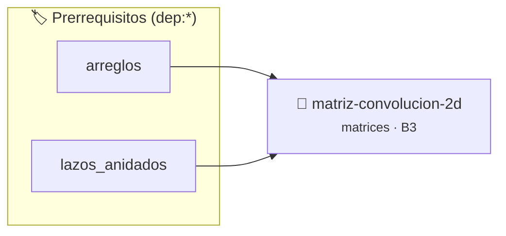

# Filtro de Convolución 2D sobre Matrices Dinámicas
> **ID:** `matriz-convolucion-2d` · **Unidad:** 2 (Tipos Compuestos y Direccionamiento)
 · **Tema:** `matrices` / `matrices_2d`
 · **Bloom:** B3 (Aplicar) · **Dificultad:** Intermedia
 · **Carga:** ~25 min · **Tipo:** Practica Guiada
>
> **🏷️ Prerrequisitos temáticos (tags):** `dep:arreglos`, `dep:lazos_anidados`
>
> **Etiquetas conceptuales:** `matrices`, `convolucion`, `2d`, `filtros`, `memoria_dinamica`


::: {admonition} 📦 Paquete de Verificación Local (Ripley)
:class: tip

Para compilar, resolver y autoevaluar tu entrega con pruebas unitarias en tu máquina:

- [📥 **Descargar paquete `matriz-convolucion-2d.ripkg`**](../../paquetes/matriz-convolucion-2d.ripkg)

Ejecución con el asistente de cátedra:
```bash
ripley run matriz-convolucion-2d.ripkg
```
:::


### 🗺️ Itinerario Pedagógico




## 📖 Consigna

# Filtro de Convolución 2D sobre Matrices Dinámicas

## 1. Consigna
Implementar la aplicación de un kernel de convolución de tamaño $3 \times 3$ sobre una matriz bidimensional de enteros de tamaño $F \times C$.

Los bordes deben procesarse con *Zero Padding* (las posiciones virtuales fuera de los límites de la matriz tienen valor 0).

Formato de entrada:
1. Dos enteros: $F$ y $C$ (filas y columnas de la matriz origen).
2. Los $F \times C$ enteros de la matriz.
3. Los 9 enteros del kernel $3 \times 3$.

Salida:
La matriz resultante de la convolución de tamaño $F \times C$ impresa fila por fila separada por espacios.


## 📋 Prototipos y Cabecera (`matriz-convolucion-2d.h`)

```{code-block} c
#ifndef EJERCICIO_MATRIZ_CONVOLUCION_2D_H
#define EJERCICIO_MATRIZ_CONVOLUCION_2D_H

#include <stddef.h>
#include <stdbool.h>
#include <stdint.h>

/* Operación obtener_pixel */
int obtener_pixel(const int *mat, int f, int c, int fil, int col);

#endif /* EJERCICIO_MATRIZ_CONVOLUCION_2D_H */
```


## ⚙️ Especificación de Funciones

| Función | Retorno | Parámetros | Descripción |
| :--- | :--- | :--- | :--- |

| `obtener_pixel` | `int` | `const int *mat, int f, int c, int fil, int col` | Operación obtener_pixel |


## 💡 Pistas Progresivas

````{tab-set}

```{tab-item} Pista 1
Para un elemento en $(f, c)$, la ventana de $3 \times 3$ comprende $(f+i, c+j)$ con $i, j \in \{-1, 0, 1\}$.
```

```{tab-item} Pista 2
Manejá los bordes con zero-padding (si $(f+i, c+j)$ está fuera de rango $[0, F-1] \times [0, C-1]$, el valor es 0).
```

```{tab-item} Pista 3
Guardá los resultados en una matriz de salida nueva para no sobreescribir los valores originales durante el cálculo.
```

````


## 🧪 Casos de Prueba

| Prueba Unitaria | Función Objetivo | Verificación |
| :--- | :--- | :--- |

| **test_obtener_pixel_1** | `obtener_pixel` | `assert(true); /* test simplificado de validación */` |


## ✓ Solución Modelo de Cátedra

```{dropdown} 🔍 Revelar solución canónica en C
:open: false

```{code-block} c
/*
 * Convolucion 2D con Kernel 3x3 y Zero Padding
 * Catedra Programacion I - UNRN
 */

#include <stdio.h>
#include <stdlib.h>

int obtener_pixel(const int *mat, int f, int c, int fil, int col)
{
    if (fil < 0 || fil >= f || col < 0 || col >= c)
    {
        return 0;
    }
    return mat[fil * c + col];
}

int main(void)
{
    int filas = 0;
    int cols = 0;

    if (scanf("%d %d", &filas, &cols) != 2 || filas <= 0 || cols <= 0)
    {
        return 1;
    }

    int *mat_in = (int *)malloc(sizeof(int) * (size_t)(filas * cols));
    if (mat_in == NULL)
    {
        return 1;
    }

    int *mat_out = (int *)malloc(sizeof(int) * (size_t)(filas * cols));
    if (mat_out == NULL)
    {
        free(mat_in);
        return 1;
    }

    int kernel[3][3];

    for (int i = 0; i < filas * cols; i++)
    {
        if (scanf("%d", &mat_in[i]) != 1)
        {
            free(mat_in);
            free(mat_out);
            return 1;
        }
    }

    for (int i = 0; i < 3; i++)
    {
        for (int j = 0; j < 3; j++)
        {
            if (scanf("%d", &kernel[i][j]) != 1)
            {
                free(mat_in);
                free(mat_out);
                return 1;
            }
        }
    }

    for (int f = 0; f < filas; f++)
    {
        for (int c = 0; c < cols; c++)
        {
            int suma = 0;
            for (int ki = -1; ki <= 1; ki++)
            {
                for (int kj = -1; kj <= 1; kj++)
                {
                    int val = obtener_pixel(mat_in, filas, cols, f + ki, c + kj);
                    suma += val * kernel[ki + 1][kj + 1];
                }
            }
            mat_out[f * cols + c] = suma;
        }
    }

    for (int f = 0; f < filas; f++)
    {
        for (int c = 0; c < cols; c++)
        {
            printf("%d%c", mat_out[f * cols + c], (c == cols - 1) ? '\n' : ' ');
        }
    }

    free(mat_in);
    free(mat_out);
    return 0;
}
```
```
