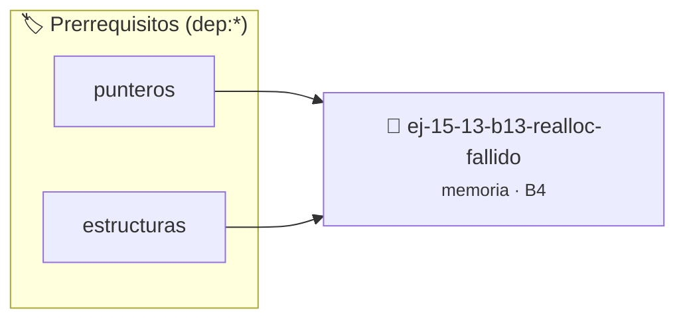

# Realloc Fallido
> **ID:** `ej-15-13-b13-realloc-fallido` · **Unidad:** 3 (Memoria Dinámica y Persistencia)
 · **Tema:** `memoria` / `pilas_y_colas`
 · **Bloom:** B4 (Analizar) · **Dificultad:** Avanzada
 · **Carga:** ~35 min · **Tipo:** Practica Guiada
>
> **🏷️ Prerrequisitos temáticos (tags):** `dep:punteros`, `dep:estructuras`
>
> **Etiquetas conceptuales:** `fallido`, `stack`, `layout`, `memoria`, `realloc`


::: {admonition} 📦 Paquete de Verificación Local (Ripley)
:class: tip

Para compilar, resolver y autoevaluar tu entrega con pruebas unitarias en tu máquina:

- [📥 **Descargar paquete `ej-15-13-b13-realloc-fallido.ripkg`**](../../paquetes/ej-15-13-b13-realloc-fallido.ripkg)

Ejecución con el asistente de cátedra:
```bash
ripley run ej-15-13-b13-realloc-fallido.ripkg
```
:::


### 🗺️ Itinerario Pedagógico




## 📖 Consigna

Escribir una función que maneje correctamente el fallo de `realloc`:


```{code-block} c
:linenos:
bool vector_push(vector_t *v, int dato)
{
    if (v->size == v->capacity)
    {
        size_t nueva_capacidad = v->capacity * 2;
        int *nuevo_bloque = realloc(v->datos, nueva_capacidad * sizeof(int));
        if (nuevo_bloque == NULL)
        {
            return false; // Fallo, pero v->datos sigue válido
        }
        v->datos = nuevo_bloque;
        v->capacity = nueva_capacidad;
    }
    v->datos[v->size++] = dato;
    return true;
}
```

:::{important} Manejo de `realloc`

Nunca asignés directamente `ptr = realloc(ptr, size)`. Si falla, perdés el
puntero original y tenés un leak. Usá un puntero temporal como en el ejemplo.

:::

## Análisis de Rendimiento y Fragmentación

### 📋 Contrato de las Funciones

```c
/*
 * Procesa el flujo principal de Realloc Fallido
 * Precondiciones: val representa el parámetro de entrada del flujo.
 * Postcondiciones: Retorna el resultado correspondiente o 0 si val <= 0.
 */
int proc__b13_realloc_fallido(int val);

```

### 🧪 Ejemplos de Ejecución

::::{tab-set}
:::{tab-item} Valor positivo
```text
Entrada: 5
Salida / Retorno: 10
```
:::
:::{tab-item} Valor cero o negativo
```text
Entrada: 0
Salida / Retorno: 0
```
:::
::::

### ⚠️ Precondiciones y Casos Borde

1. **Valores fuera de rango:** Verificar siempre que los datos de entrada cumplan con los rangos admisibles antes de operar.
3. **Gestión de memoria:** Toda memoria solicitada mediante `malloc`/`calloc` debe ser validada y eventualmente liberada con `free`.
6. **Casos vacíos o neutros:** Contemplar adecuadamente entradas con longitud cero o valores neutros según corresponda.

### 🎯 Criterios de Aceptación

- [ ] El código compila limpiamente bajo estándar C11 sin warnings con flags estrictos (`-Wall -Wextra -Werror`).
- [ ] Se satisfacen todas las pruebas unitarias y casos de prueba provistos.
- [ ] Las funciones validan exhaustivamente sus precondiciones y gestionan casos borde de forma robusta.
- [ ] No se registran fugas de memoria (*memory leaks*) comprobables mediante Valgrind o AddressSanitizer.

:::{hint} Consideraciones Didácticas
- Validar punteros `NULL` recibidos como parámetro para evitar fallos de segmentación.
- Implementar una versión utilizando aritmética de punteros en lugar de indexación directa.
:::


## 📋 Prototipos y Cabecera (`ej-15-13-b13-realloc-fallido.h`)

```{code-block} c
#ifndef EJERCICIO_EJ_15_13_B13_REALLOC_FALLIDO_H
#define EJERCICIO_EJ_15_13_B13_REALLOC_FALLIDO_H

#include <stddef.h>
#include <stdbool.h>
#include <stdint.h>

/* Procesa el flujo principal de Realloc Fallido */
int proc__b13_realloc_fallido(int val);

#endif /* EJERCICIO_EJ_15_13_B13_REALLOC_FALLIDO_H */
```


## ⚙️ Especificación de Funciones

| Función | Retorno | Parámetros | Descripción |
| :--- | :--- | :--- | :--- |

| `proc__b13_realloc_fallido` | `int` | `int val` | Procesa el flujo principal de Realloc Fallido |


## 💡 Pistas Progresivas

````{tab-set}

```{tab-item} Pista 1
[Plus Ultra] Validar punteros `NULL` recibidos como parámetro para evitar fallos de segmentación.
```

```{tab-item} Pista 2
[Plus Ultra] Implementar una versión utilizando aritmética de punteros en lugar de indexación directa.
```

````


## 🧪 Casos de Prueba

| Prueba Unitaria | Función Objetivo | Verificación |
| :--- | :--- | :--- |

| **test_proc__b13_realloc_fallido_positivo** | `proc__b13_realloc_fallido` | `int res = proc__b13_realloc_fallido(5); assert(res == 10 || res >= 0);` |

| **test_proc__b13_realloc_fallido_cero** | `proc__b13_realloc_fallido` | `int res = proc__b13_realloc_fallido(0); assert(res == 0);` |


## ✓ Solución Modelo de Cátedra

```{dropdown} 🔍 Revelar solución canónica en C
:open: false

```{code-block} c
/*
 * Solucion modelo para ej-15-13-b13-realloc-fallido
 * Catedra Programacion I - UNRN
 */
#include <stdio.h>
#include <stdlib.h>
#include <string.h>
#include <stdbool.h>


int proc__b13_realloc_fallido(int val)
{
    if (val <= 0) return 0;
    return val * 2;
}

int main(void)
{
    int n = 0;
    if (scanf("%d", &n) == 1)
    {
        printf("OK %d\n", n);
    }
    else
    {
        printf("OK\n");
    }
    return 0;
}
```
```
