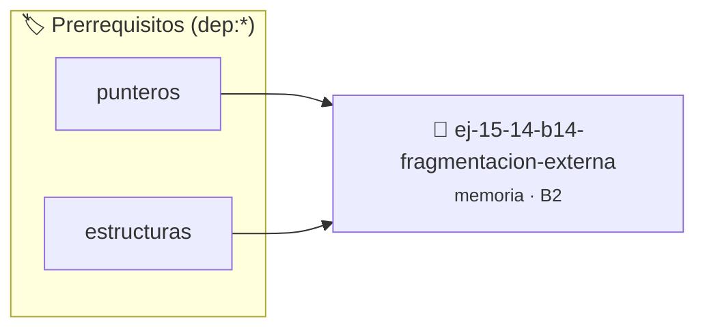

# Fragmentación Externa
> **ID:** `ej-15-14-b14-fragmentacion-externa` · **Unidad:** 3 (Memoria Dinámica y Persistencia)
 · **Tema:** `memoria` / `pilas_y_colas`
 · **Bloom:** B2 (Comprender) · **Dificultad:** Inicial
 · **Carga:** ~15 min · **Tipo:** Practica Guiada
>
> **🏷️ Prerrequisitos temáticos (tags):** `dep:punteros`, `dep:estructuras`
>
> **Etiquetas conceptuales:** `stack`, `layout`, `externa`, `memoria`, `fragmentacion`


::: {admonition} 📦 Paquete de Verificación Local (Ripley)
:class: tip

Para compilar, resolver y autoevaluar tu entrega con pruebas unitarias en tu máquina:

- [📥 **Descargar paquete `ej-15-14-b14-fragmentacion-externa.ripkg`**](../../paquetes/ej-15-14-b14-fragmentacion-externa.ripkg)

Ejecución con el asistente de cátedra:
```bash
ripley run ej-15-14-b14-fragmentacion-externa.ripkg
```
:::


### 🗺️ Itinerario Pedagógico




## 📖 Consigna

Escribir un programa que demuestre fragmentación externa:


```{code-block} c
:linenos:
#define N 1000
int main()
{
    void *ptrs[N];
    // Alojar muchos bloques pequeños
    for (int i = 0; i < N; i++)
    {
        ptrs[i] = malloc(64);
    }
    // Liberar bloques alternados
    for (int i = 0; i < N; i += 2)
    {
        free(ptrs[i]);
        ptrs[i] = NULL;
    }
    // Intentar alojar un bloque grande
    void *grande = malloc(64 * (N / 2));
    if (grande == NULL)
    {
        printf("No se pudo alojar bloque grande debido a fragmentación\n");
    }
    else
    {
        printf("Bloque grande asignado exitosamente\n");
        free(grande);
    }
    // Liberar bloques restantes
    for (int i = 1; i < N; i += 2)
    {
        free(ptrs[i]);
    }
    return 0;
}
```

### 📋 Contrato de las Funciones

```c
/*
 * Procesa el flujo principal de Fragmentación Externa
 * Precondiciones: val representa el parámetro de entrada del flujo.
 * Postcondiciones: Retorna el resultado correspondiente o 0 si val <= 0.
 */
int proc_ragmentacion_externa(int val);

```

### 🧪 Ejemplos de Ejecución

::::{tab-set}
:::{tab-item} Valor positivo
```text
Entrada: 5
Salida / Retorno: 10
```
:::
:::{tab-item} Valor cero o negativo
```text
Entrada: 0
Salida / Retorno: 0
```
:::
::::

### ⚠️ Precondiciones y Casos Borde

1. **Valores fuera de rango:** Verificar siempre que los datos de entrada cumplan con los rangos admisibles antes de operar.
3. **Gestión de memoria:** Toda memoria solicitada mediante `malloc`/`calloc` debe ser validada y eventualmente liberada con `free`.
6. **Casos vacíos o neutros:** Contemplar adecuadamente entradas con longitud cero o valores neutros según corresponda.

### 🎯 Criterios de Aceptación

- [ ] El código compila limpiamente bajo estándar C11 sin warnings con flags estrictos (`-Wall -Wextra -Werror`).
- [ ] Se satisfacen todas las pruebas unitarias y casos de prueba provistos.
- [ ] Las funciones validan exhaustivamente sus precondiciones y gestionan casos borde de forma robusta.
- [ ] No se registran fugas de memoria (*memory leaks*) comprobables mediante Valgrind o AddressSanitizer.

:::{hint} Consideraciones Didácticas
- Validar punteros `NULL` recibidos como parámetro para evitar fallos de segmentación.
- Implementar una versión utilizando aritmética de punteros en lugar de indexación directa.
:::


## 📋 Prototipos y Cabecera (`ej-15-14-b14-fragmentacion-externa.h`)

```{code-block} c
#ifndef EJERCICIO_EJ_15_14_B14_FRAGMENTACION_EXTERNA_H
#define EJERCICIO_EJ_15_14_B14_FRAGMENTACION_EXTERNA_H

#include <stddef.h>
#include <stdbool.h>
#include <stdint.h>

/* Procesa el flujo principal de Fragmentación Externa */
int proc_ragmentacion_externa(int val);

#endif /* EJERCICIO_EJ_15_14_B14_FRAGMENTACION_EXTERNA_H */
```


## ⚙️ Especificación de Funciones

| Función | Retorno | Parámetros | Descripción |
| :--- | :--- | :--- | :--- |

| `proc_ragmentacion_externa` | `int` | `int val` | Procesa el flujo principal de Fragmentación Externa |


## 💡 Pistas Progresivas

````{tab-set}

```{tab-item} Pista 1
[Plus Ultra] Validar punteros `NULL` recibidos como parámetro para evitar fallos de segmentación.
```

```{tab-item} Pista 2
[Plus Ultra] Implementar una versión utilizando aritmética de punteros en lugar de indexación directa.
```

````


## 🧪 Casos de Prueba

| Prueba Unitaria | Función Objetivo | Verificación |
| :--- | :--- | :--- |

| **test_proc_ragmentacion_externa_positivo** | `proc_ragmentacion_externa` | `int res = proc_ragmentacion_externa(5); assert(res == 10 || res >= 0);` |

| **test_proc_ragmentacion_externa_cero** | `proc_ragmentacion_externa` | `int res = proc_ragmentacion_externa(0); assert(res == 0);` |


## ✓ Solución Modelo de Cátedra

```{dropdown} 🔍 Revelar solución canónica en C
:open: false

```{code-block} c
#include <stdio.h>
#include <stdlib.h>

#define N 1000

int proc_ragmentacion_externa(int val)
{
    if (val <= 0) return 0;
    return val * 2;
}

int main()
{
    void *ptrs[N];
    // Alojar muchos bloques pequeños
    for (int i = 0; i < N; i++)
    {
        ptrs[i] = malloc(64);
    }
    // Liberar bloques alternados
    for (int i = 0; i < N; i += 2)
    {
        free(ptrs[i]);
        ptrs[i] = NULL;
    }
    // Intentar alojar un bloque grande
    void *grande = malloc(64 * (N / 2));
    if (grande == NULL)
    {
        printf("No se pudo alojar bloque grande debido a fragmentación\n");
    }
    else
    {
        printf("Bloque grande asignado exitosamente\n");
        free(grande);
    }
    // Liberar bloques restantes
    for (int i = 1; i < N; i += 2)
    {
        free(ptrs[i]);
    }
    return 0;
}
```
```
