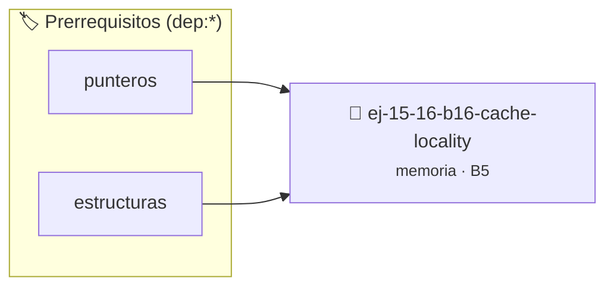

# Cache Locality
> **ID:** `ej-15-16-b16-cache-locality`
 · **Tema:** `memoria`
 · **Bloom:** B5 (Evaluar / Crear)
 · **Carga:** ~45 min
>
> **🏷️ Prerrequisitos temáticos (tags):** `dep:punteros`, `dep:estructuras`
>
> **Etiquetas conceptuales:** `stack`, `layout`, `locality`, `cache`, `memoria`


::: {admonition} 📦 Paquete de Verificación Local (Ripley)
:class: tip

Para compilar, resolver y autoevaluar tu entrega con pruebas unitarias en tu máquina:

- [📥 **Descargar paquete `ej-15-16-b16-cache-locality.ripkg`**](../../paquetes/ej-15-16-b16-cache-locality.ripkg)

Ejecución con el asistente de cátedra:
```bash
ripley run ej-15-16-b16-cache-locality.ripkg
```
:::


### 🗺️ Itinerario Pedagógico




## 📖 Consigna

### Ejercicio 15.16 - b.16 - Cache Locality ⭐⭐☆☆☆

Comparar el rendimiento de acceso secuencial vs. aleatorio en un arreglo grande:


:::{hint} Lógica y Consideraciones

-   **[*plus ultra*]:** Verificar el retorno de asignación de memoria y
    garantizar la liberación total de recursos en caso de error.
-   **[*plus ultra*]:** Verificar la ausencia de fugas de memoria (*memory
    leaks*) mediante Valgrind o AddressSanitizer.

:::
<!-- {hint} Lógica y Consideraciones -->

```{code-block} c
:linenos:
#define SIZE (100 * 1024 * 1024) // 100M enteros
int main()
{
    int *arr = malloc(SIZE * sizeof(int));
    // Secuencial
    clock_t inicio = clock();
    for (size_t i = 0; i < SIZE; i++)
    {
        arr[i] = i;
    }
    clock_t fin = clock();
    printf("Secuencial: %.3f ms\n", 1000.0 * (fin - inicio) / CLOCKS_PER_SEC);
    // Aleatorio
    inicio = clock();
    for (size_t i = 0; i < SIZE; i++)
    {
        size_t idx = rand() % SIZE;
        arr[idx] = i;
    }
    fin = clock();
    printf("Aleatorio: %.3f ms\n", 1000.0 * (fin - inicio) / CLOCKS_PER_SEC);
    free(arr);
    return 0;
}
```
<!-- {code-block} c -->

**Observación esperada:** El acceso secuencial será significativamente más
rápido debido a mejor locality y uso del caché.

## Alineación de Memoria


## 📋 Prototipos y Cabecera (`ej-15-16-b16-cache-locality.h`)

```{code-block} c
#ifndef EJERCICIO_EJ_15_16_B16_CACHE_LOCALITY_H
#define EJERCICIO_EJ_15_16_B16_CACHE_LOCALITY_H

#include <stddef.h>
#include <stdbool.h>
#include <stdint.h>

/* Procesa el flujo principal de Cache Locality */
int proc_6_b16_cache_locality(int val);

#endif /* EJERCICIO_EJ_15_16_B16_CACHE_LOCALITY_H */
```


## ⚙️ Especificación de Funciones

| Función | Retorno | Parámetros | Descripción |
| :--- | :--- | :--- | :--- |

| `proc_6_b16_cache_locality` | `int` | `int val` | Procesa el flujo principal de Cache Locality |


## 💡 Pistas Progresivas

````{tab-set}

```{tab-item} Pista 1
[Plus Ultra] Verificar el retorno de asignación de memoria y garantizar la liberación total de recursos en caso de error.
```

```{tab-item} Pista 2
[Plus Ultra] Verificar la ausencia de fugas de memoria (*memory leaks*) mediante Valgrind o AddressSanitizer.
```

````


## 🧪 Casos de Prueba

| Prueba Unitaria | Función Objetivo | Verificación |
| :--- | :--- | :--- |

| **test_proc_6_b16_cache_locality_positivo** | `proc_6_b16_cache_locality` | `int res = proc_6_b16_cache_locality(5); assert(res == 10 || res >= 0);` |

| **test_proc_6_b16_cache_locality_cero** | `proc_6_b16_cache_locality` | `int res = proc_6_b16_cache_locality(0); assert(res == 0);` |


## ✓ Solución Modelo de Cátedra

```{dropdown} 🔍 Revelar solución canónica en C
:open: false

```{code-block} c
/*
 * Solucion modelo para ej-15-16-b16-cache-locality
 * Catedra Programacion I - UNRN
 */
#include <stdio.h>
#include <stdlib.h>
#include <string.h>
#include <stdbool.h>


int proc_6_b16_cache_locality(int val)
{
    if (val <= 0) return 0;
    return val * 2;
}

int main(void)
{
    int n = 0;
    if (scanf("%d", &n) == 1)
    {
        printf("OK %d\n", n);
    }
    else
    {
        printf("OK\n");
    }
    return 0;
}
```
```
