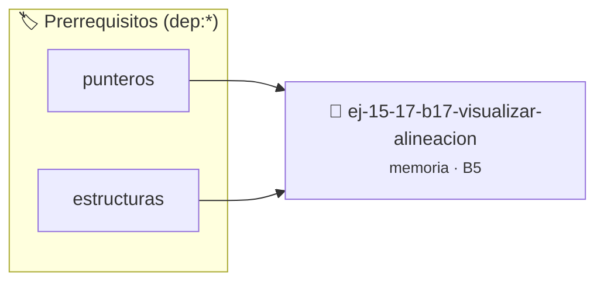

# Visualizar Alineación
> **ID:** `ej-15-17-b17-visualizar-alineacion` · **Unidad:** 3 (Memoria Dinámica y Persistencia)
 · **Tema:** `memoria` / `pilas_y_colas`
 · **Bloom:** B5 (Evaluar / Crear) · **Dificultad:** Desafio
 · **Carga:** ~45 min · **Tipo:** Desafio
>
> **🏷️ Prerrequisitos temáticos (tags):** `dep:punteros`, `dep:estructuras`
>
> **Etiquetas conceptuales:** `stack`, `layout`, `alineacion`, `visualizar`, `memoria`


::: {admonition} 📦 Paquete de Verificación Local (Ripley)
:class: tip

Para compilar, resolver y autoevaluar tu entrega con pruebas unitarias en tu máquina:

- [📥 **Descargar paquete `ej-15-17-b17-visualizar-alineacion.ripkg`**](../../paquetes/ej-15-17-b17-visualizar-alineacion.ripkg)

Ejecución con el asistente de cátedra:
```bash
ripley run ej-15-17-b17-visualizar-alineacion.ripkg
```
:::


### 🗺️ Itinerario Pedagógico




## 📖 Consigna

### Ejercicio 15.17 - b.17 - Visualizar Alineación ⭐⭐☆☆☆

Escribir un programa que demuestre la alineación de memoria en structs:


:::{hint} Lógica y Consideraciones

-   **[*plus ultra*]:** Verificar el retorno de asignación de memoria y
    garantizar la liberación total de recursos en caso de error.
-   **[*plus ultra*]:** Verificar la ausencia de fugas de memoria (*memory
    leaks*) mediante Valgrind o AddressSanitizer.

:::
<!-- {hint} Lógica y Consideraciones -->

```{code-block} c
:linenos:
struct sin_padding
{
    char a;   // 1 byte
    int b;    // 4 bytes
    char c;   // 1 byte
    double d; // 8 bytes
};
struct con_padding
{
    char a;   // 1 byte + 3 padding
    int b;    // 4 bytes
    char c;   // 1 byte + 7 padding
    double d; // 8 bytes
};
int main()
{
    printf("Tamaño sin optimizar: %zu bytes\n", sizeof(struct sin_padding));
    printf("Tamaño con padding: %zu bytes\n", sizeof(struct con_padding));
    // Imprimir offsets de cada campo
    struct con_padding s;
    printf("Offset de 'a': %zu\n", offsetof(struct con_padding, a));
    printf("Offset de 'b': %zu\n", offsetof(struct con_padding, b));
    printf("Offset de 'c': %zu\n", offsetof(struct con_padding, c));
    printf("Offset de 'd': %zu\n", offsetof(struct con_padding, d));
    return 0;
}
```
<!-- {code-block} c -->


## 📋 Prototipos y Cabecera (`ej-15-17-b17-visualizar-alineacion.h`)

```{code-block} c
#ifndef EJERCICIO_EJ_15_17_B17_VISUALIZAR_ALINEACION_H
#define EJERCICIO_EJ_15_17_B17_VISUALIZAR_ALINEACION_H

#include <stddef.h>
#include <stdbool.h>
#include <stdint.h>

/* Procesa el flujo principal de Visualizar Alineación */
int proc_isualizar_alineacion(int val);

#endif /* EJERCICIO_EJ_15_17_B17_VISUALIZAR_ALINEACION_H */
```


## ⚙️ Especificación de Funciones

| Función | Retorno | Parámetros | Descripción |
| :--- | :--- | :--- | :--- |

| `proc_isualizar_alineacion` | `int` | `int val` | Procesa el flujo principal de Visualizar Alineación |


## 💡 Pistas Progresivas

````{tab-set}

```{tab-item} Pista 1
[Plus Ultra] Verificar el retorno de asignación de memoria y garantizar la liberación total de recursos en caso de error.
```

```{tab-item} Pista 2
[Plus Ultra] Verificar la ausencia de fugas de memoria (*memory leaks*) mediante Valgrind o AddressSanitizer.
```

````


## 🧪 Casos de Prueba

| Prueba Unitaria | Función Objetivo | Verificación |
| :--- | :--- | :--- |

| **test_proc_isualizar_alineacion_positivo** | `proc_isualizar_alineacion` | `int res = proc_isualizar_alineacion(5); assert(res == 10 || res >= 0);` |

| **test_proc_isualizar_alineacion_cero** | `proc_isualizar_alineacion` | `int res = proc_isualizar_alineacion(0); assert(res == 0);` |


## ✓ Solución Modelo de Cátedra

```{dropdown} 🔍 Revelar solución canónica en C
:open: false

```{code-block} c
/*
 * Solucion modelo para ej-15-17-b17-visualizar-alineacion
 * Catedra Programacion I - UNRN
 */
#include <stdio.h>
#include <stdlib.h>
#include <string.h>
#include <stdbool.h>


int proc_isualizar_alineacion(int val)
{
    if (val <= 0) return 0;
    return val * 2;
}

int main(void)
{
    int n = 0;
    if (scanf("%d", &n) == 1)
    {
        printf("OK %d\n", n);
    }
    else
    {
        printf("OK\n");
    }
    return 0;
}
```
```
