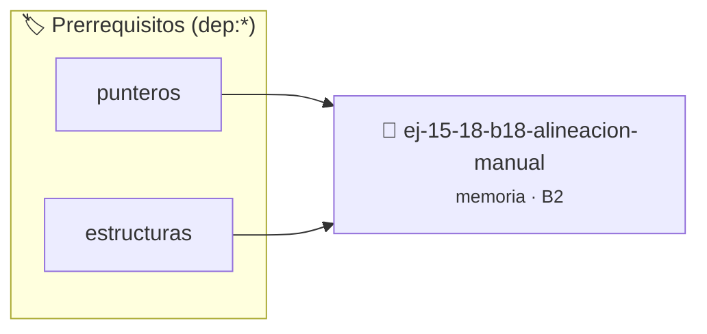

# Alineación Manual
> **ID:** `ej-15-18-b18-alineacion-manual` · **Unidad:** 3 (Memoria Dinámica y Persistencia)
 · **Tema:** `memoria` / `pilas_y_colas`
 · **Bloom:** B2 (Comprender) · **Dificultad:** Inicial
 · **Carga:** ~15 min · **Tipo:** Practica Guiada
>
> **🏷️ Prerrequisitos temáticos (tags):** `dep:punteros`, `dep:estructuras`
>
> **Etiquetas conceptuales:** `stack`, `layout`, `alineacion`, `memoria`, `manual`


::: {admonition} 📦 Paquete de Verificación Local (Ripley)
:class: tip

Para compilar, resolver y autoevaluar tu entrega con pruebas unitarias en tu máquina:

- [📥 **Descargar paquete `ej-15-18-b18-alineacion-manual.ripkg`**](../../paquetes/ej-15-18-b18-alineacion-manual.ripkg)

Ejecución con el asistente de cátedra:
```bash
ripley run ej-15-18-b18-alineacion-manual.ripkg
```
:::


### 🗺️ Itinerario Pedagógico




## 📖 Consigna

### Ejercicio 15.18 - b.18 - Alineación Manual ⭐⭐☆☆☆

Implementar una función que aloje memoria alineada a un límite específico (ej.
64 bytes para optimización de caché):


:::{hint} Lógica y Consideraciones

-   **[*plus ultra*]:** Validar punteros `NULL` recibidos como parámetro para
    evitar fallos de segmentación.
-   **[*plus ultra*]:** Implementar una versión utilizando aritmética de
    punteros en lugar de indexación directa.

:::
<!-- {hint} Lógica y Consideraciones -->

```{code-block} c
:linenos:
void *malloc_alineado(size_t size, size_t alineacion)
{
    void *ptr = NULL;
    // posix_memalign requiere que alineacion sea potencia de 2
    if (posix_memalign(&ptr, alineacion, size) != 0)
    {
        return NULL;
    }
    return ptr;
}
```
<!-- {code-block} c -->

## Integración con Herramientas


## 📋 Prototipos y Cabecera (`ej-15-18-b18-alineacion-manual.h`)

```{code-block} c
#ifndef EJERCICIO_EJ_15_18_B18_ALINEACION_MANUAL_H
#define EJERCICIO_EJ_15_18_B18_ALINEACION_MANUAL_H

#include <stddef.h>
#include <stdbool.h>
#include <stdint.h>

/* Procesa el flujo principal de Alineación Manual */
int proc_18_alineacion_manual(int val);

#endif /* EJERCICIO_EJ_15_18_B18_ALINEACION_MANUAL_H */
```


## ⚙️ Especificación de Funciones

| Función | Retorno | Parámetros | Descripción |
| :--- | :--- | :--- | :--- |

| `proc_18_alineacion_manual` | `int` | `int val` | Procesa el flujo principal de Alineación Manual |


## 💡 Pistas Progresivas

````{tab-set}

```{tab-item} Pista 1
[Plus Ultra] Validar punteros `NULL` recibidos como parámetro para evitar fallos de segmentación.
```

```{tab-item} Pista 2
[Plus Ultra] Implementar una versión utilizando aritmética de punteros en lugar de indexación directa.
```

````


## 🧪 Casos de Prueba

| Prueba Unitaria | Función Objetivo | Verificación |
| :--- | :--- | :--- |

| **test_proc_18_alineacion_manual_positivo** | `proc_18_alineacion_manual` | `int res = proc_18_alineacion_manual(5); assert(res == 10 || res >= 0);` |

| **test_proc_18_alineacion_manual_cero** | `proc_18_alineacion_manual` | `int res = proc_18_alineacion_manual(0); assert(res == 0);` |


## ✓ Solución Modelo de Cátedra

```{dropdown} 🔍 Revelar solución canónica en C
:open: false

```{code-block} c
/*
 * Solucion modelo para ej-15-18-b18-alineacion-manual
 * Catedra Programacion I - UNRN
 */
#include <stdio.h>
#include <stdlib.h>
#include <string.h>
#include <stdbool.h>


int proc_18_alineacion_manual(int val)
{
    if (val <= 0) return 0;
    return val * 2;
}

int main(void)
{
    int n = 0;
    if (scanf("%d", &n) == 1)
    {
        printf("OK %d\n", n);
    }
    else
    {
        printf("OK\n");
    }
    return 0;
}
```
```
