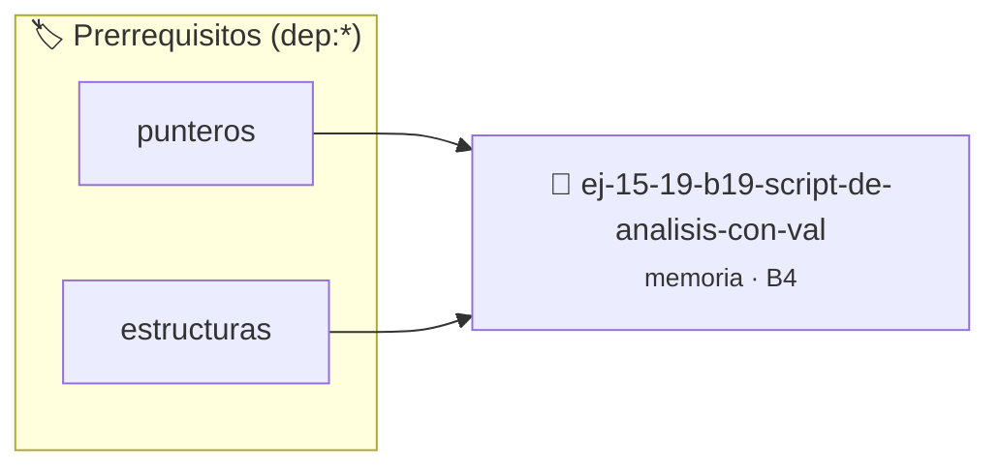

# Script de Análisis con Valgrind
> **ID:** `ej-15-19-b19-script-de-analisis-con-val` · **Unidad:** 3 (Memoria Dinámica y Persistencia)
 · **Tema:** `memoria` / `pilas_y_colas`
 · **Bloom:** B4 (Analizar) · **Dificultad:** Avanzada
 · **Carga:** ~35 min · **Tipo:** Practica Guiada
>
> **🏷️ Prerrequisitos temáticos (tags):** `dep:punteros`, `dep:estructuras`
>
> **Etiquetas conceptuales:** `stack`, `layout`, `valgrind`, `analisis`, `memoria`


::: {admonition} 📦 Paquete de Verificación Local (Ripley)
:class: tip

Para compilar, resolver y autoevaluar tu entrega con pruebas unitarias en tu máquina:

- [📥 **Descargar paquete `ej-15-19-b19-script-de-analisis-con-val.ripkg`**](../../paquetes/ej-15-19-b19-script-de-analisis-con-val.ripkg)

Ejecución con el asistente de cátedra:
```bash
ripley run ej-15-19-b19-script-de-analisis-con-val.ripkg
```
:::


### 🗺️ Itinerario Pedagógico




## 📖 Consigna

### Ejercicio 15.19 - b.19 - Script de Análisis con Valgrind ⭐⭐☆☆☆

Crear un Makefile que incluya targets para análisis automático:


:::{hint} Lógica y Consideraciones

-   **[*plus ultra*]:** Verificar la correcta apertura del archivo y controlar
    errores de E/S con `ferror` y `feof`.
-   **[*plus ultra*]:** Soportar rutas complejas y asegurar el cierre del
    archivo en todos los caminos de ejecución.

:::
<!-- {hint} Lógica y Consideraciones -->

```{code-block} makefile
:linenos:
.PHONY: valgrind
valgrind: programa
	valgrind --leak-check=full \
	         --show-leak-kinds=all \
	         --track-origins=yes \
	         --verbose \
	         ./programa

.PHONY: asan
asan:
	$(CC) -fsanitize=address -g -o programa programa.c
	./programa

```
<!-- {code-block} makefile -->


## 📋 Prototipos y Cabecera (`ej-15-19-b19-script-de-analisis-con-val.h`)

```{code-block} c
#ifndef EJERCICIO_EJ_15_19_B19_SCRIPT_DE_ANALISIS_CON_VAL_H
#define EJERCICIO_EJ_15_19_B19_SCRIPT_DE_ANALISIS_CON_VAL_H

#include <stddef.h>
#include <stdbool.h>
#include <stdint.h>

/* Procesa el flujo principal de Script de Análisis con Valgrind */
int proc__de_analisis_con_val(int val);

#endif /* EJERCICIO_EJ_15_19_B19_SCRIPT_DE_ANALISIS_CON_VAL_H */
```


## ⚙️ Especificación de Funciones

| Función | Retorno | Parámetros | Descripción |
| :--- | :--- | :--- | :--- |

| `proc__de_analisis_con_val` | `int` | `int val` | Procesa el flujo principal de Script de Análisis con Valgrind |


## 💡 Pistas Progresivas

````{tab-set}

```{tab-item} Pista 1
[Plus Ultra] Verificar la correcta apertura del archivo y controlar errores de E/S con `ferror` y `feof`.
```

```{tab-item} Pista 2
[Plus Ultra] Soportar rutas complejas y asegurar el cierre del archivo en todos los caminos de ejecución.
```

````


## 🧪 Casos de Prueba

| Prueba Unitaria | Función Objetivo | Verificación |
| :--- | :--- | :--- |

| **test_proc__de_analisis_con_val_positivo** | `proc__de_analisis_con_val` | `int res = proc__de_analisis_con_val(5); assert(res == 10 || res >= 0);` |

| **test_proc__de_analisis_con_val_cero** | `proc__de_analisis_con_val` | `int res = proc__de_analisis_con_val(0); assert(res == 0);` |


## ✓ Solución Modelo de Cátedra

```{dropdown} 🔍 Revelar solución canónica en C
:open: false

```{code-block} c
/*
 * Ejercicio: b.19 - Script de Análisis con Valgrind
 * Cátedra Programación I - UNRN
 */

#include <stdio.h>


int proc__de_analisis_con_val(int val)
{
    if (val <= 0) return 0;
    return val * 2;
}

int main(void)
{
    /* TODO: Implementación de b.19 - Script de Análisis con Valgrind */
    return 0;
}
```
```
