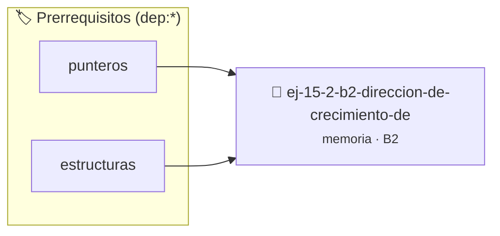

# Dirección de Crecimiento del Stack
> **ID:** `ej-15-2-b2-direccion-de-crecimiento-de` · **Unidad:** 3 (Memoria Dinámica y Persistencia)
 · **Tema:** `memoria` / `pilas_y_colas`
 · **Bloom:** B2 (Comprender) · **Dificultad:** Inicial
 · **Carga:** ~15 min · **Tipo:** Practica Guiada
>
> **🏷️ Prerrequisitos temáticos (tags):** `dep:punteros`, `dep:estructuras`
>
> **Etiquetas conceptuales:** `stack`, `crecimiento`, `layout`, `direccion`, `memoria`


::: {admonition} 📦 Paquete de Verificación Local (Ripley)
:class: tip

Para compilar, resolver y autoevaluar tu entrega con pruebas unitarias en tu máquina:

- [📥 **Descargar paquete `ej-15-2-b2-direccion-de-crecimiento-de.ripkg`**](../../paquetes/ej-15-2-b2-direccion-de-crecimiento-de.ripkg)

Ejecución con el asistente de cátedra:
```bash
ripley run ej-15-2-b2-direccion-de-crecimiento-de.ripkg
```
:::


### 🗺️ Itinerario Pedagógico




## 📖 Consigna

Escribir una función recursiva que imprima la dirección de una variable local en
cada llamada. Observar si el stack crece hacia direcciones más altas o más
bajas.


```{code-block} c
:linenos:
void explorar_stack(int nivel)
{
    int variable_local;
    printf("Nivel %d: direccion = %p\n", nivel, (void *)&variable_local);
    if (nivel < 5)
    {
        explorar_stack(nivel + 1);
    }
}
```

### 📋 Contrato de las Funciones

```c
/*
 * Operación explorar_stack
 * Precondiciones: Parámetros dentro del dominio válido de la operación.
 * Postcondiciones: Retorna el valor procesado.
 */
void explorar_stack(int nivel);

```

### 🧪 Ejemplos de Ejecución

::::{tab-set}
:::{tab-item} Valor positivo
```text
Entrada: 1
Salida / Retorno: 2
```
:::
::::

### ⚠️ Precondiciones y Casos Borde

1. **Valores fuera de rango:** Verificar siempre que los datos de entrada cumplan con los rangos admisibles antes de operar.
3. **Gestión de memoria:** Toda memoria solicitada mediante `malloc`/`calloc` debe ser validada y eventualmente liberada con `free`.
6. **Casos vacíos o neutros:** Contemplar adecuadamente entradas con longitud cero o valores neutros según corresponda.

### 🎯 Criterios de Aceptación

- [ ] El código compila limpiamente bajo estándar C11 sin warnings con flags estrictos (`-Wall -Wextra -Werror`).
- [ ] Se satisfacen todas las pruebas unitarias y casos de prueba provistos.
- [ ] Las funciones validan exhaustivamente sus precondiciones y gestionan casos borde de forma robusta.
- [ ] No se registran fugas de memoria (*memory leaks*) comprobables mediante Valgrind o AddressSanitizer.

:::{hint} Consideraciones Didácticas
- Diseñar la función para devolver un código de estado de error e informar el resultado mediante parámetros de salida.
- Documentar la función con etiquetas Doxygen especificando precondiciones y postcondiciones.
:::


## 📋 Prototipos y Cabecera (`ej-15-2-b2-direccion-de-crecimiento-de.h`)

```{code-block} c
#ifndef EJERCICIO_EJ_15_2_B2_DIRECCION_DE_CRECIMIENTO_DE_H
#define EJERCICIO_EJ_15_2_B2_DIRECCION_DE_CRECIMIENTO_DE_H

#include <stddef.h>
#include <stdbool.h>
#include <stdint.h>

/* Operación explorar_stack */
void explorar_stack(int nivel);

#endif /* EJERCICIO_EJ_15_2_B2_DIRECCION_DE_CRECIMIENTO_DE_H */
```


## ⚙️ Especificación de Funciones

| Función | Retorno | Parámetros | Descripción |
| :--- | :--- | :--- | :--- |

| `explorar_stack` | `void` | `int nivel` | Operación explorar_stack |


## 💡 Pistas Progresivas

````{tab-set}

```{tab-item} Pista 1
[Plus Ultra] Diseñar la función para devolver un código de estado de error e informar el resultado mediante parámetros de salida.
```

```{tab-item} Pista 2
[Plus Ultra] Documentar la función con etiquetas Doxygen especificando precondiciones y postcondiciones.
```

````


## 🧪 Casos de Prueba

| Prueba Unitaria | Función Objetivo | Verificación |
| :--- | :--- | :--- |

| **test_explorar_stack_1** | `explorar_stack` | `/* Verificación unitaria de explorar_stack */ explorar_stack(1); assert(true);` |


## ✓ Solución Modelo de Cátedra

```{dropdown} 🔍 Revelar solución canónica en C
:open: false

```{code-block} c
#include <stdio.h>

void explorar_stack(int nivel)
{
    int variable_local;
    printf("Nivel %d: direccion = %p\n", nivel, (void *)&variable_local);
    if (nivel < 5)
    {
        explorar_stack(nivel + 1);
    }
}

int main(void)
{
    return 0;
}
```
```
