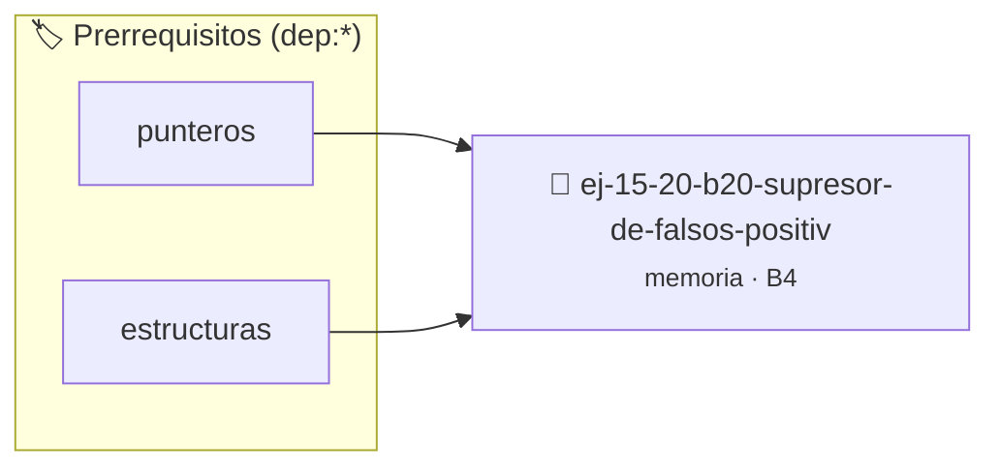

# Supresor de Falsos Positivos
> **ID:** `ej-15-20-b20-supresor-de-falsos-positiv`
 · **Tema:** `memoria`
 · **Bloom:** B4 (Analizar)
 · **Carga:** ~35 min
>
> **🏷️ Prerrequisitos temáticos (tags):** `dep:punteros`, `dep:estructuras`
>
> **Etiquetas conceptuales:** `stack`, `layout`, `memoria`, `supresor`, `falsos`


::: {admonition} 📦 Paquete de Verificación Local (Ripley)
:class: tip

Para compilar, resolver y autoevaluar tu entrega con pruebas unitarias en tu máquina:

- [📥 **Descargar paquete `ej-15-20-b20-supresor-de-falsos-positiv.ripkg`**](../../paquetes/ej-15-20-b20-supresor-de-falsos-positiv.ripkg)

Ejecución con el asistente de cátedra:
```bash
ripley run ej-15-20-b20-supresor-de-falsos-positiv.ripkg
```
:::


### 🗺️ Itinerario Pedagógico




## 📖 Consigna

### Ejercicio 15.20 - b.20 - Supresor de Falsos Positivos ⭐⭐☆☆☆

Crear un archivo de supresión para Valgrind que ignore leaks conocidos de
bibliotecas del sistema:


:::{hint} Lógica y Consideraciones

-   **[*plus ultra*]:** Verificar la correcta apertura del archivo y controlar
    errores de E/S con `ferror` y `feof`.
-   **[*plus ultra*]:** Soportar rutas complejas y asegurar el cierre del
    archivo en todos los caminos de ejecución.

:::
<!-- {hint} Lógica y Consideraciones -->

```
{
   leak_ignorado_libc
   Memcheck:Leak
   ...
   obj:/lib/x86_64-linux-gnu/libc-*.so
}
```

Usar con: `valgrind --suppressions=mi_supresion.supp ./programa`


## 📋 Prototipos y Cabecera (`ej-15-20-b20-supresor-de-falsos-positiv.h`)

```{code-block} c
#ifndef EJERCICIO_EJ_15_20_B20_SUPRESOR_DE_FALSOS_POSITIV_H
#define EJERCICIO_EJ_15_20_B20_SUPRESOR_DE_FALSOS_POSITIV_H

#include <stddef.h>
#include <stdbool.h>
#include <stdint.h>

/* Procesa el flujo principal de Supresor de Falsos Positivos */
int proc_or_de_falsos_positiv(int val);

#endif /* EJERCICIO_EJ_15_20_B20_SUPRESOR_DE_FALSOS_POSITIV_H */
```


## ⚙️ Especificación de Funciones

| Función | Retorno | Parámetros | Descripción |
| :--- | :--- | :--- | :--- |

| `proc_or_de_falsos_positiv` | `int` | `int val` | Procesa el flujo principal de Supresor de Falsos Positivos |


## 💡 Pistas Progresivas

````{tab-set}

```{tab-item} Pista 1
[Plus Ultra] Verificar la correcta apertura del archivo y controlar errores de E/S con `ferror` y `feof`.
```

```{tab-item} Pista 2
[Plus Ultra] Soportar rutas complejas y asegurar el cierre del archivo en todos los caminos de ejecución.
```

````


## 🧪 Casos de Prueba

| Prueba Unitaria | Función Objetivo | Verificación |
| :--- | :--- | :--- |

| **test_proc_or_de_falsos_positiv_positivo** | `proc_or_de_falsos_positiv` | `int res = proc_or_de_falsos_positiv(5); assert(res == 10 || res >= 0);` |

| **test_proc_or_de_falsos_positiv_cero** | `proc_or_de_falsos_positiv` | `int res = proc_or_de_falsos_positiv(0); assert(res == 0);` |


## ✓ Solución Modelo de Cátedra

```{dropdown} 🔍 Revelar solución canónica en C
:open: false

```{code-block} c
/*
 * Ejercicio: b.20 - Supresor de Falsos Positivos
 * Cátedra Programación I - UNRN
 */

#include <stdio.h>


int proc_or_de_falsos_positiv(int val)
{
    if (val <= 0) return 0;
    return val * 2;
}

int main(void)
{
    /* TODO: Implementación de b.20 - Supresor de Falsos Positivos */
    return 0;
}
```
```
