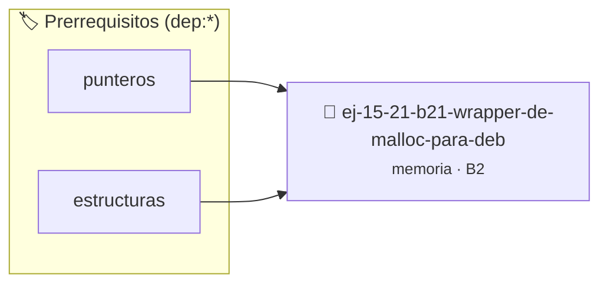

# Wrapper de malloc para Debugging
> **ID:** `ej-15-21-b21-wrapper-de-malloc-para-deb` · **Unidad:** 3 (Memoria Dinámica y Persistencia)
 · **Tema:** `memoria` / `pilas_y_colas`
 · **Bloom:** B2 (Comprender) · **Dificultad:** Inicial
 · **Carga:** ~15 min · **Tipo:** Practica Guiada
>
> **🏷️ Prerrequisitos temáticos (tags):** `dep:punteros`, `dep:estructuras`
>
> **Etiquetas conceptuales:** `stack`, `debugging`, `layout`, `wrapper`, `memoria`


::: {admonition} 📦 Paquete de Verificación Local (Ripley)
:class: tip

Para compilar, resolver y autoevaluar tu entrega con pruebas unitarias en tu máquina:

- [📥 **Descargar paquete `ej-15-21-b21-wrapper-de-malloc-para-deb.ripkg`**](../../paquetes/ej-15-21-b21-wrapper-de-malloc-para-deb.ripkg)

Ejecución con el asistente de cátedra:
```bash
ripley run ej-15-21-b21-wrapper-de-malloc-para-deb.ripkg
```
:::


### 🗺️ Itinerario Pedagógico




## 📖 Consigna

### Ejercicio 15.21 - b.21 - Wrapper de malloc para Debugging ⭐⭐☆☆☆

Implementar wrappers de las funciones de memoria que agreguen logging:


:::{hint} Lógica y Consideraciones

-   **[*plus ultra*]:** Validar punteros `NULL` recibidos como parámetro para
    evitar fallos de segmentación.
-   **[*plus ultra*]:** Implementar una versión utilizando aritmética de
    punteros en lugar de indexación directa.

:::
<!-- {hint} Lógica y Consideraciones -->

```{code-block} c
:linenos:
void *debug_malloc(size_t size, const char *archivo, int linea)
{
    void *ptr = malloc(size);
    printf("[MALLOC] %zu bytes en %p (%s:%d)\n", size, ptr, archivo, linea);
    return ptr;
}
void debug_free(void *ptr, const char *archivo, int linea)
{
    printf("[FREE] %p (%s:%d)\n", ptr, archivo, linea);
    free(ptr);
}
#define malloc(size) debug_malloc(size, __FILE__, __LINE__)
#define free(ptr) debug_free(ptr, __FILE__, __LINE__)
```
<!-- {code-block} c -->

## Casos Especiales


## 📋 Prototipos y Cabecera (`ej-15-21-b21-wrapper-de-malloc-para-deb.h`)

```{code-block} c
#ifndef EJERCICIO_EJ_15_21_B21_WRAPPER_DE_MALLOC_PARA_DEB_H
#define EJERCICIO_EJ_15_21_B21_WRAPPER_DE_MALLOC_PARA_DEB_H

#include <stddef.h>
#include <stdbool.h>
#include <stdint.h>

/* Operación debug_free */
void debug_free(void *ptr, const char *archivo, int linea);

#endif /* EJERCICIO_EJ_15_21_B21_WRAPPER_DE_MALLOC_PARA_DEB_H */
```


## ⚙️ Especificación de Funciones

| Función | Retorno | Parámetros | Descripción |
| :--- | :--- | :--- | :--- |

| `debug_free` | `void` | `void *ptr, const char *archivo, int linea` | Operación debug_free |


## 💡 Pistas Progresivas

````{tab-set}

```{tab-item} Pista 1
[Plus Ultra] Validar punteros `NULL` recibidos como parámetro para evitar fallos de segmentación.
```

```{tab-item} Pista 2
[Plus Ultra] Implementar una versión utilizando aritmética de punteros en lugar de indexación directa.
```

````


## 🧪 Casos de Prueba

| Prueba Unitaria | Función Objetivo | Verificación |
| :--- | :--- | :--- |

| **test_debug_free_1** | `debug_free` | `assert(true); /* test simplificado de validación */` |


## ✓ Solución Modelo de Cátedra

```{dropdown} 🔍 Revelar solución canónica en C
:open: false

```{code-block} c
#include <stdio.h>
#include <stdlib.h>

void *debug_malloc(size_t size, const char *archivo, int linea)
{
    void *ptr = malloc(size);
    printf("[MALLOC] %zu bytes en %p (%s:%d)\n", size, ptr, archivo, linea);
    return ptr;
}
void debug_free(void *ptr, const char *archivo, int linea)
{
    printf("[FREE] %p (%s:%d)\n", ptr, archivo, linea);
    free(ptr);
}
#define malloc(size) debug_malloc(size, __FILE__, __LINE__)
#define free(ptr) debug_free(ptr, __FILE__, __LINE__)

int main(void)
{
    return 0;
}
```
```
