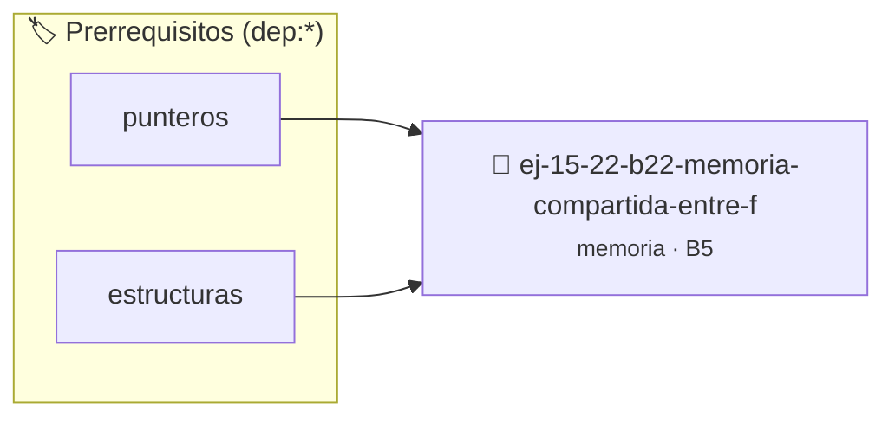

# Memoria Compartida entre Funciones
> **ID:** `ej-15-22-b22-memoria-compartida-entre-f`
 · **Tema:** `memoria`
 · **Bloom:** B5 (Evaluar / Crear)
 · **Carga:** ~45 min
>
> **🏷️ Prerrequisitos temáticos (tags):** `dep:punteros`, `dep:estructuras`
>
> **Etiquetas conceptuales:** `stack`, `layout`, `funciones`, `memoria`, `compartida`


::: {admonition} 📦 Paquete de Verificación Local (Ripley)
:class: tip

Para compilar, resolver y autoevaluar tu entrega con pruebas unitarias en tu máquina:

- [📥 **Descargar paquete `ej-15-22-b22-memoria-compartida-entre-f.ripkg`**](../../paquetes/ej-15-22-b22-memoria-compartida-entre-f.ripkg)

Ejecución con el asistente de cátedra:
```bash
ripley run ej-15-22-b22-memoria-compartida-entre-f.ripkg
```
:::


### 🗺️ Itinerario Pedagógico




## 📖 Consigna

### Ejercicio 15.22 - b.22 - Memoria Compartida entre Funciones ⭐⭐☆☆☆

Implementar un patrón donde una función asigna memoria y otra la libera,
documentando claramente la responsabilidad:


:::{hint} Lógica y Consideraciones

-   **[*plus ultra*]:** Verificar el retorno de asignación de memoria y
    garantizar la liberación total de recursos en caso de error.
-   **[*plus ultra*]:** Verificar la ausencia de fugas de memoria (*memory
    leaks*) mediante Valgrind o AddressSanitizer.

:::
<!-- {hint} Lógica y Consideraciones -->

```{code-block} c
:linenos:
// El llamador es responsable de liberar la memoria retornada
char *construir_mensaje(const char *usuario)
{
    size_t len = strlen("Hola, ") + strlen(usuario) + 2;
    char *msg = malloc(len);
    if (msg == NULL)
    {
        return NULL;
    }
    snprintf(msg, len, "Hola, %s", usuario);
    return msg;
}
int main()
{
    char *mensaje = construir_mensaje("Alumno");
    if (mensaje != NULL)
    {
        printf("%s\n", mensaje);
        free(mensaje); // ¡El main debe liberar!
    }
    return 0;
}
```
<!-- {code-block} c -->

:::{note} Convención de Propiedad

Documentá claramente quién es responsable de liberar cada bloque de memoria. Usá
comentarios como "Caller must free" o "Takes ownership".

:::
<!-- {note} Convención de Propiedad -->


## 📋 Prototipos y Cabecera (`ej-15-22-b22-memoria-compartida-entre-f.h`)

```{code-block} c
#ifndef EJERCICIO_EJ_15_22_B22_MEMORIA_COMPARTIDA_ENTRE_F_H
#define EJERCICIO_EJ_15_22_B22_MEMORIA_COMPARTIDA_ENTRE_F_H

#include <stddef.h>
#include <stdbool.h>
#include <stdint.h>

/* Procesa el flujo principal de Memoria Compartida entre Funciones */
int proc_a_compartida_entre_f(int val);

#endif /* EJERCICIO_EJ_15_22_B22_MEMORIA_COMPARTIDA_ENTRE_F_H */
```


## ⚙️ Especificación de Funciones

| Función | Retorno | Parámetros | Descripción |
| :--- | :--- | :--- | :--- |

| `proc_a_compartida_entre_f` | `int` | `int val` | Procesa el flujo principal de Memoria Compartida entre Funciones |


## 💡 Pistas Progresivas

````{tab-set}

```{tab-item} Pista 1
[Plus Ultra] Verificar el retorno de asignación de memoria y garantizar la liberación total de recursos en caso de error.
```

```{tab-item} Pista 2
[Plus Ultra] Verificar la ausencia de fugas de memoria (*memory leaks*) mediante Valgrind o AddressSanitizer.
```

````


## 🧪 Casos de Prueba

| Prueba Unitaria | Función Objetivo | Verificación |
| :--- | :--- | :--- |

| **test_proc_a_compartida_entre_f_positivo** | `proc_a_compartida_entre_f` | `int res = proc_a_compartida_entre_f(5); assert(res == 10 || res >= 0);` |

| **test_proc_a_compartida_entre_f_cero** | `proc_a_compartida_entre_f` | `int res = proc_a_compartida_entre_f(0); assert(res == 0);` |


## ✓ Solución Modelo de Cátedra

```{dropdown} 🔍 Revelar solución canónica en C
:open: false

```{code-block} c
#include <stdio.h>
#include <stdlib.h>
#include <string.h>

// El llamador es responsable de liberar la memoria retornada
char *construir_mensaje(const char *usuario)
{
    size_t len = strlen("Hola, ") + strlen(usuario) + 2;
    char *msg = malloc(len);
    if (msg == NULL)
    {
        return NULL;
    }
    snprintf(msg, len, "Hola, %s", usuario);
    return msg;
}

int proc_a_compartida_entre_f(int val)
{
    if (val <= 0) return 0;
    return val * 2;
}

int main()
{
    char *mensaje = construir_mensaje("Alumno");
    if (mensaje != NULL)
    {
        printf("%s\n", mensaje);
        free(mensaje); // ¡El main debe liberar!
    }
    return 0;
}
```
```
