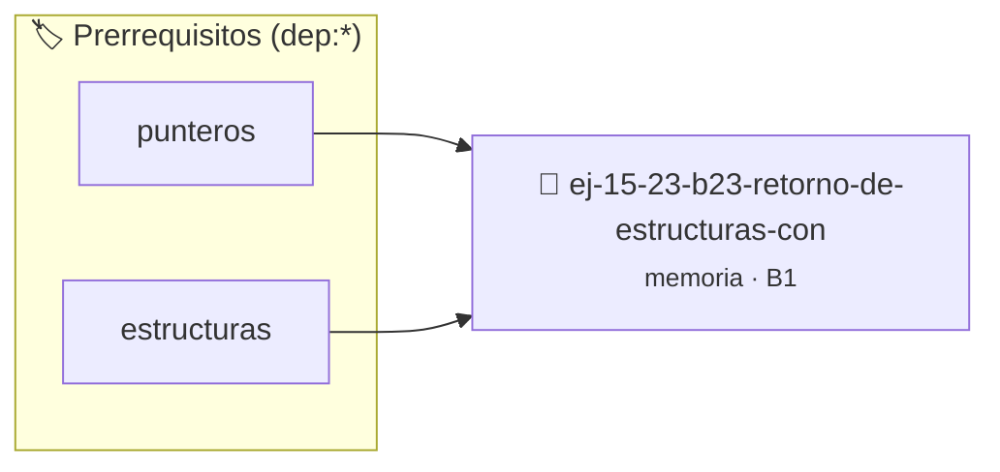

# Retorno de Estructuras con Memoria Dinámica
> **ID:** `ej-15-23-b23-retorno-de-estructuras-con`
 · **Tema:** `memoria`
 · **Bloom:** B1 (Recordar)
 · **Carga:** ~10 min
>
> **🏷️ Prerrequisitos temáticos (tags):** `dep:punteros`, `dep:estructuras`
>
> **Etiquetas conceptuales:** `stack`, `estructuras`, `layout`, `memoria`, `dinamica`


::: {admonition} 📦 Paquete de Verificación Local (Ripley)
:class: tip

Para compilar, resolver y autoevaluar tu entrega con pruebas unitarias en tu máquina:

- [📥 **Descargar paquete `ej-15-23-b23-retorno-de-estructuras-con.ripkg`**](../../paquetes/ej-15-23-b23-retorno-de-estructuras-con.ripkg)

Ejecución con el asistente de cátedra:
```bash
ripley run ej-15-23-b23-retorno-de-estructuras-con.ripkg
```
:::


### 🗺️ Itinerario Pedagógico




## 📖 Consigna

### Ejercicio 15.23 - b.23 - Retorno de Estructuras con Memoria Dinámica ⭐⭐⭐☆☆

Implementar una función que retorne un struct que contiene punteros a memoria
dinámica:


:::{hint} Lógica y Consideraciones

-   **[*plus ultra*]:** Validar punteros `NULL` recibidos como parámetro para
    evitar fallos de segmentación.
-   **[*plus ultra*]:** Implementar una versión utilizando aritmética de
    punteros en lugar de indexación directa.

:::
<!-- {hint} Lógica y Consideraciones -->

```{code-block} c
:linenos:
struct resultado_t
{
    int *datos;
    size_t tamano;
};
struct resultado_t procesar_numeros(int *entrada, size_t n)
{
    struct resultado_t res = {NULL, 0};
    res.datos = malloc(n * sizeof(int));
    if (res.datos == NULL)
    {
        return res;
    }
    for (size_t i = 0; i < n; i++)
    {
        res.datos[i] = entrada[i] * 2;
    }
    res.tamano = n;
    return res;
}
```
<!-- {code-block} c -->


## 📋 Prototipos y Cabecera (`ej-15-23-b23-retorno-de-estructuras-con.h`)

```{code-block} c
#ifndef EJERCICIO_EJ_15_23_B23_RETORNO_DE_ESTRUCTURAS_CON_H
#define EJERCICIO_EJ_15_23_B23_RETORNO_DE_ESTRUCTURAS_CON_H

#include <stddef.h>
#include <stdbool.h>
#include <stdint.h>

/* Operación procesar_numeros */
struct resultado_t procesar_numeros(int *entrada, size_t n);

#endif /* EJERCICIO_EJ_15_23_B23_RETORNO_DE_ESTRUCTURAS_CON_H */
```


## ⚙️ Especificación de Funciones

| Función | Retorno | Parámetros | Descripción |
| :--- | :--- | :--- | :--- |

| `procesar_numeros` | `struct resultado_t` | `int *entrada, size_t n` | Operación procesar_numeros |


## 💡 Pistas Progresivas

````{tab-set}

```{tab-item} Pista 1
[Plus Ultra] Validar punteros `NULL` recibidos como parámetro para evitar fallos de segmentación.
```

```{tab-item} Pista 2
[Plus Ultra] Implementar una versión utilizando aritmética de punteros en lugar de indexación directa.
```

````


## 🧪 Casos de Prueba

| Prueba Unitaria | Función Objetivo | Verificación |
| :--- | :--- | :--- |

| **test_procesar_numeros_1** | `procesar_numeros` | `/* Verificación unitaria de procesar_numeros */ int arr[] = {1, 2, 3, 4}; struct resultado_t res = procesar_numeros(arr, 4); (void)res; assert(true);` |


## ✓ Solución Modelo de Cátedra

```{dropdown} 🔍 Revelar solución canónica en C
:open: false

```{code-block} c
#include <stdlib.h>

struct resultado_t
{
    int *datos;
    size_t tamano;
};
struct resultado_t procesar_numeros(int *entrada, size_t n)
{
    struct resultado_t res = {NULL, 0};
    res.datos = malloc(n * sizeof(int));
    if (res.datos == NULL)
    {
        return res;
    }
    for (size_t i = 0; i < n; i++)
    {
        res.datos[i] = entrada[i] * 2;
    }
    res.tamano = n;
    return res;
}

int main(void)
{
    return 0;
}
```
```
