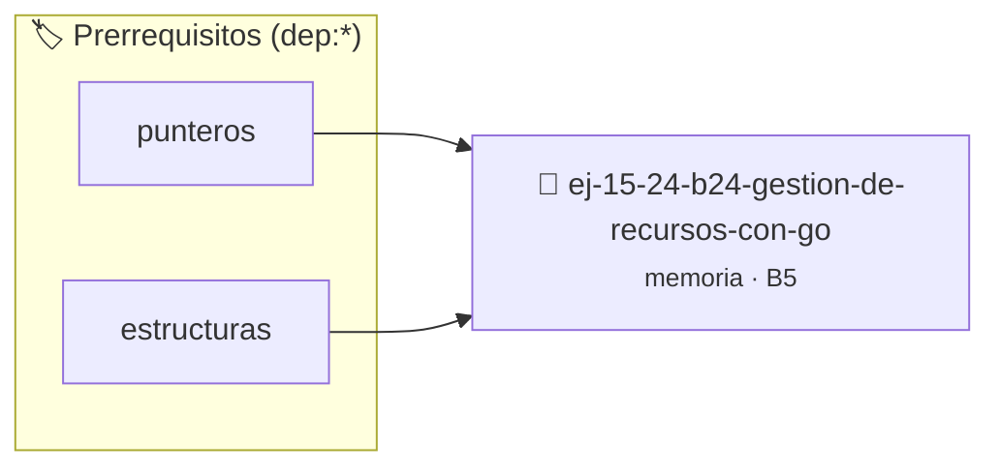

# Gestión de Recursos con goto
> **ID:** `ej-15-24-b24-gestion-de-recursos-con-go` · **Unidad:** 3 (Memoria Dinámica y Persistencia)
 · **Tema:** `memoria` / `pilas_y_colas`
 · **Bloom:** B5 (Evaluar / Crear) · **Dificultad:** Desafio
 · **Carga:** ~45 min · **Tipo:** Desafio
>
> **🏷️ Prerrequisitos temáticos (tags):** `dep:punteros`, `dep:estructuras`
>
> **Etiquetas conceptuales:** `stack`, `layout`, `memoria`, `gestion`, `recursos`


::: {admonition} 📦 Paquete de Verificación Local (Ripley)
:class: tip

Para compilar, resolver y autoevaluar tu entrega con pruebas unitarias en tu máquina:

- [📥 **Descargar paquete `ej-15-24-b24-gestion-de-recursos-con-go.ripkg`**](../../paquetes/ej-15-24-b24-gestion-de-recursos-con-go.ripkg)

Ejecución con el asistente de cátedra:
```bash
ripley run ej-15-24-b24-gestion-de-recursos-con-go.ripkg
```
:::


### 🗺️ Itinerario Pedagógico




## 📖 Consigna

Demostrar el uso apropiado de `goto` para cleanup en caso de errores:


```{code-block} c
:linenos:
int procesar_archivo(const char *ruta)
{
    FILE *archivo = NULL;
    char *buffer = NULL;
    int resultado = -1;
    archivo = fopen(ruta, "r");
    if (archivo == NULL)
    {
        goto cleanup;
    }
    buffer = malloc(1024);
    if (buffer == NULL)
    {
        goto cleanup;
    }
    // ... procesamiento ...
    resultado = 0; // éxito
cleanup:
    if (buffer != NULL)
    {
        free(buffer);
    }
    if (archivo != NULL)
    {
        fclose(archivo);
    }
    return resultado;
}
```

### 📋 Contrato de las Funciones

```c
/*
 * Operación procesar_archivo
 * Precondiciones: Los punteros recibidos deben ser válidos y no nulos.
 * Postcondiciones: Modifica el estado de la estructura o buffer de manera segura.
 */
int procesar_archivo(const char *ruta);

```

### 🧪 Ejemplos de Ejecución

::::{tab-set}
:::{tab-item} Operación típica
```text
ADD 10, ADD 20
Estructura con 2 elementos
```
:::
:::{tab-item} Colección vacía
```text
Consulta sobre estructura recién inicializada
Retorno seguro / estado vacío
```
:::
::::

### ⚠️ Precondiciones y Casos Borde

1. **Valores fuera de rango:** Verificar siempre que los datos de entrada cumplan con los rangos admisibles antes de operar.
2. **Punteros nulos:** Validar que los punteros recibidos no sean `NULL` para prevenir fallos de segmentación (*SIGSEGV*).
3. **Gestión de memoria:** Toda memoria solicitada mediante `malloc`/`calloc` debe ser validada y eventualmente liberada con `free`.
6. **Casos vacíos o neutros:** Contemplar adecuadamente entradas con longitud cero o valores neutros según corresponda.

### 🎯 Criterios de Aceptación

- [ ] El código compila limpiamente bajo estándar C11 sin warnings con flags estrictos (`-Wall -Wextra -Werror`).
- [ ] Se satisfacen todas las pruebas unitarias y casos de prueba provistos.
- [ ] Las funciones validan exhaustivamente sus precondiciones y gestionan casos borde de forma robusta.
- [ ] No se registran fugas de memoria (*memory leaks*) comprobables mediante Valgrind o AddressSanitizer.

:::{hint} Consideraciones Didácticas
- Verificar el retorno de asignación de memoria y garantizar la liberación total de recursos en caso de error.
- Verificar la ausencia de fugas de memoria (*memory leaks*) mediante Valgrind o AddressSanitizer.
- Validar estrictamente los datos de entrada para manejar valores fuera de rango o tipos inválidos.
- Permitir el procesamiento interactivo continuo mediante un lazo hasta que el usuario elija finalizar.
:::


## 📋 Prototipos y Cabecera (`ej-15-24-b24-gestion-de-recursos-con-go.h`)

```{code-block} c
#ifndef EJERCICIO_EJ_15_24_B24_GESTION_DE_RECURSOS_CON_GO_H
#define EJERCICIO_EJ_15_24_B24_GESTION_DE_RECURSOS_CON_GO_H

#include <stddef.h>
#include <stdbool.h>
#include <stdint.h>

/* Operación procesar_archivo */
int procesar_archivo(const char *ruta);

#endif /* EJERCICIO_EJ_15_24_B24_GESTION_DE_RECURSOS_CON_GO_H */
```


## ⚙️ Especificación de Funciones

| Función | Retorno | Parámetros | Descripción |
| :--- | :--- | :--- | :--- |

| `procesar_archivo` | `int` | `const char *ruta` | Operación procesar_archivo |


## 💡 Pistas Progresivas

````{tab-set}

```{tab-item} Pista 1
[Plus Ultra] Verificar el retorno de asignación de memoria y garantizar la liberación total de recursos en caso de error.
```

```{tab-item} Pista 2
[Plus Ultra] Verificar la ausencia de fugas de memoria (*memory leaks*) mediante Valgrind o AddressSanitizer.
```

```{tab-item} Pista 3
[Plus Ultra] Validar estrictamente los datos de entrada para manejar valores fuera de rango o tipos inválidos.
```

```{tab-item} Pista 4
[Plus Ultra] Permitir el procesamiento interactivo continuo mediante un lazo hasta que el usuario elija finalizar.
```

````


## 🧪 Casos de Prueba

| Prueba Unitaria | Función Objetivo | Verificación |
| :--- | :--- | :--- |

| **test_procesar_archivo_1** | `procesar_archivo` | `/* Verificación unitaria de procesar_archivo */ int res = procesar_archivo("test"); (void)res; assert(true);` |


## ✓ Solución Modelo de Cátedra

```{dropdown} 🔍 Revelar solución canónica en C
:open: false

```{code-block} c
#include <stdio.h>
#include <stdlib.h>

int procesar_archivo(const char *ruta)
{
    FILE *archivo = NULL;
    char *buffer = NULL;
    int resultado = -1;
    archivo = fopen(ruta, "r");
    if (archivo == NULL)
    {
        goto cleanup;
    }
    buffer = malloc(1024);
    if (buffer == NULL)
    {
        goto cleanup;
    }
    // ... procesamiento ...
    resultado = 0; // éxito
cleanup:
    if (buffer != NULL)
    {
        free(buffer);
    }
    if (archivo != NULL)
    {
        fclose(archivo);
    }
    return resultado;
}

int main(void)
{
    return 0;
}
```
```
