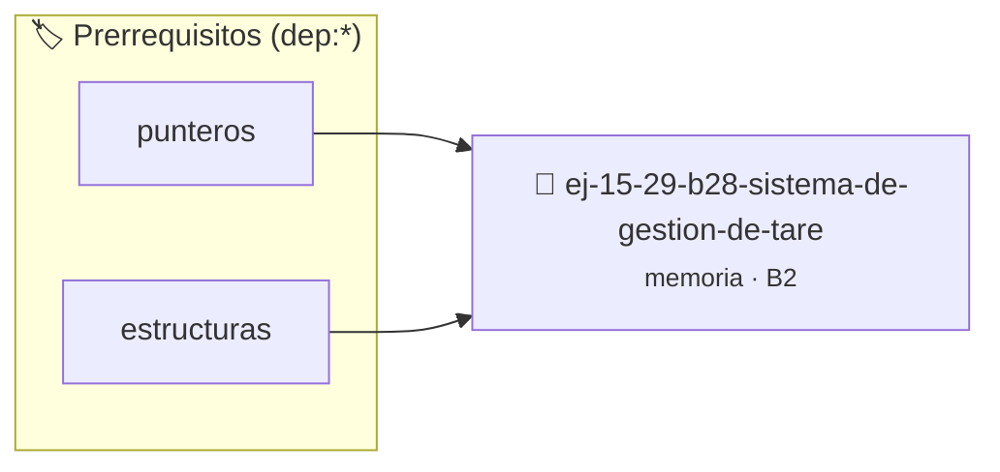

# Sistema de Gestión de Tareas
> **ID:** `ej-15-29-b28-sistema-de-gestion-de-tare` · **Unidad:** 3 (Memoria Dinámica y Persistencia)
 · **Tema:** `memoria` / `pilas_y_colas`
 · **Bloom:** B2 (Comprender) · **Dificultad:** Inicial
 · **Carga:** ~15 min · **Tipo:** Practica Guiada
>
> **🏷️ Prerrequisitos temáticos (tags):** `dep:punteros`, `dep:estructuras`
>
> **Etiquetas conceptuales:** `stack`, `layout`, `tareas`, `memoria`, `sistema`


::: {admonition} 📦 Paquete de Verificación Local (Ripley)
:class: tip

Para compilar, resolver y autoevaluar tu entrega con pruebas unitarias en tu máquina:

- [📥 **Descargar paquete `ej-15-29-b28-sistema-de-gestion-de-tare.ripkg`**](../../paquetes/ej-15-29-b28-sistema-de-gestion-de-tare.ripkg)

Ejecución con el asistente de cátedra:
```bash
ripley run ej-15-29-b28-sistema-de-gestion-de-tare.ripkg
```
:::


### 🗺️ Itinerario Pedagógico




## 📖 Consigna

### Ejercicio 15.29 - b.28 - Sistema de Gestión de Tareas ⭐⭐☆☆☆

Implementar un sistema que mantenga una lista de tareas donde cada tarea tiene:
- ID único
- Descripción (cadena dinámica)
- Subtareas (arreglo dinámico de punteros a otras tareas)

El sistema debe permitir agregar, eliminar y buscar tareas, manejando toda la
memoria correctamente.

## Preguntas Conceptuales
:::{hint} Lógica y Consideraciones

-   **[*plus ultra*]:** Validar punteros `NULL` recibidos como parámetro para
    evitar fallos de segmentación.
-   **[*plus ultra*]:** Implementar una versión utilizando aritmética de
    punteros en lugar de indexación directa.

:::
<!-- {hint} Lógica y Consideraciones -->


## 📋 Prototipos y Cabecera (`ej-15-29-b28-sistema-de-gestion-de-tare.h`)

```{code-block} c
#ifndef EJERCICIO_EJ_15_29_B28_SISTEMA_DE_GESTION_DE_TARE_H
#define EJERCICIO_EJ_15_29_B28_SISTEMA_DE_GESTION_DE_TARE_H

#include <stddef.h>
#include <stdbool.h>
#include <stdint.h>

/* Procesa el flujo principal de Sistema de Gestión de Tareas */
int proc_a_de_gestion_de_tare(int val);

#endif /* EJERCICIO_EJ_15_29_B28_SISTEMA_DE_GESTION_DE_TARE_H */
```


## ⚙️ Especificación de Funciones

| Función | Retorno | Parámetros | Descripción |
| :--- | :--- | :--- | :--- |

| `proc_a_de_gestion_de_tare` | `int` | `int val` | Procesa el flujo principal de Sistema de Gestión de Tareas |


## 💡 Pistas Progresivas

````{tab-set}

```{tab-item} Pista 1
[Plus Ultra] Validar punteros `NULL` recibidos como parámetro para evitar fallos de segmentación.
```

```{tab-item} Pista 2
[Plus Ultra] Implementar una versión utilizando aritmética de punteros en lugar de indexación directa.
```

````


## 🧪 Casos de Prueba

| Prueba Unitaria | Función Objetivo | Verificación |
| :--- | :--- | :--- |

| **test_proc_a_de_gestion_de_tare_positivo** | `proc_a_de_gestion_de_tare` | `int res = proc_a_de_gestion_de_tare(5); assert(res == 10 || res >= 0);` |

| **test_proc_a_de_gestion_de_tare_cero** | `proc_a_de_gestion_de_tare` | `int res = proc_a_de_gestion_de_tare(0); assert(res == 0);` |


## ✓ Solución Modelo de Cátedra

```{dropdown} 🔍 Revelar solución canónica en C
:open: false

```{code-block} c
/*
 * Ejercicio: b.28 - Sistema de Gestión de Tareas
 * Cátedra Programación I - UNRN
 */

#include <stdio.h>


int proc_a_de_gestion_de_tare(int val)
{
    if (val <= 0) return 0;
    return val * 2;
}

int main(void)
{
    /* TODO: Implementación de b.28 - Sistema de Gestión de Tareas */
    return 0;
}
```
```
