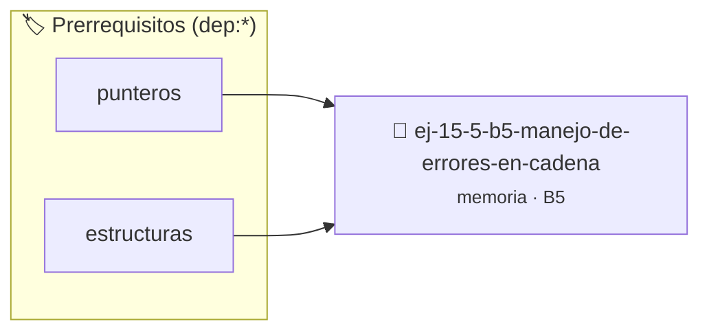

# Manejo de Errores en Cadena
> **ID:** `ej-15-5-b5-manejo-de-errores-en-cadena`
 · **Tema:** `memoria`
 · **Bloom:** B5 (Evaluar / Crear)
 · **Carga:** ~45 min
>
> **🏷️ Prerrequisitos temáticos (tags):** `dep:punteros`, `dep:estructuras`
>
> **Etiquetas conceptuales:** `stack`, `layout`, `errores`, `memoria`, `manejo`


::: {admonition} 📦 Paquete de Verificación Local (Ripley)
:class: tip

Para compilar, resolver y autoevaluar tu entrega con pruebas unitarias en tu máquina:

- [📥 **Descargar paquete `ej-15-5-b5-manejo-de-errores-en-cadena.ripkg`**](../../paquetes/ej-15-5-b5-manejo-de-errores-en-cadena.ripkg)

Ejecución con el asistente de cátedra:
```bash
ripley run ej-15-5-b5-manejo-de-errores-en-cadena.ripkg
```
:::


### 🗺️ Itinerario Pedagógico




## 📖 Consigna

### Ejercicio 15.5 - b.5 - Manejo de Errores en Cadena ⭐⭐⭐☆☆

Escribir una función que aloje múltiples estructuras anidadas:


:::{hint} Lógica y Consideraciones

-   **[*plus ultra*]:** Verificar el retorno de asignación de memoria y
    garantizar la liberación total de recursos en caso de error.
-   **[*plus ultra*]:** Verificar la ausencia de fugas de memoria (*memory
    leaks*) mediante Valgrind o AddressSanitizer.

:::
<!-- {hint} Lógica y Consideraciones -->

```{code-block} c
:linenos:
struct persona_t
{
    char *nombre;
    char *apellido;
    struct direccion_t *direccion;
};
struct direccion_t
{
    char *calle;
    char *ciudad;
};
```
<!-- {code-block} c -->

La función debe manejar correctamente fallos de `malloc` en cualquier paso,
liberando todo lo previamente asignado antes de retornar `NULL`.


## 📋 Prototipos y Cabecera (`ej-15-5-b5-manejo-de-errores-en-cadena.h`)

```{code-block} c
#ifndef EJERCICIO_EJ_15_5_B5_MANEJO_DE_ERRORES_EN_CADENA_H
#define EJERCICIO_EJ_15_5_B5_MANEJO_DE_ERRORES_EN_CADENA_H

#include <stddef.h>
#include <stdbool.h>
#include <stdint.h>

/* Procesa el flujo principal de Manejo de Errores en Cadena */
int proc_de_errores_en_cadena(int val);

#endif /* EJERCICIO_EJ_15_5_B5_MANEJO_DE_ERRORES_EN_CADENA_H */
```


## ⚙️ Especificación de Funciones

| Función | Retorno | Parámetros | Descripción |
| :--- | :--- | :--- | :--- |

| `proc_de_errores_en_cadena` | `int` | `int val` | Procesa el flujo principal de Manejo de Errores en Cadena |


## 💡 Pistas Progresivas

````{tab-set}

```{tab-item} Pista 1
[Plus Ultra] Verificar el retorno de asignación de memoria y garantizar la liberación total de recursos en caso de error.
```

```{tab-item} Pista 2
[Plus Ultra] Verificar la ausencia de fugas de memoria (*memory leaks*) mediante Valgrind o AddressSanitizer.
```

````


## 🧪 Casos de Prueba

| Prueba Unitaria | Función Objetivo | Verificación |
| :--- | :--- | :--- |

| **test_proc_de_errores_en_cadena_positivo** | `proc_de_errores_en_cadena` | `int res = proc_de_errores_en_cadena(5); assert(res == 10 || res >= 0);` |

| **test_proc_de_errores_en_cadena_cero** | `proc_de_errores_en_cadena` | `int res = proc_de_errores_en_cadena(0); assert(res == 0);` |


## ✓ Solución Modelo de Cátedra

```{dropdown} 🔍 Revelar solución canónica en C
:open: false

```{code-block} c
struct persona_t
{
    char *nombre;
    char *apellido;
    struct direccion_t *direccion;
};
struct direccion_t
{
    char *calle;
    char *ciudad;
};


int proc_de_errores_en_cadena(int val)
{
    if (val <= 0) return 0;
    return val * 2;
}

int main(void)
{
    return 0;
}
```
```
