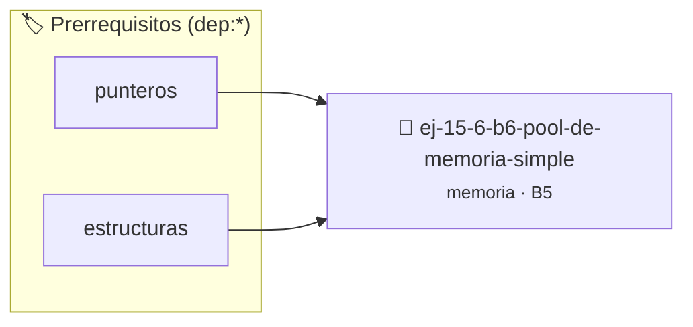

# Pool de Memoria Simple
> **ID:** `ej-15-6-b6-pool-de-memoria-simple` · **Unidad:** 3 (Memoria Dinámica y Persistencia)
 · **Tema:** `memoria` / `pilas_y_colas`
 · **Bloom:** B5 (Evaluar / Crear) · **Dificultad:** Desafio
 · **Carga:** ~45 min · **Tipo:** Desafio
>
> **🏷️ Prerrequisitos temáticos (tags):** `dep:punteros`, `dep:estructuras`
>
> **Etiquetas conceptuales:** `stack`, `simple`, `layout`, `memoria`


::: {admonition} 📦 Paquete de Verificación Local (Ripley)
:class: tip

Para compilar, resolver y autoevaluar tu entrega con pruebas unitarias en tu máquina:

- [📥 **Descargar paquete `ej-15-6-b6-pool-de-memoria-simple.ripkg`**](../../paquetes/ej-15-6-b6-pool-de-memoria-simple.ripkg)

Ejecución con el asistente de cátedra:
```bash
ripley run ej-15-6-b6-pool-de-memoria-simple.ripkg
```
:::


### 🗺️ Itinerario Pedagógico




## 📖 Consigna

### Ejercicio 15.6 - b.6 - Pool de Memoria Simple ⭐☆☆☆☆

Implementar un pool de memoria básico que preasigne un bloque grande y
distribuya bloques pequeños de tamaño fijo desde él.


:::{hint} Lógica y Consideraciones

-   **[*plus ultra*]:** Validar punteros `NULL` recibidos como parámetro para
    evitar fallos de segmentación.
-   **[*plus ultra*]:** Implementar una versión utilizando aritmética de
    punteros en lugar de indexación directa.

:::
<!-- {hint} Lógica y Consideraciones -->

```{code-block} c
:linenos:
typedef struct
{
    void *bloque_base;
    size_t tamano_total;
    size_t tamano_bloque;
    size_t bloques_usados;
    bool *mapa_uso;
} pool_t;
pool_t *pool_crear(size_t n_bloques, size_t tamano_bloque);
void *pool_alojar(pool_t *pool);
void pool_liberar(pool_t *pool, void *ptr);
void pool_destruir(pool_t *pool);
```
<!-- {code-block} c -->

**Ventaja:** Reduce la fragmentación y overhead de múltiples `malloc`/`free`.

## Errores Comunes y Detección


## 📋 Prototipos y Cabecera (`ej-15-6-b6-pool-de-memoria-simple.h`)

```{code-block} c
#ifndef EJERCICIO_EJ_15_6_B6_POOL_DE_MEMORIA_SIMPLE_H
#define EJERCICIO_EJ_15_6_B6_POOL_DE_MEMORIA_SIMPLE_H

#include <stddef.h>
#include <stdbool.h>
#include <stdint.h>

/* Procesa el flujo principal de Pool de Memoria Simple */
int proc_ol_de_memoria_simple(int val);

#endif /* EJERCICIO_EJ_15_6_B6_POOL_DE_MEMORIA_SIMPLE_H */
```


## ⚙️ Especificación de Funciones

| Función | Retorno | Parámetros | Descripción |
| :--- | :--- | :--- | :--- |

| `proc_ol_de_memoria_simple` | `int` | `int val` | Procesa el flujo principal de Pool de Memoria Simple |


## 💡 Pistas Progresivas

````{tab-set}

```{tab-item} Pista 1
[Plus Ultra] Validar punteros `NULL` recibidos como parámetro para evitar fallos de segmentación.
```

```{tab-item} Pista 2
[Plus Ultra] Implementar una versión utilizando aritmética de punteros en lugar de indexación directa.
```

````


## 🧪 Casos de Prueba

| Prueba Unitaria | Función Objetivo | Verificación |
| :--- | :--- | :--- |

| **test_proc_ol_de_memoria_simple_positivo** | `proc_ol_de_memoria_simple` | `int res = proc_ol_de_memoria_simple(5); assert(res == 10 || res >= 0);` |

| **test_proc_ol_de_memoria_simple_cero** | `proc_ol_de_memoria_simple` | `int res = proc_ol_de_memoria_simple(0); assert(res == 0);` |


## ✓ Solución Modelo de Cátedra

```{dropdown} 🔍 Revelar solución canónica en C
:open: false

```{code-block} c
/*
 * Solucion modelo para ej-15-6-b6-pool-de-memoria-simple
 * Catedra Programacion I - UNRN
 */
#include <stdio.h>
#include <stdlib.h>
#include <string.h>
#include <stdbool.h>


int proc_ol_de_memoria_simple(int val)
{
    if (val <= 0) return 0;
    return val * 2;
}

int main(void)
{
    int n = 0;
    if (scanf("%d", &n) == 1)
    {
        printf("OK %d\n", n);
    }
    else
    {
        printf("OK\n");
    }
    return 0;
}
```
```
