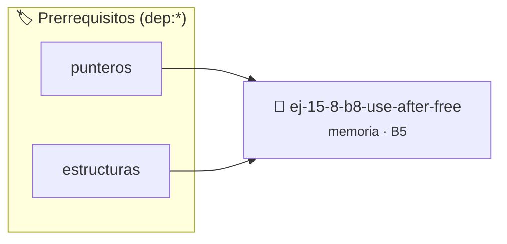

# Use After Free
> **ID:** `ej-15-8-b8-use-after-free`
 · **Tema:** `memoria`
 · **Bloom:** B5 (Evaluar / Crear)
 · **Carga:** ~45 min
>
> **🏷️ Prerrequisitos temáticos (tags):** `dep:punteros`, `dep:estructuras`
>
> **Etiquetas conceptuales:** `stack`, `after`, `layout`, `memoria`


::: {admonition} 📦 Paquete de Verificación Local (Ripley)
:class: tip

Para compilar, resolver y autoevaluar tu entrega con pruebas unitarias en tu máquina:

- [📥 **Descargar paquete `ej-15-8-b8-use-after-free.ripkg`**](../../paquetes/ej-15-8-b8-use-after-free.ripkg)

Ejecución con el asistente de cátedra:
```bash
ripley run ej-15-8-b8-use-after-free.ripkg
```
:::


### 🗺️ Itinerario Pedagógico




## 📖 Consigna

### Ejercicio 15.8 - b.8 - Use After Free ⭐⭐☆☆☆

Crear un programa que cometa use-after-free:


:::{hint} Lógica y Consideraciones

-   **[*plus ultra*]:** Verificar el retorno de asignación de memoria y
    garantizar la liberación total de recursos en caso de error.
-   **[*plus ultra*]:** Verificar la ausencia de fugas de memoria (*memory
    leaks*) mediante Valgrind o AddressSanitizer.

:::
<!-- {hint} Lógica y Consideraciones -->

```{code-block} c
:linenos:
int main()
{
    int *arr = malloc(sizeof(int) * 5);
    arr[0] = 100;
    free(arr);
    printf("%d\n", arr[0]); // ERROR: use after free
    return 0;
}
```
<!-- {code-block} c -->

Ejecutar con Valgrind: `valgrind --leak-check=full ./programa`


## 📋 Prototipos y Cabecera (`ej-15-8-b8-use-after-free.h`)

```{code-block} c
#ifndef EJERCICIO_EJ_15_8_B8_USE_AFTER_FREE_H
#define EJERCICIO_EJ_15_8_B8_USE_AFTER_FREE_H

#include <stddef.h>
#include <stdbool.h>
#include <stdint.h>

/* Procesa el flujo principal de Use After Free */
int proc__8_b8_use_after_free(int val);

#endif /* EJERCICIO_EJ_15_8_B8_USE_AFTER_FREE_H */
```


## ⚙️ Especificación de Funciones

| Función | Retorno | Parámetros | Descripción |
| :--- | :--- | :--- | :--- |

| `proc__8_b8_use_after_free` | `int` | `int val` | Procesa el flujo principal de Use After Free |


## 💡 Pistas Progresivas

````{tab-set}

```{tab-item} Pista 1
[Plus Ultra] Verificar el retorno de asignación de memoria y garantizar la liberación total de recursos en caso de error.
```

```{tab-item} Pista 2
[Plus Ultra] Verificar la ausencia de fugas de memoria (*memory leaks*) mediante Valgrind o AddressSanitizer.
```

````


## 🧪 Casos de Prueba

| Prueba Unitaria | Función Objetivo | Verificación |
| :--- | :--- | :--- |

| **test_proc__8_b8_use_after_free_positivo** | `proc__8_b8_use_after_free` | `int res = proc__8_b8_use_after_free(5); assert(res == 10 || res >= 0);` |

| **test_proc__8_b8_use_after_free_cero** | `proc__8_b8_use_after_free` | `int res = proc__8_b8_use_after_free(0); assert(res == 0);` |


## ✓ Solución Modelo de Cátedra

```{dropdown} 🔍 Revelar solución canónica en C
:open: false

```{code-block} c
#include <stdio.h>
#include <stdlib.h>


int proc__8_b8_use_after_free(int val)
{
    if (val <= 0) return 0;
    return val * 2;
}

int main()
{
    int *arr = malloc(sizeof(int) * 5);
    arr[0] = 100;
    free(arr);
    printf("%d\n", arr[0]); // ERROR: use after free
    return 0;
}
```
```
