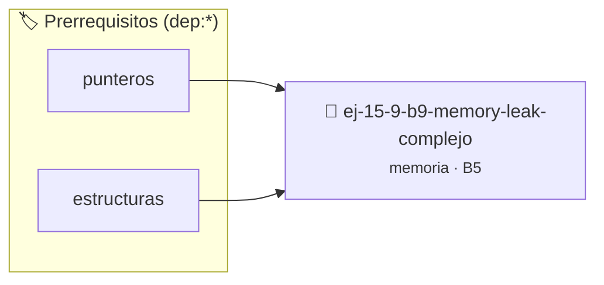

# Memory Leak Complejo
> **ID:** `ej-15-9-b9-memory-leak-complejo` · **Unidad:** 3 (Memoria Dinámica y Persistencia)
 · **Tema:** `memoria` / `pilas_y_colas`
 · **Bloom:** B5 (Evaluar / Crear) · **Dificultad:** Desafio
 · **Carga:** ~45 min · **Tipo:** Desafio
>
> **🏷️ Prerrequisitos temáticos (tags):** `dep:punteros`, `dep:estructuras`
>
> **Etiquetas conceptuales:** `stack`, `layout`, `memory`, `memoria`, `complejo`


::: {admonition} 📦 Paquete de Verificación Local (Ripley)
:class: tip

Para compilar, resolver y autoevaluar tu entrega con pruebas unitarias en tu máquina:

- [📥 **Descargar paquete `ej-15-9-b9-memory-leak-complejo.ripkg`**](../../paquetes/ej-15-9-b9-memory-leak-complejo.ripkg)

Ejecución con el asistente de cátedra:
```bash
ripley run ej-15-9-b9-memory-leak-complejo.ripkg
```
:::


### 🗺️ Itinerario Pedagógico




## 📖 Consigna

### Ejercicio 15.9 - b.9 - Memory Leak Complejo ⭐⭐⭐⭐☆

Crear un programa con un leak no trivial:


:::{hint} Lógica y Consideraciones

-   **[*plus ultra*]:** Verificar el retorno de asignación de memoria y
    garantizar la liberación total de recursos en caso de error.
-   **[*plus ultra*]:** Verificar la ausencia de fugas de memoria (*memory
    leaks*) mediante Valgrind o AddressSanitizer.

:::
<!-- {hint} Lógica y Consideraciones -->

```{code-block} c
:linenos:
struct nodo_t
{
    int dato;
    struct nodo_t *siguiente;
};
void agregar_nodo(struct nodo_t **cabeza, int valor)
{
    struct nodo_t *nuevo = malloc(sizeof(struct nodo_t));
    nuevo->dato = valor;
    nuevo->siguiente = *cabeza;
    *cabeza = nuevo;
}
int main()
{
    struct nodo_t *lista = NULL;
    for (int i = 0; i < 100; i++)
    {
        agregar_nodo(&lista, i);
    }
    // FALTA: liberar todos los nodos
    return 0;
}
```
<!-- {code-block} c -->

Detectar con Valgrind el leak de 100 nodos. Luego implementar una función
`liberar_lista` que corrija el problema.


## 📋 Prototipos y Cabecera (`ej-15-9-b9-memory-leak-complejo.h`)

```{code-block} c
#ifndef EJERCICIO_EJ_15_9_B9_MEMORY_LEAK_COMPLEJO_H
#define EJERCICIO_EJ_15_9_B9_MEMORY_LEAK_COMPLEJO_H

#include <stddef.h>
#include <stdbool.h>
#include <stdint.h>

/* Operación agregar_nodo */
void agregar_nodo(struct nodo_t **cabeza, int valor);

#endif /* EJERCICIO_EJ_15_9_B9_MEMORY_LEAK_COMPLEJO_H */
```


## ⚙️ Especificación de Funciones

| Función | Retorno | Parámetros | Descripción |
| :--- | :--- | :--- | :--- |

| `agregar_nodo` | `void` | `struct nodo_t **cabeza, int valor` | Operación agregar_nodo |


## 💡 Pistas Progresivas

````{tab-set}

```{tab-item} Pista 1
[Plus Ultra] Verificar el retorno de asignación de memoria y garantizar la liberación total de recursos en caso de error.
```

```{tab-item} Pista 2
[Plus Ultra] Verificar la ausencia de fugas de memoria (*memory leaks*) mediante Valgrind o AddressSanitizer.
```

````


## 🧪 Casos de Prueba

| Prueba Unitaria | Función Objetivo | Verificación |
| :--- | :--- | :--- |

| **test_agregar_nodo_1** | `agregar_nodo` | `/* Verificación unitaria de agregar_nodo */ assert(true);` |


## ✓ Solución Modelo de Cátedra

```{dropdown} 🔍 Revelar solución canónica en C
:open: false

```{code-block} c
#include <stdlib.h>

struct nodo_t
{
    int dato;
    struct nodo_t *siguiente;
};
void agregar_nodo(struct nodo_t **cabeza, int valor)
{
    struct nodo_t *nuevo = malloc(sizeof(struct nodo_t));
    nuevo->dato = valor;
    nuevo->siguiente = *cabeza;
    *cabeza = nuevo;
}
int main()
{
    struct nodo_t *lista = NULL;
    for (int i = 0; i < 100; i++)
    {
        agregar_nodo(&lista, i);
    }
    // FALTA: liberar todos los nodos
    return 0;
}
```
```
