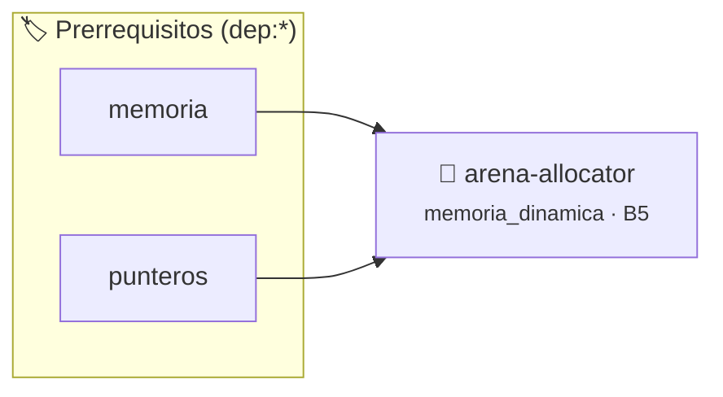

# Asignador de Memoria por Bloques (Arena Allocator)
> **ID:** `arena-allocator`
 · **Tema:** `memoria_dinamica`
 · **Bloom:** B5 (Evaluar / Crear)
 · **Carga:** ~50 min
>
> **🏷️ Prerrequisitos temáticos (tags):** `dep:memoria`, `dep:punteros`
>
> **Etiquetas conceptuales:** `memoria_dinamica`, `arena`, `alineacion`, `performance`, `punteros`


::: {admonition} 📦 Paquete de Verificación Local (Ripley)
:class: tip

Para compilar, resolver y autoevaluar tu entrega con pruebas unitarias en tu máquina:

- [📥 **Descargar paquete `arena-allocator.ripkg`**](../../paquetes/arena-allocator.ripkg)

Ejecución con el asistente de cátedra:
```bash
ripley run arena-allocator.ripkg
```
:::


### 🗺️ Itinerario Pedagógico




## 📖 Consigna

# Asignador de Memoria por Bloques (Arena Allocator)

## 1. Consigna
Implementar un asignador de memoria por región o bloques continuos (*Arena Allocator*) en C.

Estructura requerida:
- Pre-reserva un búfer de tamaño fijo $B$.
- Soporta asignaciones consecutivas con alineación a 8 bytes.
- Soporta `RESET` (pone el contador de bytes usados en 0 sin liberar el bloque base).
- Reporta estadísticas de memoria usada y capacidad restante.

Comandos:
- `INIT <capacidad_bytes>`: Inicializa la arena con la capacidad solicitada.
- `ALLOC <bytes>`: Asigna un bloque de tamaño `<bytes>` con alineación a 8 bytes. Imprime `OK offset=<offset>` o `FALLO` si no hay espacio.
- `STATS`: Imprime `USADO: <usado> / RESTANTE: <restante>`.
- `RESET`: Reinicia el puntero de asignación a 0. Imprime `ARENA_RESETEADA`.
- `EXIT`: Destruye la arena y finaliza.


## 📋 Prototipos y Cabecera (`arena-allocator.h`)

```{code-block} c
#ifndef EJERCICIO_ARENA_ALLOCATOR_H
#define EJERCICIO_ARENA_ALLOCATOR_H

#include <stddef.h>
#include <stdbool.h>
#include <stdint.h>

/* Operación arena_init */
void arena_init(Arena *arena, size_t capacidad);
/* Operación arena_reset */
void arena_reset(Arena *arena);
/* Operación arena_free */
void arena_free(Arena *arena);

#endif /* EJERCICIO_ARENA_ALLOCATOR_H */
```


## ⚙️ Especificación de Funciones

| Función | Retorno | Parámetros | Descripción |
| :--- | :--- | :--- | :--- |

| `arena_init` | `void` | `Arena *arena, size_t capacidad` | Operación arena_init |

| `arena_reset` | `void` | `Arena *arena` | Operación arena_reset |

| `arena_free` | `void` | `Arena *arena` | Operación arena_free |


## 💡 Pistas Progresivas

````{tab-set}

```{tab-item} Pista 1
Un Arena Allocator pre-reserva un bloque contiguo de memoria y despacha punteros incrementando un offset.
```

```{tab-item} Pista 2
Para respetar la alineación de memoria a múltiplos de 8 bytes, ajustá el offset hacia arriba.
```

```{tab-item} Pista 3
El reseteo de la arena simplemente pone el offset en 0 sin hacer free() individual.
```

````


## 🧪 Casos de Prueba

| Prueba Unitaria | Función Objetivo | Verificación |
| :--- | :--- | :--- |

| **test_arena_init_1** | `arena_init` | `/* Verificación unitaria de arena_init */ assert(true);` |

| **test_arena_reset_2** | `arena_reset` | `/* Verificación unitaria de arena_reset */ assert(true);` |


## ✓ Solución Modelo de Cátedra

```{dropdown} 🔍 Revelar solución canónica en C
:open: false

```{code-block} c
/*
 * Arena Allocator con alineacion a 8 bytes
 * Catedra Programacion I - UNRN
 */

#include <stdint.h>
#include <stdio.h>
#include <stdlib.h>
#include <string.h>

typedef struct
{
    uint8_t *buffer;
    size_t capacidad;
    size_t offset;
} Arena;

void arena_init(Arena *arena, size_t capacidad)
{
    uint8_t *buf = (uint8_t *)malloc(capacidad);
    if (buf == NULL)
    {
        arena->buffer = NULL;
        arena->capacidad = 0;
        arena->offset = 0;
        return;
    }
    arena->buffer = buf;
    arena->capacidad = capacidad;
    arena->offset = 0;
}

static void *arena_alloc(Arena *arena, size_t bytes, size_t alineacion)
{
    if (arena->buffer == NULL)
    {
        return NULL;
    }
    size_t alineado = (arena->offset + (alineacion - 1)) & ~(alineacion - 1);
    if (alineado + bytes > arena->capacidad)
    {
        return NULL;
    }
    void *ptr = &arena->buffer[alineado];
    arena->offset = alineado + bytes;
    return ptr;
}

void arena_reset(Arena *arena)
{
    arena->offset = 0;
}

void arena_free(Arena *arena)
{
    if (arena->buffer != NULL)
    {
        free(arena->buffer);
        arena->buffer = NULL;
    }
    arena->capacidad = 0;
    arena->offset = 0;
}

int main(void)
{
    Arena arena = {NULL, 0, 0};
    char comando[32] = {0};
    size_t param = 0;

    while (scanf("%31s", comando) == 1)
    {
        if (strcmp(comando, "INIT") == 0)
        {
            if (scanf("%zu", &param) == 1)
            {
                arena_free(&arena);
                arena_init(&arena, param);
                printf("ARENA_INICIALIZADA %zu\n", param);
            }
        }
        else if (strcmp(comando, "ALLOC") == 0)
        {
            if (scanf("%zu", &param) == 1)
            {
                void *ptr = arena_alloc(&arena, param, 8);
                if (ptr != NULL)
                {
                    printf("OK offset=%zu\n", arena.offset);
                }
                else
                {
                    printf("FALLO\n");
                }
            }
        }
        else if (strcmp(comando, "STATS") == 0)
        {
            printf("USADO: %zu / RESTANTE: %zu\n", arena.offset, arena.capacidad - arena.offset);
        }
        else if (strcmp(comando, "RESET") == 0)
        {
            arena_reset(&arena);
            printf("ARENA_RESETEADA\n");
        }
        else if (strcmp(comando, "EXIT") == 0)
        {
            break;
        }
    }

    arena_free(&arena);
    return 0;
}
```
```
