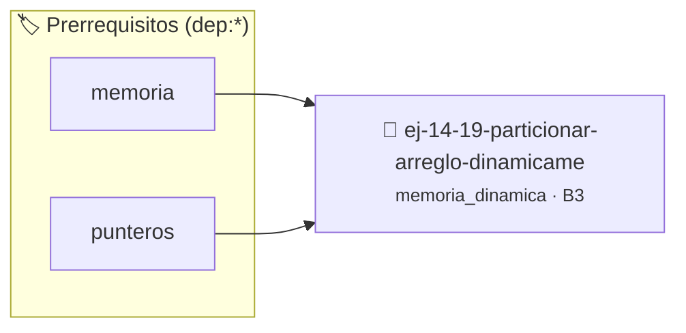

# Particionar Arreglo Dinámicamente
> **ID:** `ej-14-19-particionar-arreglo-dinamicame` · **Unidad:** 3 (Memoria Dinámica y Persistencia)
 · **Tema:** `memoria_dinamica` / `gestion_heap`
 · **Bloom:** B3 (Aplicar) · **Dificultad:** Intermedia
 · **Carga:** ~25 min · **Tipo:** Practica Guiada
>
> **🏷️ Prerrequisitos temáticos (tags):** `dep:memoria`, `dep:punteros`
>
> **Etiquetas conceptuales:** `heap`, `arreglo`, `memoria`, `malloc`, `free`


::: {admonition} 📦 Paquete de Verificación Local (Ripley)
:class: tip

Para compilar, resolver y autoevaluar tu entrega con pruebas unitarias en tu máquina:

- [📥 **Descargar paquete `ej-14-19-particionar-arreglo-dinamicame.ripkg`**](../../paquetes/ej-14-19-particionar-arreglo-dinamicame.ripkg)

Ejecución con el asistente de cátedra:
```bash
ripley run ej-14-19-particionar-arreglo-dinamicame.ripkg
```
:::


### 🗺️ Itinerario Pedagógico




## 📖 Consigna

Escribí una función en C11 que reciba un arreglo dinámico de enteros y lo
particione en dos nuevos arreglos dinámicos: uno con los elementos pares y otro
con los impares, preservando en ambas particiones el orden relativo original.

El prototipo requerido es:

```c
#include <stdbool.h>
#include <stddef.h>

bool particionar_arreglo(const int *arreglo, size_t n,
                         int **pares, size_t *cant_pares,
                         int **impares, size_t *cant_impares);
```

**Contrato de memoria y punteros**

-   `arreglo` apunta a `n` enteros reservados en el heap. La función **solo lo
    lee**: no debe modificarlo ni liberarlo; el llamador conserva su propiedad.
-   `pares` e `impares` son salidas por referencia: la función escribe en
    `*pares` e `*impares` los punteros a dos arreglos nuevos reservados con
    `malloc`. El llamador es el único responsable de liberarlos con `free`.
-   `cant_pares` y `cant_impares` reciben la cantidad de elementos de cada
    partición.
-   Retorno: `true` si la partición se completó; `false` ante cualquier
    precondición inválida o falla de `malloc`.

**Precondiciones y casos borde**

-   Si `arreglo`, `pares`, `impares`, `cant_pares` o `cant_impares` es
    `NULL`, retorná `false` sin escribir ninguna salida.
-   Si `n == 0`, la operación es válida: ambas salidas quedan en `NULL`, ambas
    cantidades en `0` y el retorno es `true`. No invoques `malloc(0)`.
-   Si todos los elementos pertenecen a una sola clase, la otra partición queda
    en `NULL` con cantidad `0`.
-   En C11 el resto de un entero negativo es negativo o cero: usá
    `x % 2 != 0` para detectar impares, de modo que valores como `-3` se
    clasifiquen correctamente.
-   Si la segunda reserva de memoria falla, liberá la primera antes de retornar
    `false`: la implementación no debe dejar memoria inaccesible.

**Ejemplo de ejecución**

```c
/* entrada = {7, 2, -3, 0, 8, 5, -4, 1}, reservada por el llamador */
int *pares = NULL, *impares = NULL;
size_t cant_pares = 0, cant_impares = 0;

if (particionar_arreglo(entrada, 8, &pares, &cant_pares,
                        &impares, &cant_impares)) {
    /* pares   = {2, 0, 8, -4}    cant_pares   = 4 */
    /* impares = {7, -3, 5, 1}    cant_impares = 4 */
}

free(pares);
free(impares);
free(entrada);
```

| Entrada                    | `pares`         | `impares`       |
|----------------------------|-----------------|-----------------|
| `{7, 2, -3, 0, 8, 5, -4, 1}` | `{2, 0, 8, -4}` | `{7, -3, 5, 1}` |
| `{2, 4, 6}`                | `{2, 4, 6}`     | `NULL` (cant. 0) |
| `n == 0`                   | `NULL` (cant. 0) | `NULL` (cant. 0) |

**Estrategia sugerida**

1.  Realizá una primera pasada sobre el arreglo para contar pares e impares.
2.  Reservá con `malloc` exactamente `cant_pares * sizeof(int)` y
    `cant_impares * sizeof(int)`, omitiendo la reserva cuando la cantidad
    sea `0`.
3.  Realizá una segunda pasada para copiar cada elemento en su partición.
4.  Verificá con Valgrind (`valgrind --leak-check=full ./ejercicio`) que toda
    la memoria reservada sea liberada.

### 📋 Contrato de las Funciones

```c
/*
 * Procesa el flujo principal de Particionar Arreglo Dinámicamente
 * Precondiciones: val representa el parámetro de entrada del flujo.
 * Postcondiciones: Retorna el resultado correspondiente o 0 si val <= 0.
 */
int proc_r_arreglo_dinamicame(int val);

```

### 🧪 Ejemplos de Ejecución

::::{tab-set}
:::{tab-item} Valor positivo
```text
Entrada: 5
Salida / Retorno: 10
```
:::
:::{tab-item} Valor cero o negativo
```text
Entrada: 0
Salida / Retorno: 0
```
:::
::::

### ⚠️ Precondiciones y Casos Borde

1. **Valores fuera de rango:** Verificar siempre que los datos de entrada cumplan con los rangos admisibles antes de operar.
3. **Gestión de memoria:** Toda memoria solicitada mediante `malloc`/`calloc` debe ser validada y eventualmente liberada con `free`.
6. **Casos vacíos o neutros:** Contemplar adecuadamente entradas con longitud cero o valores neutros según corresponda.

### 🎯 Criterios de Aceptación

- [ ] El código compila limpiamente bajo estándar C11 sin warnings con flags estrictos (`-Wall -Wextra -Werror`).
- [ ] Se satisfacen todas las pruebas unitarias y casos de prueba provistos.
- [ ] Las funciones validan exhaustivamente sus precondiciones y gestionan casos borde de forma robusta.
- [ ] No se registran fugas de memoria (*memory leaks*) comprobables mediante Valgrind o AddressSanitizer.

:::{hint} Consideraciones Didácticas
- Validar punteros `NULL` recibidos como parámetro para evitar fallos de segmentación.
- Implementar una versión utilizando aritmética de punteros en lugar de indexación directa.
:::


## 📋 Prototipos y Cabecera (`ej-14-19-particionar-arreglo-dinamicame.h`)

```{code-block} c
#ifndef EJERCICIO_EJ_14_19_PARTICIONAR_ARREGLO_DINAMICAME_H
#define EJERCICIO_EJ_14_19_PARTICIONAR_ARREGLO_DINAMICAME_H

#include <stddef.h>
#include <stdbool.h>
#include <stdint.h>

/* Procesa el flujo principal de Particionar Arreglo Dinámicamente */
int proc_r_arreglo_dinamicame(int val);

#endif /* EJERCICIO_EJ_14_19_PARTICIONAR_ARREGLO_DINAMICAME_H */
```


## ⚙️ Especificación de Funciones

| Función | Retorno | Parámetros | Descripción |
| :--- | :--- | :--- | :--- |

| `proc_r_arreglo_dinamicame` | `int` | `int val` | Procesa el flujo principal de Particionar Arreglo Dinámicamente |


## 💡 Pistas Progresivas

````{tab-set}

```{tab-item} Pista 1
[Plus Ultra] Validar punteros `NULL` recibidos como parámetro para evitar fallos de segmentación.
```

```{tab-item} Pista 2
[Plus Ultra] Implementar una versión utilizando aritmética de punteros en lugar de indexación directa.
```

````


## 🧪 Casos de Prueba

| Prueba Unitaria | Función Objetivo | Verificación |
| :--- | :--- | :--- |

| **test_proc_r_arreglo_dinamicame_positivo** | `proc_r_arreglo_dinamicame` | `int res = proc_r_arreglo_dinamicame(5); assert(res == 10 || res >= 0);` |

| **test_proc_r_arreglo_dinamicame_cero** | `proc_r_arreglo_dinamicame` | `int res = proc_r_arreglo_dinamicame(0); assert(res == 0);` |


## ✓ Solución Modelo de Cátedra

```{dropdown} 🔍 Revelar solución canónica en C
:open: false

```{code-block} c
/*
 * Ejercicio: Particionar Arreglo Dinámicamente
 * Cátedra Programación I - UNRN
 */

#include <stdio.h>


int proc_r_arreglo_dinamicame(int val)
{
    if (val <= 0) return 0;
    return val * 2;
}

int main(void)
{
    /* TODO: Implementación de Particionar Arreglo Dinámicamente */
    return 0;
}
```
```
