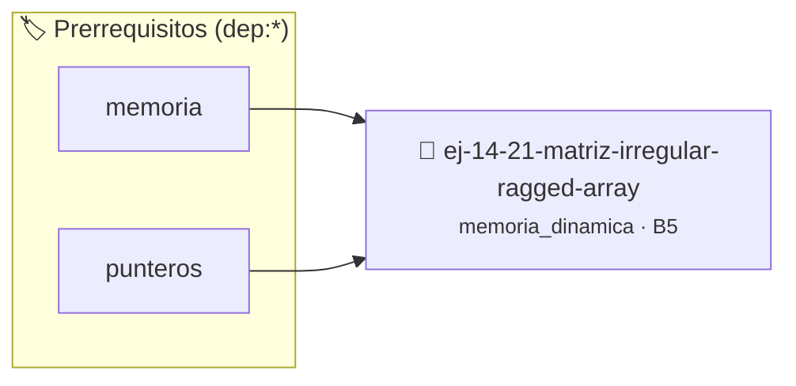

# Matriz Irregular (Ragged Array)
> **ID:** `ej-14-21-matriz-irregular-ragged-array` · **Unidad:** 3 (Memoria Dinámica y Persistencia)
 · **Tema:** `memoria_dinamica` / `matrices_2d`
 · **Bloom:** B5 (Evaluar / Crear) · **Dificultad:** Desafio
 · **Carga:** ~45 min · **Tipo:** Desafio
>
> **🏷️ Prerrequisitos temáticos (tags):** `dep:memoria`, `dep:punteros`
>
> **Etiquetas conceptuales:** `heap`, `irregular`, `array`, `ragged`, `memoria`


::: {admonition} 📦 Paquete de Verificación Local (Ripley)
:class: tip

Para compilar, resolver y autoevaluar tu entrega con pruebas unitarias en tu máquina:

- [📥 **Descargar paquete `ej-14-21-matriz-irregular-ragged-array.ripkg`**](../../paquetes/ej-14-21-matriz-irregular-ragged-array.ripkg)

Ejecución con el asistente de cátedra:
```bash
ripley run ej-14-21-matriz-irregular-ragged-array.ripkg
```
:::


### 🗺️ Itinerario Pedagógico




## 📖 Consigna

Reservar memoria para una matriz dinámica donde cada fila puede tener un número
diferente de columnas. Las dimensiones (número de columnas de cada fila) se
deben leer de un arreglo de configuración.

### 📋 Contrato de las Funciones

```c
/*
 * Procesa el flujo principal de Matriz Irregular (Ragged Array)
 * Precondiciones: val representa el parámetro de entrada del flujo.
 * Postcondiciones: Retorna el resultado correspondiente o 0 si val <= 0.
 */
int proc_regular_ragged_array(int val);

```

### 🧪 Ejemplos de Ejecución

::::{tab-set}
:::{tab-item} Valor positivo
```text
Entrada: 5
Salida / Retorno: 10
```
:::
:::{tab-item} Valor cero o negativo
```text
Entrada: 0
Salida / Retorno: 0
```
:::
::::

### ⚠️ Precondiciones y Casos Borde

1. **Valores fuera de rango:** Verificar siempre que los datos de entrada cumplan con los rangos admisibles antes de operar.
3. **Gestión de memoria:** Toda memoria solicitada mediante `malloc`/`calloc` debe ser validada y eventualmente liberada con `free`.
6. **Casos vacíos o neutros:** Contemplar adecuadamente entradas con longitud cero o valores neutros según corresponda.

### 🎯 Criterios de Aceptación

- [ ] El código compila limpiamente bajo estándar C11 sin warnings con flags estrictos (`-Wall -Wextra -Werror`).
- [ ] Se satisfacen todas las pruebas unitarias y casos de prueba provistos.
- [ ] Las funciones validan exhaustivamente sus precondiciones y gestionan casos borde de forma robusta.
- [ ] No se registran fugas de memoria (*memory leaks*) comprobables mediante Valgrind o AddressSanitizer.

:::{hint} Consideraciones Didácticas
- Verificar el retorno de asignación de memoria y garantizar la liberación total de recursos en caso de error.
- Verificar la ausencia de fugas de memoria (*memory leaks*) mediante Valgrind o AddressSanitizer.
:::


## 📋 Prototipos y Cabecera (`ej-14-21-matriz-irregular-ragged-array.h`)

```{code-block} c
#ifndef EJERCICIO_EJ_14_21_MATRIZ_IRREGULAR_RAGGED_ARRAY_H
#define EJERCICIO_EJ_14_21_MATRIZ_IRREGULAR_RAGGED_ARRAY_H

#include <stddef.h>
#include <stdbool.h>
#include <stdint.h>

/* Procesa el flujo principal de Matriz Irregular (Ragged Array) */
int proc_regular_ragged_array(int val);

#endif /* EJERCICIO_EJ_14_21_MATRIZ_IRREGULAR_RAGGED_ARRAY_H */
```


## ⚙️ Especificación de Funciones

| Función | Retorno | Parámetros | Descripción |
| :--- | :--- | :--- | :--- |

| `proc_regular_ragged_array` | `int` | `int val` | Procesa el flujo principal de Matriz Irregular (Ragged Array) |


## 💡 Pistas Progresivas

````{tab-set}

```{tab-item} Pista 1
[Plus Ultra] Verificar el retorno de asignación de memoria y garantizar la liberación total de recursos en caso de error.
```

```{tab-item} Pista 2
[Plus Ultra] Verificar la ausencia de fugas de memoria (*memory leaks*) mediante Valgrind o AddressSanitizer.
```

````


## 🧪 Casos de Prueba

| Prueba Unitaria | Función Objetivo | Verificación |
| :--- | :--- | :--- |

| **test_proc_regular_ragged_array_positivo** | `proc_regular_ragged_array` | `int res = proc_regular_ragged_array(5); assert(res == 10 || res >= 0);` |

| **test_proc_regular_ragged_array_cero** | `proc_regular_ragged_array` | `int res = proc_regular_ragged_array(0); assert(res == 0);` |


## ✓ Solución Modelo de Cátedra

```{dropdown} 🔍 Revelar solución canónica en C
:open: false

```{code-block} c
/*
 * Ejercicio: Matriz Irregular (Ragged Array)
 * Cátedra Programación I - UNRN
 */

#include <stdio.h>


int proc_regular_ragged_array(int val)
{
    if (val <= 0) return 0;
    return val * 2;
}

int main(void)
{
    /* TODO: Implementación de Matriz Irregular (Ragged Array) */
    return 0;
}
```
```
