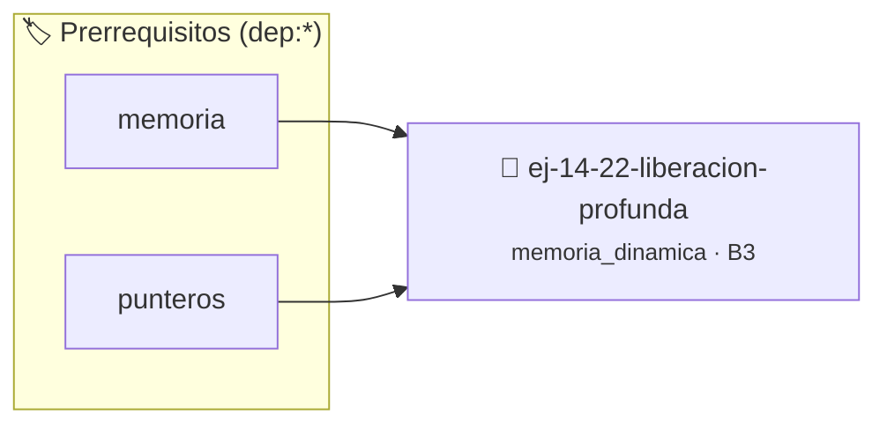

# Liberación Profunda
> **ID:** `ej-14-22-liberacion-profunda` · **Unidad:** 3 (Memoria Dinámica y Persistencia)
 · **Tema:** `memoria_dinamica` / `gestion_heap`
 · **Bloom:** B3 (Aplicar) · **Dificultad:** Intermedia
 · **Carga:** ~25 min · **Tipo:** Practica Guiada
>
> **🏷️ Prerrequisitos temáticos (tags):** `dep:memoria`, `dep:punteros`
>
> **Etiquetas conceptuales:** `heap`, `memoria`, `profunda`, `liberacion`, `malloc`


::: {admonition} 📦 Paquete de Verificación Local (Ripley)
:class: tip

Para compilar, resolver y autoevaluar tu entrega con pruebas unitarias en tu máquina:

- [📥 **Descargar paquete `ej-14-22-liberacion-profunda.ripkg`**](../../paquetes/ej-14-22-liberacion-profunda.ripkg)

Ejecución con el asistente de cátedra:
```bash
ripley run ej-14-22-liberacion-profunda.ripkg
```
:::


### 🗺️ Itinerario Pedagógico




## 📖 Consigna

### Ejercicio 14.22 - Liberación Profunda ⭐⭐☆☆☆

Escribir una función `void liberar_historial(char** historial, int n_comandos)`
que libere correctamente toda la memoria utilizada por la estructura del
ejercicio 1.19: primero la memoria de cada cadena individual y luego la memoria
del arreglo de punteros.
:::{hint} Lógica y Consideraciones

-   **[*plus ultra*]:** Validar punteros `NULL` recibidos como parámetro para
    evitar fallos de segmentación.
-   **[*plus ultra*]:** Implementar una versión utilizando aritmética de
    punteros en lugar de indexación directa.

:::
<!-- {hint} Lógica y Consideraciones -->


## 📋 Prototipos y Cabecera (`ej-14-22-liberacion-profunda.h`)

```{code-block} c
#ifndef EJERCICIO_EJ_14_22_LIBERACION_PROFUNDA_H
#define EJERCICIO_EJ_14_22_LIBERACION_PROFUNDA_H

#include <stddef.h>
#include <stdbool.h>
#include <stdint.h>

/* Procesa el flujo principal de Liberación Profunda */
int proc__liberacion_profunda(int val);

#endif /* EJERCICIO_EJ_14_22_LIBERACION_PROFUNDA_H */
```


## ⚙️ Especificación de Funciones

| Función | Retorno | Parámetros | Descripción |
| :--- | :--- | :--- | :--- |

| `proc__liberacion_profunda` | `int` | `int val` | Procesa el flujo principal de Liberación Profunda |


## 💡 Pistas Progresivas

````{tab-set}

```{tab-item} Pista 1
[Plus Ultra] Validar punteros `NULL` recibidos como parámetro para evitar fallos de segmentación.
```

```{tab-item} Pista 2
[Plus Ultra] Implementar una versión utilizando aritmética de punteros en lugar de indexación directa.
```

````


## 🧪 Casos de Prueba

| Prueba Unitaria | Función Objetivo | Verificación |
| :--- | :--- | :--- |

| **test_proc__liberacion_profunda_positivo** | `proc__liberacion_profunda` | `int res = proc__liberacion_profunda(5); assert(res == 10 || res >= 0);` |

| **test_proc__liberacion_profunda_cero** | `proc__liberacion_profunda` | `int res = proc__liberacion_profunda(0); assert(res == 0);` |


## ✓ Solución Modelo de Cátedra

```{dropdown} 🔍 Revelar solución canónica en C
:open: false

```{code-block} c
/*
 * Ejercicio: Liberación Profunda
 * Cátedra Programación I - UNRN
 */

#include <stdio.h>


int proc__liberacion_profunda(int val)
{
    if (val <= 0) return 0;
    return val * 2;
}

int main(void)
{
    /* TODO: Implementación de Liberación Profunda */
    return 0;
}
```
```
