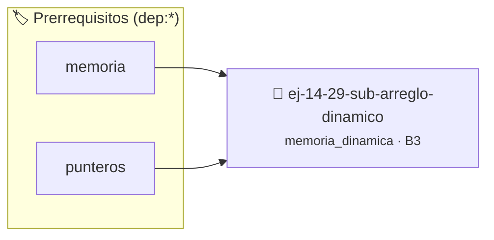

# Sub-arreglo Dinámico
> **ID:** `ej-14-29-sub-arreglo-dinamico`
 · **Tema:** `memoria_dinamica`
 · **Bloom:** B3 (Aplicar)
 · **Carga:** ~25 min
>
> **🏷️ Prerrequisitos temáticos (tags):** `dep:memoria`, `dep:punteros`
>
> **Etiquetas conceptuales:** `heap`, `dinamico`, `sub-arreglo`, `memoria`, `malloc`


::: {admonition} 📦 Paquete de Verificación Local (Ripley)
:class: tip

Para compilar, resolver y autoevaluar tu entrega con pruebas unitarias en tu máquina:

- [📥 **Descargar paquete `ej-14-29-sub-arreglo-dinamico.ripkg`**](../../paquetes/ej-14-29-sub-arreglo-dinamico.ripkg)

Ejecución con el asistente de cátedra:
```bash
ripley run ej-14-29-sub-arreglo-dinamico.ripkg
```
:::


### 🗺️ Itinerario Pedagógico




## 📖 Consigna

### Ejercicio 14.29 - Sub-arreglo Dinámico ⭐⭐⭐☆☆

Crear una función `int* sub_arreglo(const int* arr, size_t inicio, size_t fin)`
que devuelva un nuevo arreglo dinámico conteniendo una copia de los elementos
del arreglo original desde el índice `inicio` hasta `fin-1`.
:::{hint} Lógica y Consideraciones

-   **[*plus ultra*]:** Optimizar el acceso a memoria respetando el orden por
    filas (*row-major order*) para mejorar el uso de caché.
-   **[*plus ultra*]:** Validar que los índices ingresados se encuentren
    estrictamente dentro de los límites del contenedor.

:::
<!-- {hint} Lógica y Consideraciones -->


## 📋 Prototipos y Cabecera (`ej-14-29-sub-arreglo-dinamico.h`)

```{code-block} c
#ifndef EJERCICIO_EJ_14_29_SUB_ARREGLO_DINAMICO_H
#define EJERCICIO_EJ_14_29_SUB_ARREGLO_DINAMICO_H

#include <stddef.h>
#include <stdbool.h>
#include <stdint.h>

/* Procesa el flujo principal de Sub-arreglo Dinámico */
int proc_sub_arreglo_dinamico(int val);

#endif /* EJERCICIO_EJ_14_29_SUB_ARREGLO_DINAMICO_H */
```


## ⚙️ Especificación de Funciones

| Función | Retorno | Parámetros | Descripción |
| :--- | :--- | :--- | :--- |

| `proc_sub_arreglo_dinamico` | `int` | `int val` | Procesa el flujo principal de Sub-arreglo Dinámico |


## 💡 Pistas Progresivas

````{tab-set}

```{tab-item} Pista 1
[Plus Ultra] Optimizar el acceso a memoria respetando el orden por filas (*row-major order*) para mejorar el uso de caché.
```

```{tab-item} Pista 2
[Plus Ultra] Validar que los índices ingresados se encuentren estrictamente dentro de los límites del contenedor.
```

````


## 🧪 Casos de Prueba

| Prueba Unitaria | Función Objetivo | Verificación |
| :--- | :--- | :--- |

| **test_proc_sub_arreglo_dinamico_positivo** | `proc_sub_arreglo_dinamico` | `int res = proc_sub_arreglo_dinamico(5); assert(res == 10 || res >= 0);` |

| **test_proc_sub_arreglo_dinamico_cero** | `proc_sub_arreglo_dinamico` | `int res = proc_sub_arreglo_dinamico(0); assert(res == 0);` |


## ✓ Solución Modelo de Cátedra

```{dropdown} 🔍 Revelar solución canónica en C
:open: false

```{code-block} c
/*
 * Ejercicio: Sub-arreglo Dinámico
 * Cátedra Programación I - UNRN
 */

#include <stdio.h>


int proc_sub_arreglo_dinamico(int val)
{
    if (val <= 0) return 0;
    return val * 2;
}

int main(void)
{
    /* TODO: Implementación de Sub-arreglo Dinámico */
    return 0;
}
```
```
