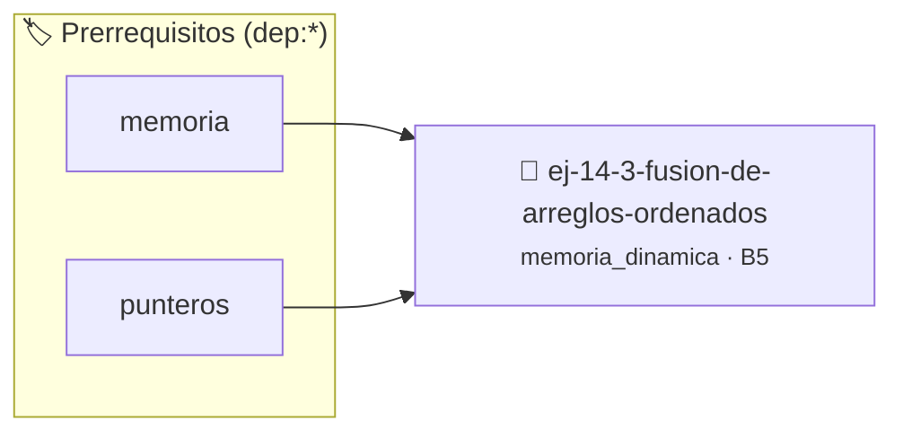

# Fusión de Arreglos Ordenados
> **ID:** `ej-14-3-fusion-de-arreglos-ordenados` · **Unidad:** 3 (Memoria Dinámica y Persistencia)
 · **Tema:** `memoria_dinamica` / `gestion_heap`
 · **Bloom:** B5 (Evaluar / Crear) · **Dificultad:** Desafio
 · **Carga:** ~45 min · **Tipo:** Desafio
>
> **🏷️ Prerrequisitos temáticos (tags):** `dep:memoria`, `dep:punteros`
>
> **Etiquetas conceptuales:** `heap`, `arreglos`, `fusion`, `memoria`, `malloc`


::: {admonition} 📦 Paquete de Verificación Local (Ripley)
:class: tip

Para compilar, resolver y autoevaluar tu entrega con pruebas unitarias en tu máquina:

- [📥 **Descargar paquete `ej-14-3-fusion-de-arreglos-ordenados.ripkg`**](../../paquetes/ej-14-3-fusion-de-arreglos-ordenados.ripkg)

Ejecución con el asistente de cátedra:
```bash
ripley run ej-14-3-fusion-de-arreglos-ordenados.ripkg
```
:::


### 🗺️ Itinerario Pedagógico




## 📖 Consigna

### Ejercicio 14.3 - Fusión de Arreglos Ordenados ⭐⭐⭐☆☆

Implementar `int* fusionar(const int *a1, size_t n1, const int *a2, size_t n2)`.
**Algoritmo:**

1.  Reservar memoria para un nuevo arreglo de tamaño `n1 + n2`.
2.  Usar tres contadores: `i` para `a1`, `j` para `a2`, y `k` para el nuevo
    arreglo.
3.  Mientras `i < n1` y `j < n2`, comparar `a1[i]` y `a2[j]` y copiar el menor
    al nuevo arreglo, incrementando el contador correspondiente y `k`.
4.  Al salir del lazo, copiar los elementos restantes del arreglo que no se haya
    completado.
:::{hint} Lógica y Consideraciones

-   **[*plus ultra*]:** Verificar el retorno de asignación de memoria y
    garantizar la liberación total de recursos en caso de error.
-   **[*plus ultra*]:** Verificar la ausencia de fugas de memoria (*memory
    leaks*) mediante Valgrind o AddressSanitizer.

:::
<!-- {hint} Lógica y Consideraciones -->


## 📋 Prototipos y Cabecera (`ej-14-3-fusion-de-arreglos-ordenados.h`)

```{code-block} c
#ifndef EJERCICIO_EJ_14_3_FUSION_DE_ARREGLOS_ORDENADOS_H
#define EJERCICIO_EJ_14_3_FUSION_DE_ARREGLOS_ORDENADOS_H

#include <stddef.h>
#include <stdbool.h>
#include <stdint.h>

/* Procesa el flujo principal de Fusión de Arreglos Ordenados */
int proc_e_arreglos_ordenados(int val);

#endif /* EJERCICIO_EJ_14_3_FUSION_DE_ARREGLOS_ORDENADOS_H */
```


## ⚙️ Especificación de Funciones

| Función | Retorno | Parámetros | Descripción |
| :--- | :--- | :--- | :--- |

| `proc_e_arreglos_ordenados` | `int` | `int val` | Procesa el flujo principal de Fusión de Arreglos Ordenados |


## 💡 Pistas Progresivas

````{tab-set}

```{tab-item} Pista 1
[Plus Ultra] Verificar el retorno de asignación de memoria y garantizar la liberación total de recursos en caso de error.
```

```{tab-item} Pista 2
[Plus Ultra] Verificar la ausencia de fugas de memoria (*memory leaks*) mediante Valgrind o AddressSanitizer.
```

````


## 🧪 Casos de Prueba

| Prueba Unitaria | Función Objetivo | Verificación |
| :--- | :--- | :--- |

| **test_proc_e_arreglos_ordenados_positivo** | `proc_e_arreglos_ordenados` | `int res = proc_e_arreglos_ordenados(5); assert(res == 10 || res >= 0);` |

| **test_proc_e_arreglos_ordenados_cero** | `proc_e_arreglos_ordenados` | `int res = proc_e_arreglos_ordenados(0); assert(res == 0);` |


## ✓ Solución Modelo de Cátedra

```{dropdown} 🔍 Revelar solución canónica en C
:open: false

```{code-block} c
/*
 * Ejercicio: Fusión de Arreglos Ordenados
 * Cátedra Programación I - UNRN
 */

#include <stdio.h>


int proc_e_arreglos_ordenados(int val)
{
    if (val <= 0) return 0;
    return val * 2;
}

int main(void)
{
    /* TODO: Implementación de Fusión de Arreglos Ordenados */
    return 0;
}
```
```
