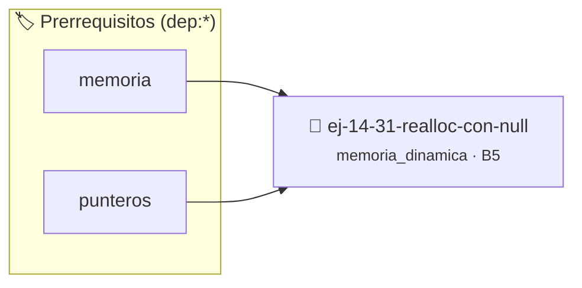

# realloc con NULL
> **ID:** `ej-14-31-realloc-con-null`
 · **Tema:** `memoria_dinamica`
 · **Bloom:** B5 (Evaluar / Crear)
 · **Carga:** ~45 min
>
> **🏷️ Prerrequisitos temáticos (tags):** `dep:memoria`, `dep:punteros`
>
> **Etiquetas conceptuales:** `heap`, `memoria`, `malloc`, `realloc`, `free`


::: {admonition} 📦 Paquete de Verificación Local (Ripley)
:class: tip

Para compilar, resolver y autoevaluar tu entrega con pruebas unitarias en tu máquina:

- [📥 **Descargar paquete `ej-14-31-realloc-con-null.ripkg`**](../../paquetes/ej-14-31-realloc-con-null.ripkg)

Ejecución con el asistente de cátedra:
```bash
ripley run ej-14-31-realloc-con-null.ripkg
```
:::


### 🗺️ Itinerario Pedagógico




## 📖 Consigna

### Ejercicio 14.31 - realloc con NULL ⭐⭐☆☆☆

Escribir un pequeño programa que demuestre que `realloc(NULL, n)` se comporta de
manera idéntica a `malloc(n)`. Verificar que la memoria se asigna correctamente.
:::{hint} Lógica y Consideraciones

-   **[*plus ultra*]:** Verificar el retorno de asignación de memoria y
    garantizar la liberación total de recursos en caso de error.
-   **[*plus ultra*]:** Verificar la ausencia de fugas de memoria (*memory
    leaks*) mediante Valgrind o AddressSanitizer.

:::
<!-- {hint} Lógica y Consideraciones -->


## 📋 Prototipos y Cabecera (`ej-14-31-realloc-con-null.h`)

```{code-block} c
#ifndef EJERCICIO_EJ_14_31_REALLOC_CON_NULL_H
#define EJERCICIO_EJ_14_31_REALLOC_CON_NULL_H

#include <stddef.h>
#include <stdbool.h>
#include <stdint.h>

/* Procesa el flujo principal de realloc con NULL */
int proc__31_realloc_con_null(int val);

#endif /* EJERCICIO_EJ_14_31_REALLOC_CON_NULL_H */
```


## ⚙️ Especificación de Funciones

| Función | Retorno | Parámetros | Descripción |
| :--- | :--- | :--- | :--- |

| `proc__31_realloc_con_null` | `int` | `int val` | Procesa el flujo principal de realloc con NULL |


## 💡 Pistas Progresivas

````{tab-set}

```{tab-item} Pista 1
[Plus Ultra] Verificar el retorno de asignación de memoria y garantizar la liberación total de recursos en caso de error.
```

```{tab-item} Pista 2
[Plus Ultra] Verificar la ausencia de fugas de memoria (*memory leaks*) mediante Valgrind o AddressSanitizer.
```

````


## 🧪 Casos de Prueba

| Prueba Unitaria | Función Objetivo | Verificación |
| :--- | :--- | :--- |

| **test_proc__31_realloc_con_null_positivo** | `proc__31_realloc_con_null` | `int res = proc__31_realloc_con_null(5); assert(res == 10 || res >= 0);` |

| **test_proc__31_realloc_con_null_cero** | `proc__31_realloc_con_null` | `int res = proc__31_realloc_con_null(0); assert(res == 0);` |


## ✓ Solución Modelo de Cátedra

```{dropdown} 🔍 Revelar solución canónica en C
:open: false

```{code-block} c
/*
 * Ejercicio: realloc con NULL
 * Cátedra Programación I - UNRN
 */

#include <stdio.h>


int proc__31_realloc_con_null(int val)
{
    if (val <= 0) return 0;
    return val * 2;
}

int main(void)
{
    /* TODO: Implementación de realloc con NULL */
    return 0;
}
```
```
