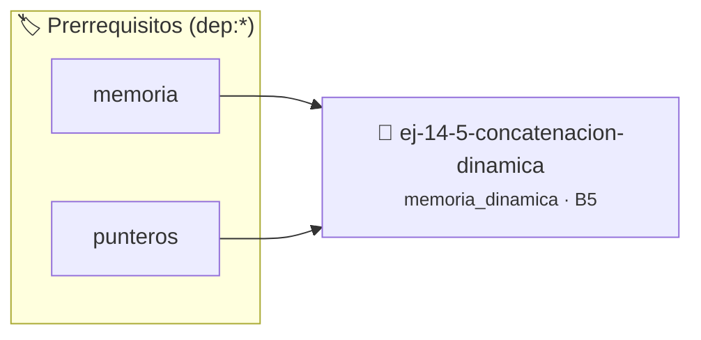

# Concatenación dinámica
> **ID:** `ej-14-5-concatenacion-dinamica`
 · **Tema:** `memoria_dinamica`
 · **Bloom:** B5 (Evaluar / Crear)
 · **Carga:** ~45 min
>
> **🏷️ Prerrequisitos temáticos (tags):** `dep:memoria`, `dep:punteros`
>
> **Etiquetas conceptuales:** `heap`, `memoria`, `dinamica`, `concatenacion`, `malloc`


::: {admonition} 📦 Paquete de Verificación Local (Ripley)
:class: tip

Para compilar, resolver y autoevaluar tu entrega con pruebas unitarias en tu máquina:

- [📥 **Descargar paquete `ej-14-5-concatenacion-dinamica.ripkg`**](../../paquetes/ej-14-5-concatenacion-dinamica.ripkg)

Ejecución con el asistente de cátedra:
```bash
ripley run ej-14-5-concatenacion-dinamica.ripkg
```
:::


### 🗺️ Itinerario Pedagógico




## 📖 Consigna

### Ejercicio 14.5 - Concatenación dinámica ⭐⭐⭐☆☆

Implementar `char* concatenar(const char *s1, const char *s2)`. **Algoritmo:**

1.  Calcular la longitud total necesaria: `strlen(s1) + strlen(s2) + 1` (para el
    `\0`).
2.  Reservar memoria con `malloc` para este tamaño.
3.  Copiar la primera cadena (`s1`) al nuevo bloque.
4.  Concatenar la segunda cadena (`s2`) al final.
:::{hint} Lógica y Consideraciones

-   **[*plus ultra*]:** Verificar el retorno de asignación de memoria y
    garantizar la liberación total de recursos en caso de error.
-   **[*plus ultra*]:** Verificar la ausencia de fugas de memoria (*memory
    leaks*) mediante Valgrind o AddressSanitizer.

:::
<!-- {hint} Lógica y Consideraciones -->


## 📋 Prototipos y Cabecera (`ej-14-5-concatenacion-dinamica.h`)

```{code-block} c
#ifndef EJERCICIO_EJ_14_5_CONCATENACION_DINAMICA_H
#define EJERCICIO_EJ_14_5_CONCATENACION_DINAMICA_H

#include <stddef.h>
#include <stdbool.h>
#include <stdint.h>

/* Procesa el flujo principal de Concatenación dinámica */
int proc_ncatenacion_dinamica(int val);

#endif /* EJERCICIO_EJ_14_5_CONCATENACION_DINAMICA_H */
```


## ⚙️ Especificación de Funciones

| Función | Retorno | Parámetros | Descripción |
| :--- | :--- | :--- | :--- |

| `proc_ncatenacion_dinamica` | `int` | `int val` | Procesa el flujo principal de Concatenación dinámica |


## 💡 Pistas Progresivas

````{tab-set}

```{tab-item} Pista 1
[Plus Ultra] Verificar el retorno de asignación de memoria y garantizar la liberación total de recursos en caso de error.
```

```{tab-item} Pista 2
[Plus Ultra] Verificar la ausencia de fugas de memoria (*memory leaks*) mediante Valgrind o AddressSanitizer.
```

````


## 🧪 Casos de Prueba

| Prueba Unitaria | Función Objetivo | Verificación |
| :--- | :--- | :--- |

| **test_proc_ncatenacion_dinamica_positivo** | `proc_ncatenacion_dinamica` | `int res = proc_ncatenacion_dinamica(5); assert(res == 10 || res >= 0);` |

| **test_proc_ncatenacion_dinamica_cero** | `proc_ncatenacion_dinamica` | `int res = proc_ncatenacion_dinamica(0); assert(res == 0);` |


## ✓ Solución Modelo de Cátedra

```{dropdown} 🔍 Revelar solución canónica en C
:open: false

```{code-block} c
/*
 * Ejercicio: Concatenación dinámica
 * Cátedra Programación I - UNRN
 */

#include <stdio.h>


int proc_ncatenacion_dinamica(int val)
{
    if (val <= 0) return 0;
    return val * 2;
}

int main(void)
{
    /* TODO: Implementación de Concatenación dinámica */
    return 0;
}
```
```
