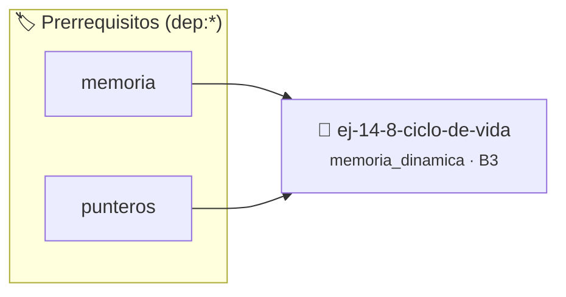

# Ciclo de vida
> **ID:** `ej-14-8-ciclo-de-vida` · **Unidad:** 3 (Memoria Dinámica y Persistencia)
 · **Tema:** `memoria_dinamica` / `gestion_heap`
 · **Bloom:** B3 (Aplicar) · **Dificultad:** Intermedia
 · **Carga:** ~25 min · **Tipo:** Practica Guiada
>
> **🏷️ Prerrequisitos temáticos (tags):** `dep:memoria`, `dep:punteros`
>
> **Etiquetas conceptuales:** `heap`, `memoria`, `ciclo`, `malloc`, `free`


::: {admonition} 📦 Paquete de Verificación Local (Ripley)
:class: tip

Para compilar, resolver y autoevaluar tu entrega con pruebas unitarias en tu máquina:

- [📥 **Descargar paquete `ej-14-8-ciclo-de-vida.ripkg`**](../../paquetes/ej-14-8-ciclo-de-vida.ripkg)

Ejecución con el asistente de cátedra:
```bash
ripley run ej-14-8-ciclo-de-vida.ripkg
```
:::


### 🗺️ Itinerario Pedagógico




## 📖 Consigna

### Ejercicio 14.8 - Ciclo de vida ⭐⭐☆☆☆

Implementar funciones para reservar y liberar una matriz `m x n` usando un
arreglo de punteros.

- **Reserva**: Se realiza en dos etapas. Primero se reserva el arreglo de
  punteros a las filas, y luego, en un lazo, se reserva la memoria para cada
  fila individual.
- **Liberación**: Debe seguir el orden inverso. Primero, en un lazo, se libera
  la memoria de cada fila, y finalmente se libera el arreglo que contenía los
  punteros a las filas.
:::{hint} Lógica y Consideraciones

-   **[*plus ultra*]:** Validar punteros `NULL` recibidos como parámetro para
    evitar fallos de segmentación.
-   **[*plus ultra*]:** Implementar una versión utilizando aritmética de
    punteros en lugar de indexación directa.

:::
<!-- {hint} Lógica y Consideraciones -->


## 📋 Prototipos y Cabecera (`ej-14-8-ciclo-de-vida.h`)

```{code-block} c
#ifndef EJERCICIO_EJ_14_8_CICLO_DE_VIDA_H
#define EJERCICIO_EJ_14_8_CICLO_DE_VIDA_H

#include <stddef.h>
#include <stdbool.h>
#include <stdint.h>

/* Procesa el flujo principal de Ciclo de vida */
int ejecutar_ej_14_8_ciclo_de_vida(int val);

#endif /* EJERCICIO_EJ_14_8_CICLO_DE_VIDA_H */
```


## ⚙️ Especificación de Funciones

| Función | Retorno | Parámetros | Descripción |
| :--- | :--- | :--- | :--- |

| `ejecutar_ej_14_8_ciclo_de_vida` | `int` | `int val` | Procesa el flujo principal de Ciclo de vida |


## 💡 Pistas Progresivas

````{tab-set}

```{tab-item} Pista 1
[Plus Ultra] Validar punteros `NULL` recibidos como parámetro para evitar fallos de segmentación.
```

```{tab-item} Pista 2
[Plus Ultra] Implementar una versión utilizando aritmética de punteros en lugar de indexación directa.
```

````


## 🧪 Casos de Prueba

| Prueba Unitaria | Función Objetivo | Verificación |
| :--- | :--- | :--- |

| **test_ejecutar_ej_14_8_ciclo_de_vida_positivo** | `ejecutar_ej_14_8_ciclo_de_vida` | `int res = ejecutar_ej_14_8_ciclo_de_vida(5); assert(res == 10 || res >= 0);` |

| **test_ejecutar_ej_14_8_ciclo_de_vida_cero** | `ejecutar_ej_14_8_ciclo_de_vida` | `int res = ejecutar_ej_14_8_ciclo_de_vida(0); assert(res == 0);` |


## ✓ Solución Modelo de Cátedra

```{dropdown} 🔍 Revelar solución canónica en C
:open: false

```{code-block} c
/*
 * Ejercicio: Ciclo de vida
 * Cátedra Programación I - UNRN
 */

#include <stdio.h>


int ejecutar_ej_14_8_ciclo_de_vida(int val)
{
    if (val <= 0) return 0;
    return val * 2;
}

int main(void)
{
    /* TODO: Implementación de Ciclo de vida */
    return 0;
}
```
```
