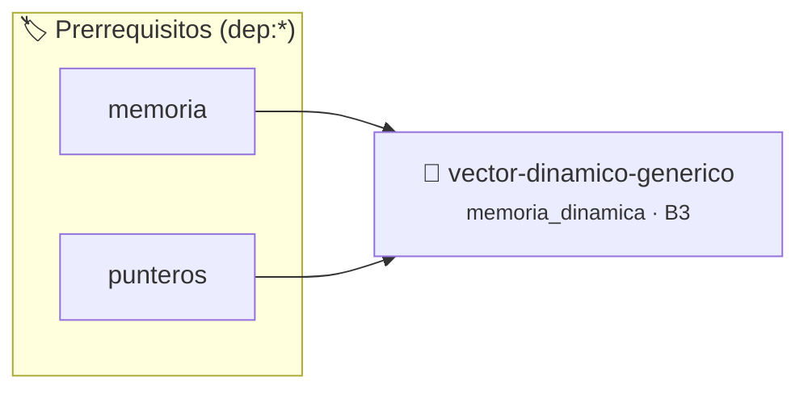

# Vector Dinámico con Crecimiento Amortizado
> **ID:** `vector-dinamico-generico` · **Unidad:** 3 (Memoria Dinámica y Persistencia)
 · **Tema:** `memoria_dinamica` / `gestion_heap`
 · **Bloom:** B3 (Aplicar) · **Dificultad:** Intermedia
 · **Carga:** ~25 min · **Tipo:** Practica Guiada
>
> **🏷️ Prerrequisitos temáticos (tags):** `dep:memoria`, `dep:punteros`
>
> **Etiquetas conceptuales:** `memoria_dinamica`, `vector`, `amortizado`, `realloc`, `tad`


::: {admonition} 📦 Paquete de Verificación Local (Ripley)
:class: tip

Para compilar, resolver y autoevaluar tu entrega con pruebas unitarias en tu máquina:

- [📥 **Descargar paquete `vector-dinamico-generico.ripkg`**](../../paquetes/vector-dinamico-generico.ripkg)

Ejecución con el asistente de cátedra:
```bash
ripley run vector-dinamico-generico.ripkg
```
:::


### 🗺️ Itinerario Pedagógico




## 📖 Consigna

# Vector Dinámico con Crecimiento Amortizado

## 1. Consigna
Implementar una estructura de Vector Dinámico para enteros con redimensionamiento automático.

Comandos:
- `PUSH <int>`: Agrega el valor al final del vector (duplicando capacidad si se llena).
- `POP`: Elimina y devuelve el último elemento. Imprime `VACIO` si no hay elementos.
- `GET <index>`: Devuelve el valor en la posición `<index>` o `FUERA_RANGO`.
- `SIZE`: Imprime `LEN: <longitud> | CAP: <capacidad>`.
- `CLEAR`: Vacía el vector reseteando su tamaño a 0.
- `EXIT`: Libera memoria y termina.


## 📋 Prototipos y Cabecera (`vector-dinamico-generico.h`)

```{code-block} c
#ifndef EJERCICIO_VECTOR_DINAMICO_GENERICO_H
#define EJERCICIO_VECTOR_DINAMICO_GENERICO_H

#include <stddef.h>
#include <stdbool.h>
#include <stdint.h>

/* Operación vector_init */
void vector_init(VectorDinamico *vec);
/* Operación vector_push */
void vector_push(VectorDinamico *vec, int valor);
/* Operación vector_pop */
void vector_pop(VectorDinamico *vec);
/* Operación vector_get */
void vector_get(const VectorDinamico *vec, size_t index);
/* Operación vector_free */
void vector_free(VectorDinamico *vec);

#endif /* EJERCICIO_VECTOR_DINAMICO_GENERICO_H */
```


## ⚙️ Especificación de Funciones

| Función | Retorno | Parámetros | Descripción |
| :--- | :--- | :--- | :--- |

| `vector_init` | `void` | `VectorDinamico *vec` | Operación vector_init |

| `vector_push` | `void` | `VectorDinamico *vec, int valor` | Operación vector_push |

| `vector_pop` | `void` | `VectorDinamico *vec` | Operación vector_pop |

| `vector_get` | `void` | `const VectorDinamico *vec, size_t index` | Operación vector_get |

| `vector_free` | `void` | `VectorDinamico *vec` | Operación vector_free |


## 💡 Pistas Progresivas

````{tab-set}

```{tab-item} Pista 1
Iniciá con una capacidad inicial pequeña (ej. 4 elementos).
```

```{tab-item} Pista 2
Cuando `longitud == capacidad`, duplicá la capacidad: `nueva_capacidad = capacidad * 2` y usá `realloc()`.
```

```{tab-item} Pista 3
Si la longitud cae por debajo de `capacidad / 4`, podés reducir la capacidad.
```

````


## 🧪 Casos de Prueba

| Prueba Unitaria | Función Objetivo | Verificación |
| :--- | :--- | :--- |

| **test_vector_init_1** | `vector_init` | `/* Verificación unitaria de vector_init */ assert(true);` |

| **test_vector_push_2** | `vector_push` | `/* Verificación unitaria de vector_push */ assert(true);` |


## ✓ Solución Modelo de Cátedra

```{dropdown} 🔍 Revelar solución canónica en C
:open: false

```{code-block} c
/*
 * Vector Dinamico Redimensionable
 * Catedra Programacion I - UNRN
 */

#include <stdio.h>
#include <stdlib.h>
#include <string.h>

#define CAPACIDAD_INICIAL 4

typedef struct
{
    int *datos;
    size_t longitud;
    size_t capacidad;
} VectorDinamico;

void vector_init(VectorDinamico *vec)
{
    vec->capacidad = CAPACIDAD_INICIAL;
    vec->longitud = 0;
    int *d = (int *)malloc(vec->capacidad * sizeof(int));
    if (d == NULL)
    {
        vec->datos = NULL;
        vec->capacidad = 0;
        return;
    }
    vec->datos = d;
}

void vector_push(VectorDinamico *vec, int valor)
{
    if (vec->datos == NULL)
    {
        vector_init(vec);
        if (vec->datos == NULL)
        {
            return;
        }
    }
    if (vec->longitud >= vec->capacidad)
    {
        size_t nueva_cap = vec->capacidad * 2;
        int *nuevos_datos = (int *)realloc(vec->datos, nueva_cap * sizeof(int));
        if (nuevos_datos == NULL)
        {
            return;
        }
        vec->datos = nuevos_datos;
        vec->capacidad = nueva_cap;
    }
    vec->datos[vec->longitud++] = valor;
}

void vector_pop(VectorDinamico *vec)
{
    if (vec->longitud == 0 || vec->datos == NULL)
    {
        printf("VACIO\n");
        return;
    }
    int v = vec->datos[--vec->longitud];
    printf("%d\n", v);
}

void vector_get(const VectorDinamico *vec, size_t index)
{
    if (vec->datos == NULL || index >= vec->longitud)
    {
        printf("FUERA_RANGO\n");
        return;
    }
    printf("%d\n", vec->datos[index]);
}

void vector_free(VectorDinamico *vec)
{
    if (vec->datos != NULL)
    {
        free(vec->datos);
        vec->datos = NULL;
    }
    vec->longitud = 0;
    vec->capacidad = 0;
}

int main(void)
{
    VectorDinamico vec;
    vector_init(&vec);

    char op[32] = {0};
    int val = 0;
    size_t idx = 0;

    while (scanf("%31s", op) == 1)
    {
        if (strcmp(op, "PUSH") == 0)
        {
            if (scanf("%d", &val) == 1)
            {
                vector_push(&vec, val);
            }
        }
        else if (strcmp(op, "POP") == 0)
        {
            vector_pop(&vec);
        }
        else if (strcmp(op, "GET") == 0)
        {
            if (scanf("%zu", &idx) == 1)
            {
                vector_get(&vec, idx);
            }
        }
        else if (strcmp(op, "SIZE") == 0)
        {
            printf("LEN: %zu | CAP: %zu\n", vec.longitud, vec.capacidad);
        }
        else if (strcmp(op, "CLEAR") == 0)
        {
            vec.longitud = 0;
        }
        else if (strcmp(op, "EXIT") == 0)
        {
            break;
        }
    }

    vector_free(&vec);
    return 0;
}
```
```
