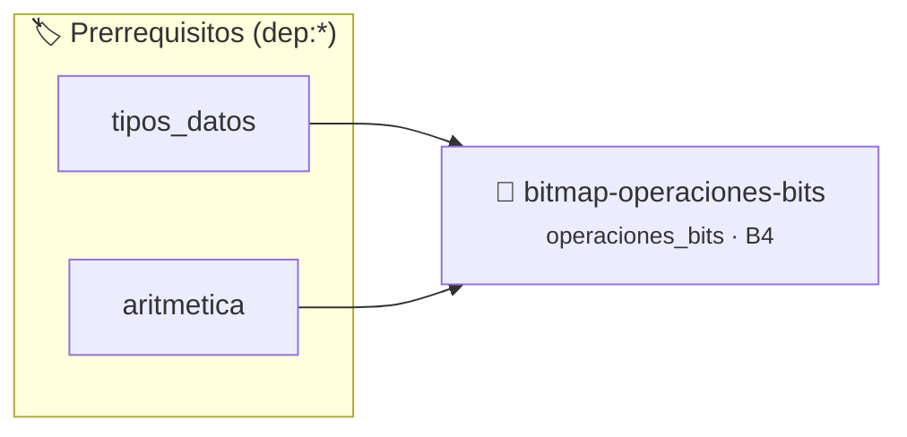

# Estructura de Bitmap Compacto y Operaciones Bitwise
> **ID:** `bitmap-operaciones-bits` · **Unidad:** 5 (Ingeniería de Software y Calidad en C)
 · **Tema:** `operaciones_bits` / `operaciones_bits`
 · **Bloom:** B4 (Analizar) · **Dificultad:** Avanzada
 · **Carga:** ~40 min · **Tipo:** Practica Guiada
>
> **🏷️ Prerrequisitos temáticos (tags):** `dep:tipos_datos`, `dep:aritmetica`
>
> **Etiquetas conceptuales:** `operaciones_bits`, `bitwise`, `bitmap`, `mascaras`, `optimizacion`


::: {admonition} 📦 Paquete de Verificación Local (Ripley)
:class: tip

Para compilar, resolver y autoevaluar tu entrega con pruebas unitarias en tu máquina:

- [📥 **Descargar paquete `bitmap-operaciones-bits.ripkg`**](../../paquetes/bitmap-operaciones-bits.ripkg)

Ejecución con el asistente de cátedra:
```bash
ripley run bitmap-operaciones-bits.ripkg
```
:::


### 🗺️ Itinerario Pedagógico




## 📖 Consigna

Implementar una estructura de Bitmap (arreglo de bits compacto) que administre un rango de $N$ bits utilizando la mínima cantidad de memoria (`uint8_t` contiguos).

Comandos:
- `INIT <total_bits>`: Inicializa el bitmap a 0 con tamaño `<total_bits>`.
- `SET <bit_index>`: Enciende el bit en la posición indicada.
- `CLEAR <bit_index>`: Apaga el bit en la posición indicada.
- `TEST <bit_index>`: Imprime `1` si está encendido o `0` si está apagado.
- `COUNT`: Cuenta e imprime la cantidad total de bits encendidos en el bitmap.
- `EXIT`: Libera memoria y finaliza.

### 📋 Contrato de las Funciones

```c
/*
 * Operación bitmap_init
 * Precondiciones: Los punteros recibidos deben ser válidos y no nulos.
 * Postcondiciones: Modifica el estado de la estructura o buffer de manera segura.
 */
void bitmap_init(Bitmap *bm, size_t total_bits);

/*
 * Operación bitmap_set
 * Precondiciones: Los punteros recibidos deben ser válidos y no nulos.
 * Postcondiciones: Modifica el estado de la estructura o buffer de manera segura.
 */
void bitmap_set(Bitmap *bm, size_t index);

/*
 * Operación bitmap_clear
 * Precondiciones: Los punteros recibidos deben ser válidos y no nulos.
 * Postcondiciones: Modifica el estado de la estructura o buffer de manera segura.
 */
void bitmap_clear(Bitmap *bm, size_t index);

/*
 * Operación bitmap_test
 * Precondiciones: Los punteros recibidos deben ser válidos y no nulos.
 * Postcondiciones: Modifica el estado de la estructura o buffer de manera segura.
 */
int bitmap_test(const Bitmap *bm, size_t index);

/*
 * Operación bitmap_count
 * Precondiciones: Los punteros recibidos deben ser válidos y no nulos.
 * Postcondiciones: Modifica el estado de la estructura o buffer de manera segura.
 */
size_t bitmap_count(const Bitmap *bm);

/*
 * Operación bitmap_free
 * Precondiciones: Los punteros recibidos deben ser válidos y no nulos.
 * Postcondiciones: Modifica el estado de la estructura o buffer de manera segura.
 */
void bitmap_free(Bitmap *bm);

```

### 🧪 Ejemplos de Ejecución

::::{tab-set}
:::{tab-item} Caso general
```text
val = 10
Retorno esperado calculado
```
:::
:::{tab-item} Caso límite
```text
val = 0
Retorno 0 o manejo de borde
```
:::
::::

### ⚠️ Precondiciones y Casos Borde

1. **Valores fuera de rango:** Verificar siempre que los datos de entrada cumplan con los rangos admisibles antes de operar.
2. **Punteros nulos:** Validar que los punteros recibidos no sean `NULL` para prevenir fallos de segmentación (*SIGSEGV*).
6. **Casos vacíos o neutros:** Contemplar adecuadamente entradas con longitud cero o valores neutros según corresponda.

### 🎯 Criterios de Aceptación

- [ ] El código compila limpiamente bajo estándar C11 sin warnings con flags estrictos (`-Wall -Wextra -Werror`).
- [ ] Se satisfacen todas las pruebas unitarias y casos de prueba provistos.
- [ ] Las funciones validan exhaustivamente sus precondiciones y gestionan casos borde de forma robusta.

:::{hint} Consideraciones Didácticas
- Para un bit $n$, el byte que lo contiene es `n / 8` y la posición dentro del byte es `n % 8`.
- Para encender el bit: `buffer[n / 8] |= (1 << (n % 8))`.
- Para apagar el bit: `buffer[n / 8] &= ~(1 << (n % 8))`.
- Para consultar el bit: `(buffer[n / 8] & (1 << (n % 8))) != 0`.
:::


## 📋 Prototipos y Cabecera (`bitmap-operaciones-bits.h`)

```{code-block} c
#ifndef EJERCICIO_BITMAP_OPERACIONES_BITS_H
#define EJERCICIO_BITMAP_OPERACIONES_BITS_H

#include <stddef.h>
#include <stdbool.h>
#include <stdint.h>

/* Operación bitmap_init */
void bitmap_init(Bitmap *bm, size_t total_bits);
/* Operación bitmap_set */
void bitmap_set(Bitmap *bm, size_t index);
/* Operación bitmap_clear */
void bitmap_clear(Bitmap *bm, size_t index);
/* Operación bitmap_test */
int bitmap_test(const Bitmap *bm, size_t index);
/* Operación bitmap_count */
size_t bitmap_count(const Bitmap *bm);
/* Operación bitmap_free */
void bitmap_free(Bitmap *bm);

#endif /* EJERCICIO_BITMAP_OPERACIONES_BITS_H */
```


## ⚙️ Especificación de Funciones

| Función | Retorno | Parámetros | Descripción |
| :--- | :--- | :--- | :--- |

| `bitmap_init` | `void` | `Bitmap *bm, size_t total_bits` | Operación bitmap_init |

| `bitmap_set` | `void` | `Bitmap *bm, size_t index` | Operación bitmap_set |

| `bitmap_clear` | `void` | `Bitmap *bm, size_t index` | Operación bitmap_clear |

| `bitmap_test` | `int` | `const Bitmap *bm, size_t index` | Operación bitmap_test |

| `bitmap_count` | `size_t` | `const Bitmap *bm` | Operación bitmap_count |

| `bitmap_free` | `void` | `Bitmap *bm` | Operación bitmap_free |


## 💡 Pistas Progresivas

````{tab-set}

```{tab-item} Pista 1
Para un bit $n$, el byte que lo contiene es `n / 8` y la posición dentro del byte es `n % 8`.
```

```{tab-item} Pista 2
Para encender el bit: `buffer[n / 8] |= (1 << (n % 8))`.
```

```{tab-item} Pista 3
Para apagar el bit: `buffer[n / 8] &= ~(1 << (n % 8))`.
```

```{tab-item} Pista 4
Para consultar el bit: `(buffer[n / 8] & (1 << (n % 8))) != 0`.
```

````


## 🧪 Casos de Prueba

| Prueba Unitaria | Función Objetivo | Verificación |
| :--- | :--- | :--- |

| **test_bitmap_init_1** | `bitmap_init` | `/* Verificación unitaria de bitmap_init */ assert(true);` |

| **test_bitmap_set_2** | `bitmap_set` | `/* Verificación unitaria de bitmap_set */ assert(true);` |


## ✓ Solución Modelo de Cátedra

```{dropdown} 🔍 Revelar solución canónica en C
:open: false

```{code-block} c
/*
 * Bitmap Compacto con Operaciones a Nivel de Bits
 * Catedra Programacion I - UNRN
 */

#include <stdint.h>
#include <stdio.h>
#include <stdlib.h>
#include <string.h>

typedef struct
{
    uint8_t *bytes;
    size_t total_bits;
    size_t num_bytes;
} Bitmap;

void bitmap_init(Bitmap *bm, size_t total_bits)
{
    bm->total_bits = total_bits;
    bm->num_bytes = (total_bits + 7) / 8;
    uint8_t *b = (uint8_t *)calloc(bm->num_bytes, sizeof(uint8_t));
    if (b == NULL)
    {
        bm->bytes = NULL;
        bm->total_bits = 0;
        bm->num_bytes = 0;
        return;
    }
    bm->bytes = b;
}

void bitmap_set(Bitmap *bm, size_t index)
{
    if (bm->bytes != NULL && index < bm->total_bits)
    {
        bm->bytes[index / 8] |= (uint8_t)(1 << (index % 8));
    }
}

void bitmap_clear(Bitmap *bm, size_t index)
{
    if (bm->bytes != NULL && index < bm->total_bits)
    {
        bm->bytes[index / 8] &= (uint8_t)(~(1 << (index % 8)));
    }
}

int bitmap_test(const Bitmap *bm, size_t index)
{
    if (bm->bytes == NULL || index >= bm->total_bits)
    {
        return 0;
    }
    return (bm->bytes[index / 8] & (uint8_t)(1 << (index % 8))) ? 1 : 0;
}

size_t bitmap_count(const Bitmap *bm)
{
    if (bm->bytes == NULL)
    {
        return 0;
    }
    size_t contador = 0;
    for (size_t i = 0; i < bm->num_bytes; i++)
    {
        uint8_t b = bm->bytes[i];
        while (b > 0)
        {
            contador += (size_t)(b & 1);
            b >>= 1;
        }
    }
    return contador;
}

void bitmap_free(Bitmap *bm)
{
    if (bm->bytes != NULL)
    {
        free(bm->bytes);
        bm->bytes = NULL;
    }
    bm->total_bits = 0;
    bm->num_bytes = 0;
}

int main(void)
{
    Bitmap bm = {NULL, 0, 0};
    char comando[32] = {0};
    size_t index = 0;

    while (scanf("%31s", comando) == 1)
    {
        if (strcmp(comando, "INIT") == 0)
        {
            if (scanf("%zu", &index) == 1)
            {
                bitmap_free(&bm);
                bitmap_init(&bm, index);
            }
        }
        else if (strcmp(comando, "SET") == 0)
        {
            if (scanf("%zu", &index) == 1)
            {
                bitmap_set(&bm, index);
            }
        }
        else if (strcmp(comando, "CLEAR") == 0)
        {
            if (scanf("%zu", &index) == 1)
            {
                bitmap_clear(&bm, index);
            }
        }
        else if (strcmp(comando, "TEST") == 0)
        {
            if (scanf("%zu", &index) == 1)
            {
                printf("%d\n", bitmap_test(&bm, index));
            }
        }
        else if (strcmp(comando, "COUNT") == 0)
        {
            printf("%zu\n", bitmap_count(&bm));
        }
        else if (strcmp(comando, "EXIT") == 0)
        {
            break;
        }
    }

    bitmap_free(&bm);
    return 0;
}
```
```
