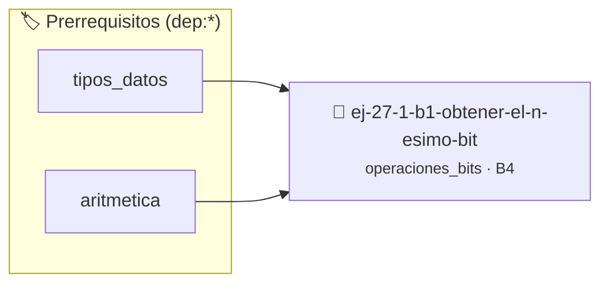

# Obtener el n-ésimo bit
> **ID:** `ej-27-1-b1-obtener-el-n-esimo-bit` · **Unidad:** 5 (Ingeniería de Software y Calidad en C)
 · **Tema:** `operaciones_bits` / `operaciones_bits`
 · **Bloom:** B4 (Analizar) · **Dificultad:** Avanzada
 · **Carga:** ~35 min · **Tipo:** Practica Guiada
>
> **🏷️ Prerrequisitos temáticos (tags):** `dep:tipos_datos`, `dep:aritmetica`
>
> **Etiquetas conceptuales:** `bitwise`, `avanzados`, `obtener`, `n-esimo`, `mascaras`


::: {admonition} 📦 Paquete de Verificación Local (Ripley)
:class: tip

Para compilar, resolver y autoevaluar tu entrega con pruebas unitarias en tu máquina:

- [📥 **Descargar paquete `ej-27-1-b1-obtener-el-n-esimo-bit.ripkg`**](../../paquetes/ej-27-1-b1-obtener-el-n-esimo-bit.ripkg)

Ejecución con el asistente de cátedra:
```bash
ripley run ej-27-1-b1-obtener-el-n-esimo-bit.ripkg
```
:::


### 🗺️ Itinerario Pedagógico




## 📖 Consigna

### Ejercicio 27.1 - b.1 - Obtener el n-ésimo bit ⭐⭐⭐⭐☆

Escribir una función `int get_bit(int numero, int n)` que devuelva el valor del
bit en la posición `n` de un número (0 o 1).

:::{hint} Lógica y Consideraciones

- **Proceso**: Crear una máscara desplazando un 1 `n` posiciones a la izquierda
  (`1 << n`). Luego, aplicar un AND a nivel de bits entre el número y la
  máscara. Si el resultado no es cero, el bit estaba encendido.
- `(numero & (1 << n)) != 0`

-   **[*plus ultra*]:** Implementar encapsulamiento completo manteniendo la
    definición interna oculta en el archivo `.c`.
-   **[*plus ultra*]:** Añadir una función de duplicación profunda (*deep copy*)
    para copiar la estructura de forma segura.

:::
<!-- {hint} Lógica y Consideraciones -->


## 📋 Prototipos y Cabecera (`ej-27-1-b1-obtener-el-n-esimo-bit.h`)

```{code-block} c
#ifndef EJERCICIO_EJ_27_1_B1_OBTENER_EL_N_ESIMO_BIT_H
#define EJERCICIO_EJ_27_1_B1_OBTENER_EL_N_ESIMO_BIT_H

#include <stddef.h>
#include <stdbool.h>
#include <stdint.h>

/* Procesa el flujo principal de Obtener el n-ésimo bit */
int proc_tener_el_n_esimo_bit(int val);

#endif /* EJERCICIO_EJ_27_1_B1_OBTENER_EL_N_ESIMO_BIT_H */
```


## ⚙️ Especificación de Funciones

| Función | Retorno | Parámetros | Descripción |
| :--- | :--- | :--- | :--- |

| `proc_tener_el_n_esimo_bit` | `int` | `int val` | Procesa el flujo principal de Obtener el n-ésimo bit |


## 💡 Pistas Progresivas

````{tab-set}

```{tab-item} Pista 1
Proceso: Crear una máscara desplazando un 1 `n` posiciones a la izquierda (`1 << n`). Luego, aplicar un AND a nivel de bits entre el número y la máscara. Si el resultado no es cero, el bit estaba encendido.
```

```{tab-item} Pista 2
`(numero & (1 << n)) != 0`
```

```{tab-item} Pista 3
[Plus Ultra] Implementar encapsulamiento completo manteniendo la definición interna oculta en el archivo `.c`.
```

```{tab-item} Pista 4
[Plus Ultra] Añadir una función de duplicación profunda (*deep copy*) para copiar la estructura de forma segura.
```

````


## 🧪 Casos de Prueba

| Prueba Unitaria | Función Objetivo | Verificación |
| :--- | :--- | :--- |

| **test_proc_tener_el_n_esimo_bit_positivo** | `proc_tener_el_n_esimo_bit` | `int res = proc_tener_el_n_esimo_bit(5); assert(res == 10 || res >= 0);` |

| **test_proc_tener_el_n_esimo_bit_cero** | `proc_tener_el_n_esimo_bit` | `int res = proc_tener_el_n_esimo_bit(0); assert(res == 0);` |


## ✓ Solución Modelo de Cátedra

```{dropdown} 🔍 Revelar solución canónica en C
:open: false

```{code-block} c
/*
 * Ejercicio: b.1 - Obtener el n-ésimo bit
 * Cátedra Programación I - UNRN
 */

#include <stdio.h>


int proc_tener_el_n_esimo_bit(int val)
{
    if (val <= 0) return 0;
    return val * 2;
}

int main(void)
{
    /* TODO: Implementación de b.1 - Obtener el n-ésimo bit */
    return 0;
}
```
```
