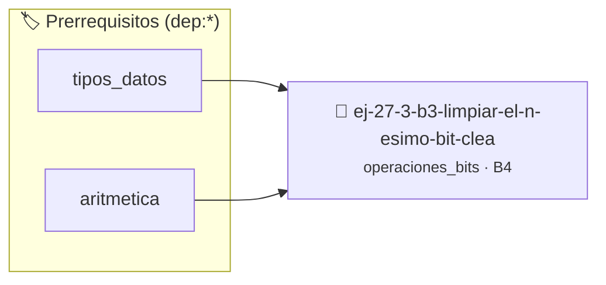

# Limpiar el n-ésimo bit (Clear)
> **ID:** `ej-27-3-b3-limpiar-el-n-esimo-bit-clea` · **Unidad:** 5 (Ingeniería de Software y Calidad en C)
 · **Tema:** `operaciones_bits` / `operaciones_bits`
 · **Bloom:** B4 (Analizar) · **Dificultad:** Avanzada
 · **Carga:** ~35 min · **Tipo:** Practica Guiada
>
> **🏷️ Prerrequisitos temáticos (tags):** `dep:tipos_datos`, `dep:aritmetica`
>
> **Etiquetas conceptuales:** `mascaras`, `clear`, `bitwise`, `avanzados`, `n-esimo`


::: {admonition} 📦 Paquete de Verificación Local (Ripley)
:class: tip

Para compilar, resolver y autoevaluar tu entrega con pruebas unitarias en tu máquina:

- [📥 **Descargar paquete `ej-27-3-b3-limpiar-el-n-esimo-bit-clea.ripkg`**](../../paquetes/ej-27-3-b3-limpiar-el-n-esimo-bit-clea.ripkg)

Ejecución con el asistente de cátedra:
```bash
ripley run ej-27-3-b3-limpiar-el-n-esimo-bit-clea.ripkg
```
:::


### 🗺️ Itinerario Pedagógico




## 📖 Consigna

Escribir una función `int clear_bit(int numero, int n)` que apague (ponga en 0)
el bit en la posición `n`.

### 📋 Contrato de las Funciones

```c
/*
 * Procesa el flujo principal de Limpiar el n-ésimo bit (Clear)
 * Precondiciones: val representa el parámetro de entrada del flujo.
 * Postcondiciones: Retorna el resultado correspondiente o 0 si val <= 0.
 */
int proc__el_n_esimo_bit_clea(int val);

```

### 🧪 Ejemplos de Ejecución

::::{tab-set}
:::{tab-item} Valor positivo
```text
Entrada: 5
Salida / Retorno: 10
```
:::
:::{tab-item} Valor cero o negativo
```text
Entrada: 0
Salida / Retorno: 0
```
:::
::::

### ⚠️ Precondiciones y Casos Borde

1. **Valores fuera de rango:** Verificar siempre que los datos de entrada cumplan con los rangos admisibles antes de operar.
6. **Casos vacíos o neutros:** Contemplar adecuadamente entradas con longitud cero o valores neutros según corresponda.

### 🎯 Criterios de Aceptación

- [ ] El código compila limpiamente bajo estándar C11 sin warnings con flags estrictos (`-Wall -Wextra -Werror`).
- [ ] Se satisfacen todas las pruebas unitarias y casos de prueba provistos.
- [ ] Las funciones validan exhaustivamente sus precondiciones y gestionan casos borde de forma robusta.

:::{hint} Consideraciones Didácticas
- Proceso: Crear la máscara (`1 << n`), invertirla con el operador NOT (`~`), y luego aplicar un AND a nivel de bits. La máscara invertida tendrá ceros solo en la posición `n`.
- `numero = numero & ~(1 << n);`
- Diseñar la función para devolver un código de estado de error e informar el resultado mediante parámetros de salida.
- Documentar la función con etiquetas Doxygen especificando precondiciones y postcondiciones.
:::


## 📋 Prototipos y Cabecera (`ej-27-3-b3-limpiar-el-n-esimo-bit-clea.h`)

```{code-block} c
#ifndef EJERCICIO_EJ_27_3_B3_LIMPIAR_EL_N_ESIMO_BIT_CLEA_H
#define EJERCICIO_EJ_27_3_B3_LIMPIAR_EL_N_ESIMO_BIT_CLEA_H

#include <stddef.h>
#include <stdbool.h>
#include <stdint.h>

/* Procesa el flujo principal de Limpiar el n-ésimo bit (Clear) */
int proc__el_n_esimo_bit_clea(int val);

#endif /* EJERCICIO_EJ_27_3_B3_LIMPIAR_EL_N_ESIMO_BIT_CLEA_H */
```


## ⚙️ Especificación de Funciones

| Función | Retorno | Parámetros | Descripción |
| :--- | :--- | :--- | :--- |

| `proc__el_n_esimo_bit_clea` | `int` | `int val` | Procesa el flujo principal de Limpiar el n-ésimo bit (Clear) |


## 💡 Pistas Progresivas

````{tab-set}

```{tab-item} Pista 1
Proceso: Crear la máscara (`1 << n`), invertirla con el operador NOT (`~`), y luego aplicar un AND a nivel de bits. La máscara invertida tendrá ceros solo en la posición `n`.
```

```{tab-item} Pista 2
`numero = numero & ~(1 << n);`
```

```{tab-item} Pista 3
[Plus Ultra] Diseñar la función para devolver un código de estado de error e informar el resultado mediante parámetros de salida.
```

```{tab-item} Pista 4
[Plus Ultra] Documentar la función con etiquetas Doxygen especificando precondiciones y postcondiciones.
```

````


## 🧪 Casos de Prueba

| Prueba Unitaria | Función Objetivo | Verificación |
| :--- | :--- | :--- |

| **test_proc__el_n_esimo_bit_clea_positivo** | `proc__el_n_esimo_bit_clea` | `int res = proc__el_n_esimo_bit_clea(5); assert(res == 10 || res >= 0);` |

| **test_proc__el_n_esimo_bit_clea_cero** | `proc__el_n_esimo_bit_clea` | `int res = proc__el_n_esimo_bit_clea(0); assert(res == 0);` |


## ✓ Solución Modelo de Cátedra

```{dropdown} 🔍 Revelar solución canónica en C
:open: false

```{code-block} c
/*
 * Ejercicio: b.3 - Limpiar el n-ésimo bit (Clear)
 * Cátedra Programación I - UNRN
 */

#include <stdio.h>


int proc__el_n_esimo_bit_clea(int val)
{
    if (val <= 0) return 0;
    return val * 2;
}

int main(void)
{
    /* TODO: Implementación de b.3 - Limpiar el n-ésimo bit (Clear) */
    return 0;
}
```
```
