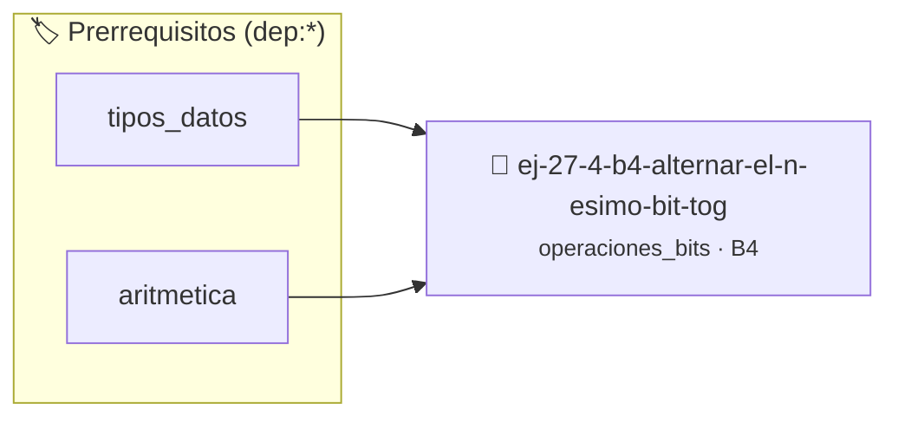

# Alternar el n-ésimo bit (Toggle)
> **ID:** `ej-27-4-b4-alternar-el-n-esimo-bit-tog`
 · **Tema:** `operaciones_bits`
 · **Bloom:** B4 (Analizar)
 · **Carga:** ~35 min
>
> **🏷️ Prerrequisitos temáticos (tags):** `dep:tipos_datos`, `dep:aritmetica`
>
> **Etiquetas conceptuales:** `toggle`, `alternar`, `bitwise`, `avanzados`, `n-esimo`


::: {admonition} 📦 Paquete de Verificación Local (Ripley)
:class: tip

Para compilar, resolver y autoevaluar tu entrega con pruebas unitarias en tu máquina:

- [📥 **Descargar paquete `ej-27-4-b4-alternar-el-n-esimo-bit-tog.ripkg`**](../../paquetes/ej-27-4-b4-alternar-el-n-esimo-bit-tog.ripkg)

Ejecución con el asistente de cátedra:
```bash
ripley run ej-27-4-b4-alternar-el-n-esimo-bit-tog.ripkg
```
:::


### 🗺️ Itinerario Pedagógico




## 📖 Consigna

### Ejercicio 27.4 - b.4 - Alternar el n-ésimo bit (Toggle) ⭐⭐⭐⭐☆

Escribir una función `int toggle_bit(int numero, int n)` que invierta el valor
del bit en la posición `n` (de 0 a 1, o de 1 a 0).

:::{hint} Lógica y Consideraciones

- **Proceso**: Crear la máscara (`1 << n`) y aplicar un XOR a nivel de bits. El
  XOR con 1 invierte un bit, mientras que el XOR con 0 lo deja igual.
- `numero = numero ^ (1 << n);`

-   **[*plus ultra*]:** Diseñar la función para devolver un código de estado de
    error e informar el resultado mediante parámetros de salida.
-   **[*plus ultra*]:** Documentar la función con etiquetas Doxygen
    especificando precondiciones y postcondiciones.

:::
<!-- {hint} Lógica y Consideraciones -->

## Algoritmos con Bits


## 📋 Prototipos y Cabecera (`ej-27-4-b4-alternar-el-n-esimo-bit-tog.h`)

```{code-block} c
#ifndef EJERCICIO_EJ_27_4_B4_ALTERNAR_EL_N_ESIMO_BIT_TOG_H
#define EJERCICIO_EJ_27_4_B4_ALTERNAR_EL_N_ESIMO_BIT_TOG_H

#include <stddef.h>
#include <stdbool.h>
#include <stdint.h>

/* Procesa el flujo principal de Alternar el n-ésimo bit (Toggle) */
int proc_r_el_n_esimo_bit_tog(int val);

#endif /* EJERCICIO_EJ_27_4_B4_ALTERNAR_EL_N_ESIMO_BIT_TOG_H */
```


## ⚙️ Especificación de Funciones

| Función | Retorno | Parámetros | Descripción |
| :--- | :--- | :--- | :--- |

| `proc_r_el_n_esimo_bit_tog` | `int` | `int val` | Procesa el flujo principal de Alternar el n-ésimo bit (Toggle) |


## 💡 Pistas Progresivas

````{tab-set}

```{tab-item} Pista 1
Proceso: Crear la máscara (`1 << n`) y aplicar un XOR a nivel de bits. El XOR con 1 invierte un bit, mientras que el XOR con 0 lo deja igual.
```

```{tab-item} Pista 2
`numero = numero ^ (1 << n);`
```

```{tab-item} Pista 3
[Plus Ultra] Diseñar la función para devolver un código de estado de error e informar el resultado mediante parámetros de salida.
```

```{tab-item} Pista 4
[Plus Ultra] Documentar la función con etiquetas Doxygen especificando precondiciones y postcondiciones.
```

````


## 🧪 Casos de Prueba

| Prueba Unitaria | Función Objetivo | Verificación |
| :--- | :--- | :--- |

| **test_proc_r_el_n_esimo_bit_tog_positivo** | `proc_r_el_n_esimo_bit_tog` | `int res = proc_r_el_n_esimo_bit_tog(5); assert(res == 10 || res >= 0);` |

| **test_proc_r_el_n_esimo_bit_tog_cero** | `proc_r_el_n_esimo_bit_tog` | `int res = proc_r_el_n_esimo_bit_tog(0); assert(res == 0);` |


## ✓ Solución Modelo de Cátedra

```{dropdown} 🔍 Revelar solución canónica en C
:open: false

```{code-block} c
/*
 * Ejercicio: b.4 - Alternar el n-ésimo bit (Toggle)
 * Cátedra Programación I - UNRN
 */

#include <stdio.h>


int proc_r_el_n_esimo_bit_tog(int val)
{
    if (val <= 0) return 0;
    return val * 2;
}

int main(void)
{
    /* TODO: Implementación de b.4 - Alternar el n-ésimo bit (Toggle) */
    return 0;
}
```
```
