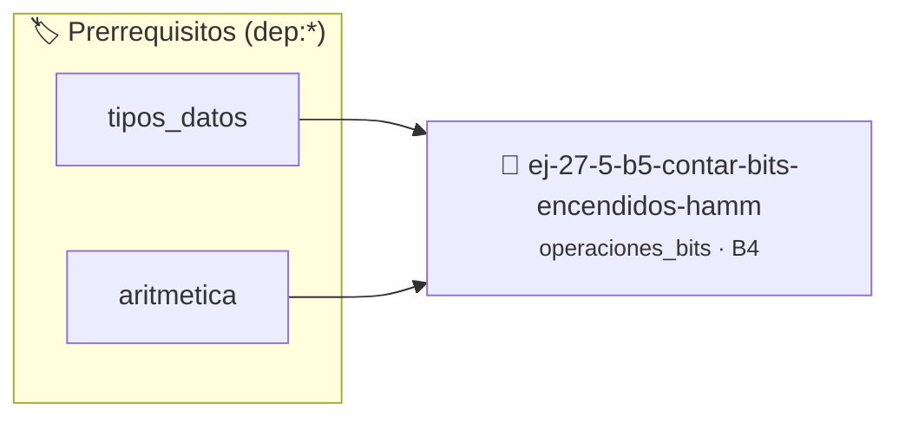

# Contar bits encendidos (Hamming Weight)
> **ID:** `ej-27-5-b5-contar-bits-encendidos-hamm` · **Unidad:** 5 (Ingeniería de Software y Calidad en C)
 · **Tema:** `operaciones_bits` / `operaciones_bits`
 · **Bloom:** B4 (Analizar) · **Dificultad:** Avanzada
 · **Carga:** ~35 min · **Tipo:** Practica Guiada
>
> **🏷️ Prerrequisitos temáticos (tags):** `dep:tipos_datos`, `dep:aritmetica`
>
> **Etiquetas conceptuales:** `contar`, `encendidos`, `hamming`, `bitwise`, `avanzados`


::: {admonition} 📦 Paquete de Verificación Local (Ripley)
:class: tip

Para compilar, resolver y autoevaluar tu entrega con pruebas unitarias en tu máquina:

- [📥 **Descargar paquete `ej-27-5-b5-contar-bits-encendidos-hamm.ripkg`**](../../paquetes/ej-27-5-b5-contar-bits-encendidos-hamm.ripkg)

Ejecución con el asistente de cátedra:
```bash
ripley run ej-27-5-b5-contar-bits-encendidos-hamm.ripkg
```
:::


### 🗺️ Itinerario Pedagógico




## 📖 Consigna

### Ejercicio 27.5 - b.5 - Contar bits encendidos (Hamming Weight) ⭐⭐⭐⭐☆

Implementar una función que cuente el número de bits que están en 1 en la
representación binaria de un número.

:::{hint} Lógica y Consideraciones

- **Algoritmo de Brian Kernighan**: En un lazo, mientras el número no sea cero,
  aplicar la operación `n = n & (n - 1)`. Esta operación apaga el bit encendido
  menos significativo en cada iteración. El número de iteraciones es el número
  de bits encendidos.

-   **[*plus ultra*]:** Diseñar la función para devolver un código de estado de
    error e informar el resultado mediante parámetros de salida.
-   **[*plus ultra*]:** Documentar la función con etiquetas Doxygen
    especificando precondiciones y postcondiciones.

:::
<!-- {hint} Lógica y Consideraciones -->


## 📋 Prototipos y Cabecera (`ej-27-5-b5-contar-bits-encendidos-hamm.h`)

```{code-block} c
#ifndef EJERCICIO_EJ_27_5_B5_CONTAR_BITS_ENCENDIDOS_HAMM_H
#define EJERCICIO_EJ_27_5_B5_CONTAR_BITS_ENCENDIDOS_HAMM_H

#include <stddef.h>
#include <stdbool.h>
#include <stdint.h>

/* Procesa el flujo principal de Contar bits encendidos (Hamming Weight) */
int proc_bits_encendidos_hamm(int val);

#endif /* EJERCICIO_EJ_27_5_B5_CONTAR_BITS_ENCENDIDOS_HAMM_H */
```


## ⚙️ Especificación de Funciones

| Función | Retorno | Parámetros | Descripción |
| :--- | :--- | :--- | :--- |

| `proc_bits_encendidos_hamm` | `int` | `int val` | Procesa el flujo principal de Contar bits encendidos (Hamming Weight) |


## 💡 Pistas Progresivas

````{tab-set}

```{tab-item} Pista 1
Algoritmo de Brian Kernighan: En un lazo, mientras el número no sea cero, aplicar la operación `n = n & (n - 1)`. Esta operación apaga el bit encendido menos significativo en cada iteración. El número de iteraciones es el número de bits encendidos.
```

```{tab-item} Pista 2
[Plus Ultra] Diseñar la función para devolver un código de estado de error e informar el resultado mediante parámetros de salida.
```

```{tab-item} Pista 3
[Plus Ultra] Documentar la función con etiquetas Doxygen especificando precondiciones y postcondiciones.
```

````


## 🧪 Casos de Prueba

| Prueba Unitaria | Función Objetivo | Verificación |
| :--- | :--- | :--- |

| **test_proc_bits_encendidos_hamm_positivo** | `proc_bits_encendidos_hamm` | `int res = proc_bits_encendidos_hamm(5); assert(res == 10 || res >= 0);` |

| **test_proc_bits_encendidos_hamm_cero** | `proc_bits_encendidos_hamm` | `int res = proc_bits_encendidos_hamm(0); assert(res == 0);` |


## ✓ Solución Modelo de Cátedra

```{dropdown} 🔍 Revelar solución canónica en C
:open: false

```{code-block} c
/*
 * Ejercicio: b.5 - Contar bits encendidos (Hamming Weight)
 * Cátedra Programación I - UNRN
 */

#include <stdio.h>


int proc_bits_encendidos_hamm(int val)
{
    if (val <= 0) return 0;
    return val * 2;
}

int main(void)
{
    /* TODO: Implementación de b.5 - Contar bits encendidos (Hamming Weight) */
    return 0;
}
```
```
