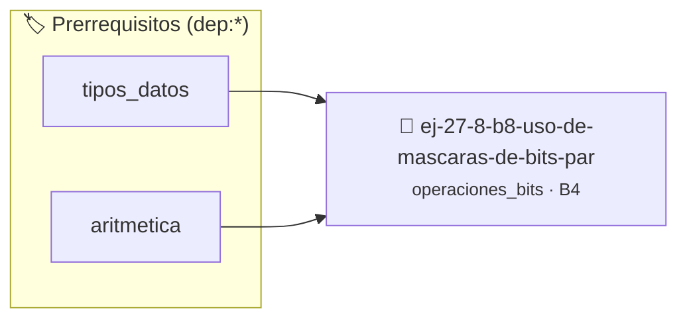

# Uso de máscaras de bits para permisos
> **ID:** `ej-27-8-b8-uso-de-mascaras-de-bits-par`
 · **Tema:** `operaciones_bits`
 · **Bloom:** B4 (Analizar)
 · **Carga:** ~35 min
>
> **🏷️ Prerrequisitos temáticos (tags):** `dep:tipos_datos`, `dep:aritmetica`
>
> **Etiquetas conceptuales:** `permisos`, `bitwise`, `avanzados`, `mascaras`


::: {admonition} 📦 Paquete de Verificación Local (Ripley)
:class: tip

Para compilar, resolver y autoevaluar tu entrega con pruebas unitarias en tu máquina:

- [📥 **Descargar paquete `ej-27-8-b8-uso-de-mascaras-de-bits-par.ripkg`**](../../paquetes/ej-27-8-b8-uso-de-mascaras-de-bits-par.ripkg)

Ejecución con el asistente de cátedra:
```bash
ripley run ej-27-8-b8-uso-de-mascaras-de-bits-par.ripkg
```
:::


### 🗺️ Itinerario Pedagógico




## 📖 Consigna

### Ejercicio 27.8 - b.8 - Uso de máscaras de bits para permisos ⭐⭐⭐⭐☆

Simular un sistema de permisos de archivo (Lectura, Escritura, Ejecución) usando
una sola variable `unsigned char`.

:::{hint} Lógica y Consideraciones

- **Definir Máscaras**: `#define LECTURA 1<<0`, `#define ESCRITURA 1<<1`,
  `#define EJECUCION 1<<2`
- **Añadir Permiso**: `permisos = permisos | ESCRITURA;`
- **Quitar Permiso**: `permisos = permisos & ~EJECUCION;`
- **Verificar Permiso**: `if (permisos & LECTURA) { ... }`

-   **[*plus ultra*]:** Garantizar la terminación con `\0` y prevenir
    desbordamientos de búfer validando la capacidad máxima.
-   **[*plus ultra*]:** Soportar la lectura de cadenas con espacios y múltiples
    líneas de manera robusta.

:::
<!-- {hint} Lógica y Consideraciones -->


## 📋 Prototipos y Cabecera (`ej-27-8-b8-uso-de-mascaras-de-bits-par.h`)

```{code-block} c
#ifndef EJERCICIO_EJ_27_8_B8_USO_DE_MASCARAS_DE_BITS_PAR_H
#define EJERCICIO_EJ_27_8_B8_USO_DE_MASCARAS_DE_BITS_PAR_H

#include <stddef.h>
#include <stdbool.h>
#include <stdint.h>

/* Procesa el flujo principal de Uso de máscaras de bits para permisos */
int proc_mascaras_de_bits_par(int val);

#endif /* EJERCICIO_EJ_27_8_B8_USO_DE_MASCARAS_DE_BITS_PAR_H */
```


## ⚙️ Especificación de Funciones

| Función | Retorno | Parámetros | Descripción |
| :--- | :--- | :--- | :--- |

| `proc_mascaras_de_bits_par` | `int` | `int val` | Procesa el flujo principal de Uso de máscaras de bits para permisos |


## 💡 Pistas Progresivas

````{tab-set}

```{tab-item} Pista 1
Definir Máscaras: `#define LECTURA 1<<0`, `#define ESCRITURA 1<<1`, `#define EJECUCION 1<<2`
```

```{tab-item} Pista 2
Añadir Permiso: `permisos = permisos | ESCRITURA;`
```

```{tab-item} Pista 3
Quitar Permiso: `permisos = permisos & ~EJECUCION;`
```

```{tab-item} Pista 4
Verificar Permiso: `if (permisos & LECTURA) { ... }`
```

```{tab-item} Pista 5
[Plus Ultra] Garantizar la terminación con `\0` y prevenir desbordamientos de búfer validando la capacidad máxima.
```

```{tab-item} Pista 6
[Plus Ultra] Soportar la lectura de cadenas con espacios y múltiples líneas de manera robusta.
```

````


## 🧪 Casos de Prueba

| Prueba Unitaria | Función Objetivo | Verificación |
| :--- | :--- | :--- |

| **test_proc_mascaras_de_bits_par_positivo** | `proc_mascaras_de_bits_par` | `int res = proc_mascaras_de_bits_par(5); assert(res == 10 || res >= 0);` |

| **test_proc_mascaras_de_bits_par_cero** | `proc_mascaras_de_bits_par` | `int res = proc_mascaras_de_bits_par(0); assert(res == 0);` |


## ✓ Solución Modelo de Cátedra

```{dropdown} 🔍 Revelar solución canónica en C
:open: false

```{code-block} c
/*
 * Ejercicio: b.8 - Uso de máscaras de bits para permisos
 * Cátedra Programación I - UNRN
 */

#include <stdio.h>


int proc_mascaras_de_bits_par(int val)
{
    if (val <= 0) return 0;
    return val * 2;
}

int main(void)
{
    /* TODO: Implementación de b.8 - Uso de máscaras de bits para permisos */
    return 0;
}
```
```
