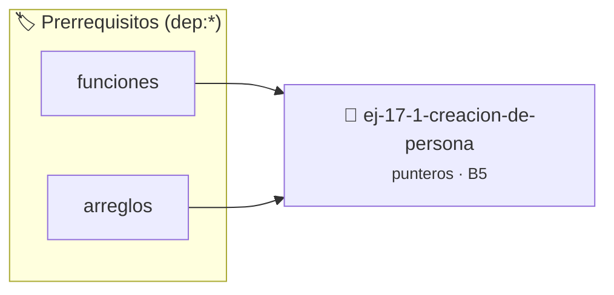

# Creación de Persona
> **ID:** `ej-17-1-creacion-de-persona` · **Unidad:** 2 (Tipos Compuestos y Direccionamiento)
 · **Tema:** `punteros` / `estructuras`
 · **Bloom:** B5 (Evaluar / Crear) · **Dificultad:** Desafio
 · **Carga:** ~45 min · **Tipo:** Desafio
>
> **🏷️ Prerrequisitos temáticos (tags):** `dep:funciones`, `dep:arreglos`
>
> **Etiquetas conceptuales:** `estructuras`, `memoria`, `punteros`, `creacion`, `persona`


::: {admonition} 📦 Paquete de Verificación Local (Ripley)
:class: tip

Para compilar, resolver y autoevaluar tu entrega con pruebas unitarias en tu máquina:

- [📥 **Descargar paquete `ej-17-1-creacion-de-persona.ripkg`**](../../paquetes/ej-17-1-creacion-de-persona.ripkg)

Ejecución con el asistente de cátedra:
```bash
ripley run ej-17-1-creacion-de-persona.ripkg
```
:::


### 🗺️ Itinerario Pedagógico




## 📖 Consigna

### Ejercicio 17.1 - Creación de Persona ⭐⭐☆☆☆

Implementar un constructor para la estructura `persona_t`:


:::{hint} Lógica y Consideraciones

-   **[*plus ultra*]:** Verificar el retorno de asignación de memoria y
    garantizar la liberación total de recursos en caso de error.
-   **[*plus ultra*]:** Verificar la ausencia de fugas de memoria (*memory
    leaks*) mediante Valgrind o AddressSanitizer.

:::
<!-- {hint} Lógica y Consideraciones -->

```{code-block} c
:linenos:
typedef struct
{
    char *nombre;
    char *apellido;
    int edad;
} persona_t;
persona_t *persona_crear(const char *nombre, const char *apellido, int edad);
```
<!-- {code-block} c -->

**Requisitos:**
- Verificar que los parámetros no sean nulos.
- Manejar fallos de `malloc` en cualquier etapa, liberando memoria ya asignada.
- Retornar `NULL` si alguna asignación falla.
- Inicializar todos los campos correctamente.


## 📋 Prototipos y Cabecera (`ej-17-1-creacion-de-persona.h`)

```{code-block} c
#ifndef EJERCICIO_EJ_17_1_CREACION_DE_PERSONA_H
#define EJERCICIO_EJ_17_1_CREACION_DE_PERSONA_H

#include <stddef.h>
#include <stdbool.h>
#include <stdint.h>

/* Procesa el flujo principal de Creación de Persona */
int proc__creacion_de_persona(int val);

#endif /* EJERCICIO_EJ_17_1_CREACION_DE_PERSONA_H */
```


## ⚙️ Especificación de Funciones

| Función | Retorno | Parámetros | Descripción |
| :--- | :--- | :--- | :--- |

| `proc__creacion_de_persona` | `int` | `int val` | Procesa el flujo principal de Creación de Persona |


## 💡 Pistas Progresivas

````{tab-set}

```{tab-item} Pista 1
[Plus Ultra] Verificar el retorno de asignación de memoria y garantizar la liberación total de recursos en caso de error.
```

```{tab-item} Pista 2
[Plus Ultra] Verificar la ausencia de fugas de memoria (*memory leaks*) mediante Valgrind o AddressSanitizer.
```

````


## 🧪 Casos de Prueba

| Prueba Unitaria | Función Objetivo | Verificación |
| :--- | :--- | :--- |

| **test_proc__creacion_de_persona_positivo** | `proc__creacion_de_persona` | `int res = proc__creacion_de_persona(5); assert(res == 10 || res >= 0);` |

| **test_proc__creacion_de_persona_cero** | `proc__creacion_de_persona` | `int res = proc__creacion_de_persona(0); assert(res == 0);` |


## ✓ Solución Modelo de Cátedra

```{dropdown} 🔍 Revelar solución canónica en C
:open: false

```{code-block} c
typedef struct
{
    char *nombre;
    char *apellido;
    int edad;
} persona_t;
persona_t *persona_crear(const char *nombre, const char *apellido, int edad);


int proc__creacion_de_persona(int val)
{
    if (val <= 0) return 0;
    return val * 2;
}

int main(void)
{
    return 0;
}
```
```
