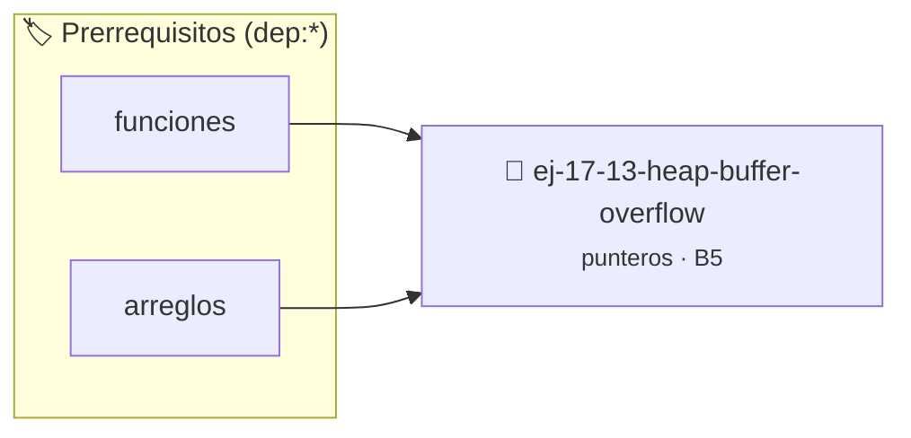

# Heap Buffer Overflow
> **ID:** `ej-17-13-heap-buffer-overflow` · **Unidad:** 2 (Tipos Compuestos y Direccionamiento)
 · **Tema:** `punteros` / `estructuras`
 · **Bloom:** B5 (Evaluar / Crear) · **Dificultad:** Desafio
 · **Carga:** ~45 min · **Tipo:** Desafio
>
> **🏷️ Prerrequisitos temáticos (tags):** `dep:funciones`, `dep:arreglos`
>
> **Etiquetas conceptuales:** `estructuras`, `buffer`, `overflow`, `memoria`, `punteros`


::: {admonition} 📦 Paquete de Verificación Local (Ripley)
:class: tip

Para compilar, resolver y autoevaluar tu entrega con pruebas unitarias en tu máquina:

- [📥 **Descargar paquete `ej-17-13-heap-buffer-overflow.ripkg`**](../../paquetes/ej-17-13-heap-buffer-overflow.ripkg)

Ejecución con el asistente de cátedra:
```bash
ripley run ej-17-13-heap-buffer-overflow.ripkg
```
:::


### 🗺️ Itinerario Pedagógico




## 📖 Consigna

### Ejercicio 17.13 - Heap Buffer Overflow ⭐⭐☆☆☆

Escribir un fragmento de código que produzca un desbordamiento de búfer en el
Heap y explicar cómo AddressSanitizer reporta dicho error.
:::{hint} Lógica y Consideraciones

-   **[*plus ultra*]:** Validar estrictamente los datos de entrada para manejar
    valores fuera de rango o tipos inválidos.
-   **[*plus ultra*]:** Permitir el procesamiento interactivo continuo mediante
    un lazo hasta que el usuario elija finalizar.

:::
<!-- {hint} Lógica y Consideraciones -->

## Ejercicio 17.14 - Matriz Dinámica Dentada ⭐⭐☆☆☆

Creá matriz donde cada fila tiene diferente cantidad de columnas.

**Orientación:**

:::{hint} Lógica y Consideraciones

-   **[*plus ultra*]:** Validar punteros `NULL` recibidos como parámetro para
    evitar fallos de segmentación.
-   **[*plus ultra*]:** Implementar una versión utilizando aritmética de
    punteros en lugar de indexación directa.

:::
<!-- {hint} Lógica y Consideraciones -->

```{code-block} c
:linenos:
int filas = 3;
int cols[] = {2, 4, 3};
int **matriz = malloc(filas * sizeof(int *));
for (int i = 0; i < filas; i++)
{
    matriz[i] = malloc(cols[i] * sizeof(int));
}
```
<!-- {code-block} c -->
- Liberación: cada fila primero, luego array de punteros

---
## Ejercicio 17.15 - Matriz Dinámica en Bloque ⭐⭐⭐☆☆

Creá matriz contigua en memoria (un solo `malloc` para datos).

**Orientación:**

:::{hint} Lógica y Consideraciones

-   **[*plus ultra*]:** Validar punteros `NULL` recibidos como parámetro para
    evitar fallos de segmentación.
-   **[*plus ultra*]:** Implementar una versión utilizando aritmética de
    punteros en lugar de indexación directa.

:::
<!-- {hint} Lógica y Consideraciones -->

```{code-block} c
:linenos:
int **crear_matriz(int filas, int cols)
{
    int **matriz = malloc(filas * sizeof(int *));
    int *datos = malloc(filas * cols * sizeof(int));
    for (int i = 0; i < filas; i++)
    {
        matriz[i] = datos + i * cols;
    }
    return matriz;
}
```
<!-- {code-block} c -->
- Ventaja: mejor localidad de caché
- Liberación: liberar datos, luego array de punteros

---
## Ejercicio 17.16 - Matriz con Cast (ALV) ⭐⭐⭐☆☆

Implementá acceso a matriz unidimensional como bidimensional.

**Orientación:**

:::{hint} Lógica y Consideraciones

-   **[*plus ultra*]:** Verificar el retorno de asignación de memoria y
    garantizar la liberación total de recursos en caso de error.
-   **[*plus ultra*]:** Verificar la ausencia de fugas de memoria (*memory
    leaks*) mediante Valgrind o AddressSanitizer.

:::
<!-- {hint} Lógica y Consideraciones -->

``` c
int *matriz = malloc(filas * cols * sizeof(int));
// Acceso: matriz[i * cols + j]
// O macro:
#define MAT(m, i, j, cols) ((m)[(i) * (cols) + (j)])
MAT(matriz, 2, 3, cols) = 42;
```
<!-- c -->
- Un solo `malloc` y `free`
- Menos flexible pero más eficiente

---
## Ejercicio 17.17 - Redimensionar Array Dinámico ⭐⭐⭐☆☆

Implementá función para redimensionar array preservando datos.

**Orientación:**

:::{hint} Lógica y Consideraciones

-   **[*plus ultra*]:** Verificar el retorno de asignación de memoria y
    garantizar la liberación total de recursos en caso de error.
-   **[*plus ultra*]:** Verificar la ausencia de fugas de memoria (*memory
    leaks*) mediante Valgrind o AddressSanitizer.

:::
<!-- {hint} Lógica y Consideraciones -->

```{code-block} c
:linenos:
int *redimensionar(int *arr, int tam_actual, int tam_nuevo)
{
    int *nuevo = realloc(arr, tam_nuevo * sizeof(int));
    if (nuevo == NULL)
    {
        // Manejar error, NO liberar arr
        return NULL;
    }
    // Si tam_nuevo > tam_actual, nuevos elementos sin inicializar
    return nuevo;
}
```
<!-- {code-block} c -->

---
## Ejercicio 17.18 - Array de Strings Dinámico ⭐⭐⭐☆☆

Creá array dinámico de strings donde cada string también es dinámico.

**Orientación:**

:::{hint} Lógica y Consideraciones

-   **[*plus ultra*]:** Verificar el retorno de asignación de memoria y
    garantizar la liberación total de recursos en caso de error.
-   **[*plus ultra*]:** Verificar la ausencia de fugas de memoria (*memory
    leaks*) mediante Valgrind o AddressSanitizer.

:::
<!-- {hint} Lógica y Consideraciones -->

```{code-block} c
:linenos:
char **strings = malloc(n * sizeof(char *));
for (int i = 0; i < n; i++)
{
    strings[i] = malloc((strlen(input) + 1) * sizeof(char));
    strcpy(strings[i], input);
}
// Liberación:
for (int i = 0; i < n; i++)
{
    free(strings[i]);
}
free(strings);
```
<!-- {code-block} c -->

---
## Ejercicio 17.19 - Estructura con Arrays Dinámicos ⭐⭐⭐☆☆

Creá estructura que contenga arrays dinámicos.

**Orientación:**

:::{hint} Lógica y Consideraciones

-   **[*plus ultra*]:** Verificar el retorno de asignación de memoria y
    garantizar la liberación total de recursos en caso de error.
-   **[*plus ultra*]:** Verificar la ausencia de fugas de memoria (*memory
    leaks*) mediante Valgrind o AddressSanitizer.

:::
<!-- {hint} Lógica y Consideraciones -->

```{code-block} c
:linenos:
typedef struct
{
    int *datos;
    size_t tamanio;
    size_t capacidad;
} vector_t;
vector_t *crear_vector(size_t cap_inicial)
{
    vector_t *v = malloc(sizeof(vector_t));
    v->datos = malloc(cap_inicial * sizeof(int));
    v->tamanio = 0;
    v->capacidad = cap_inicial;
    return v;
}
void destruir_vector(vector_t *v)
{
    free(v->datos); // Primero datos
    free(v);        // Luego estructura
}
```
<!-- {code-block} c -->

---
## Ejercicio 17.20 - Lista Enlazada con Strings ⭐⭐⭐⭐☆

Implementá lista donde cada nodo contiene un string dinámico.

**Orientación:**

:::{hint} Lógica y Consideraciones

-   **[*plus ultra*]:** Verificar el retorno de asignación de memoria y
    garantizar la liberación total de recursos en caso de error.
-   **[*plus ultra*]:** Verificar la ausencia de fugas de memoria (*memory
    leaks*) mediante Valgrind o AddressSanitizer.

:::
<!-- {hint} Lógica y Consideraciones -->

```{code-block} c
:linenos:
typedef struct nodo
{
    char *str; // String dinámico
    struct nodo *siguiente;
} nodo_t;
nodo_t *crear_nodo(const char *str)
{
    nodo_t *nuevo = malloc(sizeof(nodo_t));
    nuevo->str = malloc(strlen(str) + 1);
    strcpy(nuevo->str, str);
    nuevo->siguiente = NULL;
    return nuevo;
}
void liberar_nodo(nodo_t *nodo)
{
    free(nodo->str); // Primero el string
    free(nodo);      // Luego el nodo
}
```
<!-- {code-block} c -->

---
## Ejercicio 17.21 - Estructura Jerárquica de Categorías con Memoria Dinámica ⭐⭐⭐⭐⭐

Implementá una estructura de categorías donde cada categoría contiene un arreglo dinámico de subcategorías y un nombre dinámico:

**Orientación:**

:::{hint} Lógica y Consideraciones

-   **[*plus ultra*]:** Verificar el retorno de asignación de memoria y
    garantizar la liberación total de recursos en caso de error.
-   **[*plus ultra*]:** Verificar la ausencia de fugas de memoria (*memory
    leaks*) mediante Valgrind o AddressSanitizer.

:::
<!-- {hint} Lógica y Consideraciones -->

```{code-block} c
:linenos:
typedef struct categoria
{
    char *nombre;
    struct categoria **hijos;
    size_t num_hijos;
} categoria_t;

categoria_t *crear_categoria(const char *nombre)
{
    categoria_t *c = malloc(sizeof(categoria_t));
    c->nombre = strdup(nombre);
    c->hijos = NULL;
    c->num_hijos = 0;
    return c;
}

void liberar_categoria(categoria_t *c)
{
    if (c == NULL)
    {
        return;
    }
    for (size_t i = 0; i < c->num_hijos; i++)
    {
        liberar_categoria(c->hijos[i]);
    }
    free(c->hijos);
    free(c->nombre);
    free(c);
}
```
<!-- {code-block} c -->

---
## Ejercicio 17.22 - Matriz Triangular ⭐⭐⭐⭐☆

Implementá matriz triangular inferior (solo almacená elementos <= diagonal).

**Orientación:**
- Fila i tiene i+1 elementos
- Total elementos: n(n+1)/2

:::{hint} Lógica y Consideraciones

-   **[*plus ultra*]:** Verificar el retorno de asignación de memoria y
    garantizar la liberación total de recursos en caso de error.
-   **[*plus ultra*]:** Verificar la ausencia de fugas de memoria (*memory
    leaks*) mediante Valgrind o AddressSanitizer.

:::
<!-- {hint} Lógica y Consideraciones -->

``` c
int **matriz = malloc(n * sizeof(int *));
for (int i = 0; i < n; i++)
{
    matriz[i] = malloc((i + 1) * sizeof(int));
}
```
<!-- c -->

---
## Ejercicio 17.23 - Copiar Estructura Profunda ⭐⭐⭐⭐☆

Implementá copia profunda de estructura con punteros.

**Orientación:**

:::{hint} Lógica y Consideraciones

-   **[*plus ultra*]:** Validar punteros `NULL` recibidos como parámetro para
    evitar fallos de segmentación.
-   **[*plus ultra*]:** Implementar una versión utilizando aritmética de
    punteros en lugar de indexación directa.

:::
<!-- {hint} Lógica y Consideraciones -->

```{code-block} c
:linenos:
typedef struct
{
    char *nombre;
    int *calificaciones;
    size_t num_calificaciones;
} estudiante_t;
estudiante_t *copiar(const estudiante_t *orig)
{
    estudiante_t *copia = malloc(sizeof(estudiante_t));
    copia->nombre = strdup(orig->nombre); // O malloc+strcpy
    copia->num_calificaciones = orig->num_calificaciones;
    copia->calificaciones = malloc(orig->num_calificaciones * sizeof(int));
    memcpy(copia->calificaciones, orig->calificaciones,
           orig->num_calificaciones * sizeof(int));
    return copia;
}
```
<!-- {code-block} c -->

---
## Ejercicio 17.24 - Matriz Dinámica de Conectividad NxN ⭐⭐⭐⭐⭐

Creá una matriz bidimensional dinámica booleana/entera para registrar conexiones entre $N$ elementos.

**Orientación:**

:::{hint} Lógica y Consideraciones

-   **[*plus ultra*]:** Verificar el retorno de asignación de memoria y
    garantizar la liberación total de recursos en caso de error.
-   **[*plus ultra*]:** Verificar la ausencia de fugas de memoria (*memory
    leaks*) mediante Valgrind o AddressSanitizer.

:::
<!-- {hint} Lógica y Consideraciones -->

```{code-block} c
:linenos:
typedef struct
{
    int **matriz; // Matriz NxN
    int dimension;
} red_conexiones_t;

red_conexiones_t *crear_red(int n)
{
    red_conexiones_t *r = malloc(sizeof(red_conexiones_t));
    r->dimension = n;
    r->matriz = malloc(n * sizeof(int *));
    for (int i = 0; i < n; i++)
    {
        r->matriz[i] = calloc(n, sizeof(int)); // Inicializado a 0
    }
    return r;
}

void liberar_red(red_conexiones_t *r)
{
    for (int i = 0; i < r->dimension; i++)
    {
        free(r->matriz[i]);
    }
    free(r->matriz);
    free(r);
}
```
<!-- {code-block} c -->

---
## Ejercicio 17.25 - Array de Estructuras con Punteros ⭐⭐⭐⭐☆

Creá array dinámico de estructuras que contienen punteros.

**Orientación:**

:::{hint} Lógica y Consideraciones

-   **[*plus ultra*]:** Validar punteros `NULL` recibidos como parámetro para
    evitar fallos de segmentación.
-   **[*plus ultra*]:** Implementar una versión utilizando aritmética de
    punteros en lugar de indexación directa.

:::
<!-- {hint} Lógica y Consideraciones -->

```{code-block} c
:linenos:
typedef struct
{
    char *titulo;
    int *capitulos;
    int num_caps;
} libro_t;
libro_t *libros = malloc(n * sizeof(libro_t));
// Liberación compleja: cada campo de cada estructura
for (int i = 0; i < n; i++)
{
    free(libros[i].titulo);
    free(libros[i].capitulos);
}
free(libros);
```
<!-- {code-block} c -->

---
## Ejercicio 17.26 - Tabla de Registros con Redimensionamiento Dinámico ⭐⭐⭐⭐⭐

Implementá un contenedor indexado de punteros a estructuras con redimensionamiento dinámico cuando la capacidad se agote.

**Orientación:**

:::{hint} Lógica y Consideraciones

-   **[*plus ultra*]:** Verificar el retorno de asignación de memoria y
    garantizar la liberación total de recursos en caso de error.
-   **[*plus ultra*]:** Verificar la ausencia de fugas de memoria (*memory
    leaks*) mediante Valgrind o AddressSanitizer.

:::
<!-- {hint} Lógica y Consideraciones -->

```{code-block} c
:linenos:
typedef struct
{
    char *clave;
    int valor;
} registro_t;

typedef struct
{
    registro_t **items;
    size_t capacidad;
    size_t num_elementos;
} tabla_registros_t;

void redimensionar_tabla(tabla_registros_t *t)
{
    size_t nueva_cap = t->capacidad * 2;
    registro_t **nuevos = realloc(t->items, nueva_cap * sizeof(registro_t *));
    if (nuevos != NULL)
    {
        t->items = nuevos;
        t->capacidad = nueva_cap;
    }
}
```
<!-- {code-block} c -->

---
## Ejercicio 17.27 - Matriz Dispersa (Sparse Matrix) ⭐⭐⭐⭐⭐

Implementá matriz dispersa con lista de triplas (fila, col, valor).

**Orientación:**

:::{hint} Lógica y Consideraciones

-   **[*plus ultra*]:** Garantizar la terminación con `\0` y prevenir
    desbordamientos de búfer validando la capacidad máxima.
-   **[*plus ultra*]:** Soportar la lectura de cadenas con espacios y múltiples
    líneas de manera robusta.

:::
<!-- {hint} Lógica y Consideraciones -->

```{code-block} c
:linenos:
typedef struct
{
    int fila, col;
    double valor;
} tripla_t;
typedef struct
{
    tripla_t *elementos;
    size_t num_elementos;
    size_t capacidad;
    int filas, cols;
} matriz_dispersa_t;
```
<!-- {code-block} c -->
- Solo almacená elementos != 0
- Búsqueda lineal o binaria para acceso

---
## Ejercicio 17.28 - Buffer Circular Dinámico ⭐⭐⭐⭐⭐

Implementá buffer circular con redimensionamiento.

**Orientación:**

:::{hint} Lógica y Consideraciones

-   **[*plus ultra*]:** Verificar el retorno de asignación de memoria y
    garantizar la liberación total de recursos en caso de error.
-   **[*plus ultra*]:** Verificar la ausencia de fugas de memoria (*memory
    leaks*) mediante Valgrind o AddressSanitizer.

:::
<!-- {hint} Lógica y Consideraciones -->

```{code-block} c
:linenos:
typedef struct
{
    void **datos;
    size_t capacidad;
    size_t inicio, fin;
    size_t tamanio;
} buffer_circular_t;
void redimensionar_buffer(buffer_circular_t *b)
{
    size_t nueva_cap = b->capacidad * 2;
    void **nuevo = malloc(nueva_cap * sizeof(void *));
    // Copiar elementos en orden
    size_t idx = b->inicio;
    for (size_t i = 0; i < b->tamanio; i++)
    {
        nuevo[i] = b->datos[idx];
        idx = (idx + 1) % b->capacidad;
    }
    free(b->datos);
    b->datos = nuevo;
    b->inicio = 0;
    b->fin = b->tamanio;
    b->capacidad = nueva_cap;
}
```
<!-- {code-block} c -->

---
## Ejercicio 17.29 - Punteros a Punteros para Modificar ⭐⭐⭐⭐☆

Implementá función que modifica puntero pasado como argumento.

**Orientación:**

:::{hint} Lógica y Consideraciones

-   **[*plus ultra*]:** Validar punteros `NULL` recibidos como parámetro para
    evitar fallos de segmentación.
-   **[*plus ultra*]:** Implementar una versión utilizando aritmética de
    punteros en lugar de indexación directa.

:::
<!-- {hint} Lógica y Consideraciones -->

```{code-block} c
:linenos:
void insertar_inicio(nodo_t **cabeza, int valor)
{
    nodo_t *nuevo = malloc(sizeof(nodo_t));
    nuevo->dato = valor;
    nuevo->siguiente = *cabeza;
    *cabeza = nuevo; // Modifica el puntero original
}
// Uso:
nodo_t *lista = NULL;
insertar_inicio(&lista, 42); // Pasa dirección del puntero
```
<!-- {code-block} c -->

---
## Ejercicio 17.30 - Array 3D Dinámico ⭐⭐⭐⭐⭐

Creá array tridimensional dinámico.

**Orientación:**

:::{hint} Lógica y Consideraciones

-   **[*plus ultra*]:** Verificar el retorno de asignación de memoria y
    garantizar la liberación total de recursos en caso de error.
-   **[*plus ultra*]:** Verificar la ausencia de fugas de memoria (*memory
    leaks*) mediante Valgrind o AddressSanitizer.

:::
<!-- {hint} Lógica y Consideraciones -->

```{code-block} c
:linenos:
int ***crear_array_3d(int x, int y, int z)
{
    int ***arr = malloc(x * sizeof(int **));
    for (int i = 0; i < x; i++)
    {
        arr[i] = malloc(y * sizeof(int *));
        for (int j = 0; j < y; j++)
        {
            arr[i][j] = malloc(z * sizeof(int));
        }
    }
    return arr;
}
void liberar_array_3d(int ***arr, int x, int y)
{
    for (int i = 0; i < x; i++)
    {
        for (int j = 0; j < y; j++)
        {
            free(arr[i][j]); // Nivel más profundo primero
        }
        free(arr[i]);
    }
    free(arr);
}
```
<!-- {code-block} c -->

---
## Ejercicio 17.31 - Pool de Objetos ⭐⭐⭐⭐⭐

Implementá pool de objetos para evitar malloc/free frecuentes.

**Orientación:**

:::{hint} Lógica y Consideraciones

-   **[*plus ultra*]:** Verificar el retorno de asignación de memoria y
    garantizar la liberación total de recursos en caso de error.
-   **[*plus ultra*]:** Verificar la ausencia de fugas de memoria (*memory
    leaks*) mediante Valgrind o AddressSanitizer.

:::
<!-- {hint} Lógica y Consideraciones -->

```{code-block} c
:linenos:
typedef struct
{
    void *bloques;
    size_t tam_objeto;
    size_t capacidad;
    void **libres; // Stack de objetos libres
    size_t num_libres;
} pool_t;
void *pool_alloc(pool_t *p)
{
    if (p->num_libres == 0)
        return NULL;
    return p->libres[--p->num_libres];
}
void pool_free(pool_t *p, void *obj)
{
    p->libres[p->num_libres++] = obj;
}
```
<!-- {code-block} c -->

---
## Ejercicio 17.32 - Reference Counting ⭐⭐⭐⭐⭐

Implementá sistema de conteo de referencias para compartir datos.

**Orientación:**

:::{hint} Lógica y Consideraciones

-   **[*plus ultra*]:** Verificar el retorno de asignación de memoria y
    garantizar la liberación total de recursos en caso de error.
-   **[*plus ultra*]:** Verificar la ausencia de fugas de memoria (*memory
    leaks*) mediante Valgrind o AddressSanitizer.

:::
<!-- {hint} Lógica y Consideraciones -->

```{code-block} c
:linenos:
typedef struct
{
    void *datos;
    size_t contador_refs;
} ref_counted_t;
ref_counted_t *crear_ref(void *datos)
{
    ref_counted_t *r = malloc(sizeof(ref_counted_t));
    r->datos = datos;
    r->contador_refs = 1;
    return r;
}
void incrementar_ref(ref_counted_t *r)
{
    r->contador_refs++;
}
void decrementar_ref(ref_counted_t *r, void (*destruir)(void *))
{
    if (--r->contador_refs == 0)
    {
        destruir(r->datos);
        free(r);
    }
}
```
<!-- {code-block} c -->

---
## Ejercicio 17.33 - Sistema de Memoria con Debug ⭐⭐⭐⭐⭐

Implementá wrapper de malloc/free que registre asignaciones.

**Orientación:**

:::{hint} Lógica y Consideraciones

-   **[*plus ultra*]:** Validar punteros `NULL` recibidos como parámetro para
    evitar fallos de segmentación.
-   **[*plus ultra*]:** Implementar una versión utilizando aritmética de
    punteros en lugar de indexación directa.

:::
<!-- {hint} Lógica y Consideraciones -->

```{code-block} c
:linenos:
typedef struct
{
    void *ptr;
    size_t tamanio;
    const char *archivo;
    int linea;
} alloc_info_t;
#define MALLOC_DEBUG(size) malloc_debug(size, __FILE__, __LINE__)
#define FREE_DEBUG(ptr) free_debug(ptr, __FILE__, __LINE__)
void *malloc_debug(size_t size, const char *file, int line)
{
    void *ptr = malloc(size);
    // Registrar en tabla de asignaciones
    return ptr;
}
void mostrar_leaks()
{
    // Mostrar asignaciones no liberadas
}
```
<!-- {code-block} c -->

---

## Notas Finales

:::{danger} Orden de Liberación

**Regla de Oro:** Liberar en orden inverso a asignación

**Matriz dentada:**
```{code-block} c
:linenos:
// Asignación:
int **m = malloc(filas * sizeof(int *)); // 1
for (i...)
    m[i] = malloc(cols * sizeof(int)); // 2
// Liberación:
for (i...)
    free(m[i]); // 2 primero
free(m);        // 1 después
```
<!-- {code-block} c -->

**Estructura con punteros:**
```{code-block} c
:linenos:
// Asignación:
persona_t *p = malloc(sizeof(persona_t)); // 1
p->nombre = malloc(100);                  // 2
// Liberación:
free(p->nombre); // 2 primero
free(p);         // 1 después
```
<!-- {code-block} c -->

:::
<!-- {danger} Orden de Liberación -->

:::{tip} Estrategias de Matrices Dinámicas

**1. Dentada (Jagged):**
- Ventaja: Filas de diferentes tamaños
- Desventaja: Múltiples malloc, peor localidad

**2. Bloque con Punteros:**
- Ventaja: Datos contiguos, mejor cache
- Desventaja: Dos mallocs, sintaxis M[i][j]

**3. Cast/ALV (Array Lineal Virtual):**
- Ventaja: Un malloc, máxima eficiencia
- Desventaja: Sintaxis M[i*cols+j], menos flexible

**Elección:** Depende de requisitos de performance y flexibilidad

:::
<!-- {tip} Estrategias de Matrices Dinámicas -->

:::{warning} Errores Comunes

1. **Olvidar liberar datos internos:**
   ```c
   typedef struct
   {
       char *str;
   } S;
   S *s = malloc(sizeof(S));
   s->str = malloc(100);
   free(s); // MAL: leak de s->str
   ```

2. **Orden incorrecto:**
   ```c
   free(m);    // MAL: pierde acceso a m[i]
   free(m[i]); // Comportamiento indefinido
   ```

3. **Realloc mal usado:**
   ```c
   arr = realloc(arr, nuevo_tam); // MAL: si falla, pierde arr original
   // BIEN:
   int *temp = realloc(arr, nuevo_tam);
   if (temp == NULL)
   { /* manejar error */
   }
   arr = temp;
   ```

4. **Copiar punteros en lugar de datos:**
   ```c
   copia->nombre = orig->nombre;         // MAL: shallow copy
   copia->nombre = strdup(orig->nombre); // BIEN: deep copy
   ```

:::
<!-- {warning} Errores Comunes -->

:::{note} Herramientas de Debugging

**Valgrind - Memcheck:**
``` bash
valgrind --leak-check=full --show-leak-kinds=all ./programa
```
<!-- bash -->

**AddressSanitizer:**
``` bash
gcc -fsanitize=address -g programa.c
./programa
```
<!-- bash -->

**Errores detectados:**
- Memory leaks
- Use after free
- Double free
- Buffer overflows
- Uninitialized memory

:::
<!-- {note} Herramientas de Debugging -->

Estas consignas cubren gestión avanzada de memoria y estructuras dinámicas
complejas, esenciales para implementar TADs y aplicaciones de performance
crítica.


## 📋 Prototipos y Cabecera (`ej-17-13-heap-buffer-overflow.h`)

```{code-block} c
#ifndef EJERCICIO_EJ_17_13_HEAP_BUFFER_OVERFLOW_H
#define EJERCICIO_EJ_17_13_HEAP_BUFFER_OVERFLOW_H

#include <stddef.h>
#include <stdbool.h>
#include <stdint.h>

/* Procesa el flujo principal de Heap Buffer Overflow */
int proc_heap_buffer_overflow(int val);

#endif /* EJERCICIO_EJ_17_13_HEAP_BUFFER_OVERFLOW_H */
```


## ⚙️ Especificación de Funciones

| Función | Retorno | Parámetros | Descripción |
| :--- | :--- | :--- | :--- |

| `proc_heap_buffer_overflow` | `int` | `int val` | Procesa el flujo principal de Heap Buffer Overflow |


## 💡 Pistas Progresivas

````{tab-set}

```{tab-item} Pista 1
[Plus Ultra] Validar estrictamente los datos de entrada para manejar valores fuera de rango o tipos inválidos.
```

```{tab-item} Pista 2
[Plus Ultra] Permitir el procesamiento interactivo continuo mediante un lazo hasta que el usuario elija finalizar.
```

```{tab-item} Pista 3
[Plus Ultra] Validar punteros `NULL` recibidos como parámetro para evitar fallos de segmentación.
```

```{tab-item} Pista 4
[Plus Ultra] Implementar una versión utilizando aritmética de punteros en lugar de indexación directa.
```

```{tab-item} Pista 5
[Plus Ultra] Validar punteros `NULL` recibidos como parámetro para evitar fallos de segmentación.
```

```{tab-item} Pista 6
[Plus Ultra] Implementar una versión utilizando aritmética de punteros en lugar de indexación directa.
```

```{tab-item} Pista 7
[Plus Ultra] Verificar el retorno de asignación de memoria y garantizar la liberación total de recursos en caso de error.
```

```{tab-item} Pista 8
[Plus Ultra] Verificar la ausencia de fugas de memoria (*memory leaks*) mediante Valgrind o AddressSanitizer.
```

```{tab-item} Pista 9
[Plus Ultra] Verificar el retorno de asignación de memoria y garantizar la liberación total de recursos en caso de error.
```

```{tab-item} Pista 10
[Plus Ultra] Verificar la ausencia de fugas de memoria (*memory leaks*) mediante Valgrind o AddressSanitizer.
```

```{tab-item} Pista 11
[Plus Ultra] Verificar el retorno de asignación de memoria y garantizar la liberación total de recursos en caso de error.
```

```{tab-item} Pista 12
[Plus Ultra] Verificar la ausencia de fugas de memoria (*memory leaks*) mediante Valgrind o AddressSanitizer.
```

```{tab-item} Pista 13
[Plus Ultra] Verificar el retorno de asignación de memoria y garantizar la liberación total de recursos en caso de error.
```

```{tab-item} Pista 14
[Plus Ultra] Verificar la ausencia de fugas de memoria (*memory leaks*) mediante Valgrind o AddressSanitizer.
```

```{tab-item} Pista 15
[Plus Ultra] Verificar el retorno de asignación de memoria y garantizar la liberación total de recursos en caso de error.
```

```{tab-item} Pista 16
[Plus Ultra] Verificar la ausencia de fugas de memoria (*memory leaks*) mediante Valgrind o AddressSanitizer.
```

```{tab-item} Pista 17
[Plus Ultra] Verificar el retorno de asignación de memoria y garantizar la liberación total de recursos en caso de error.
```

```{tab-item} Pista 18
[Plus Ultra] Verificar la ausencia de fugas de memoria (*memory leaks*) mediante Valgrind o AddressSanitizer.
```

```{tab-item} Pista 19
[Plus Ultra] Verificar el retorno de asignación de memoria y garantizar la liberación total de recursos en caso de error.
```

```{tab-item} Pista 20
[Plus Ultra] Verificar la ausencia de fugas de memoria (*memory leaks*) mediante Valgrind o AddressSanitizer.
```

```{tab-item} Pista 21
[Plus Ultra] Validar punteros `NULL` recibidos como parámetro para evitar fallos de segmentación.
```

```{tab-item} Pista 22
[Plus Ultra] Implementar una versión utilizando aritmética de punteros en lugar de indexación directa.
```

```{tab-item} Pista 23
[Plus Ultra] Verificar el retorno de asignación de memoria y garantizar la liberación total de recursos en caso de error.
```

```{tab-item} Pista 24
[Plus Ultra] Verificar la ausencia de fugas de memoria (*memory leaks*) mediante Valgrind o AddressSanitizer.
```

```{tab-item} Pista 25
[Plus Ultra] Validar punteros `NULL` recibidos como parámetro para evitar fallos de segmentación.
```

```{tab-item} Pista 26
[Plus Ultra] Implementar una versión utilizando aritmética de punteros en lugar de indexación directa.
```

```{tab-item} Pista 27
[Plus Ultra] Verificar el retorno de asignación de memoria y garantizar la liberación total de recursos en caso de error.
```

```{tab-item} Pista 28
[Plus Ultra] Verificar la ausencia de fugas de memoria (*memory leaks*) mediante Valgrind o AddressSanitizer.
```

```{tab-item} Pista 29
[Plus Ultra] Garantizar la terminación con `\0` y prevenir desbordamientos de búfer validando la capacidad máxima.
```

```{tab-item} Pista 30
[Plus Ultra] Soportar la lectura de cadenas con espacios y múltiples líneas de manera robusta.
```

```{tab-item} Pista 31
[Plus Ultra] Verificar el retorno de asignación de memoria y garantizar la liberación total de recursos en caso de error.
```

```{tab-item} Pista 32
[Plus Ultra] Verificar la ausencia de fugas de memoria (*memory leaks*) mediante Valgrind o AddressSanitizer.
```

```{tab-item} Pista 33
[Plus Ultra] Validar punteros `NULL` recibidos como parámetro para evitar fallos de segmentación.
```

```{tab-item} Pista 34
[Plus Ultra] Implementar una versión utilizando aritmética de punteros en lugar de indexación directa.
```

```{tab-item} Pista 35
[Plus Ultra] Verificar el retorno de asignación de memoria y garantizar la liberación total de recursos en caso de error.
```

```{tab-item} Pista 36
[Plus Ultra] Verificar la ausencia de fugas de memoria (*memory leaks*) mediante Valgrind o AddressSanitizer.
```

```{tab-item} Pista 37
[Plus Ultra] Verificar el retorno de asignación de memoria y garantizar la liberación total de recursos en caso de error.
```

```{tab-item} Pista 38
[Plus Ultra] Verificar la ausencia de fugas de memoria (*memory leaks*) mediante Valgrind o AddressSanitizer.
```

```{tab-item} Pista 39
[Plus Ultra] Verificar el retorno de asignación de memoria y garantizar la liberación total de recursos en caso de error.
```

```{tab-item} Pista 40
[Plus Ultra] Verificar la ausencia de fugas de memoria (*memory leaks*) mediante Valgrind o AddressSanitizer.
```

```{tab-item} Pista 41
[Plus Ultra] Validar punteros `NULL` recibidos como parámetro para evitar fallos de segmentación.
```

```{tab-item} Pista 42
[Plus Ultra] Implementar una versión utilizando aritmética de punteros en lugar de indexación directa.
```

```{tab-item} Pista 43
Ventaja: Filas de diferentes tamaños
```

```{tab-item} Pista 44
Desventaja: Múltiples malloc, peor localidad **2. Bloque con Punteros:**
```

```{tab-item} Pista 45
Ventaja: Datos contiguos, mejor cache
```

```{tab-item} Pista 46
Desventaja: Dos mallocs, sintaxis M[i][j] **3. Cast/ALV (Array Lineal Virtual):**
```

```{tab-item} Pista 47
Ventaja: Un malloc, máxima eficiencia
```

```{tab-item} Pista 48
Desventaja: Sintaxis M[i*cols+j], menos flexible **Elección:** Depende de requisitos de performance y flexibilidad
```

````


## 🧪 Casos de Prueba

| Prueba Unitaria | Función Objetivo | Verificación |
| :--- | :--- | :--- |

| **test_proc_heap_buffer_overflow_positivo** | `proc_heap_buffer_overflow` | `int res = proc_heap_buffer_overflow(5); assert(res == 10 || res >= 0);` |

| **test_proc_heap_buffer_overflow_cero** | `proc_heap_buffer_overflow` | `int res = proc_heap_buffer_overflow(0); assert(res == 0);` |


## ✓ Solución Modelo de Cátedra

```{dropdown} 🔍 Revelar solución canónica en C
:open: false

```{code-block} c
/*
 * Solucion modelo para ej-17-13-heap-buffer-overflow
 * Catedra Programacion I - UNRN
 */
#include <stdio.h>
#include <stdlib.h>
#include <string.h>
#include <stdbool.h>


int proc_heap_buffer_overflow(int val)
{
    if (val <= 0) return 0;
    return val * 2;
}

int main(void)
{
    int n = 0;
    if (scanf("%d", &n) == 1)
    {
        printf("OK %d\n", n);
    }
    else
    {
        printf("OK\n");
    }
    return 0;
}
```
```
