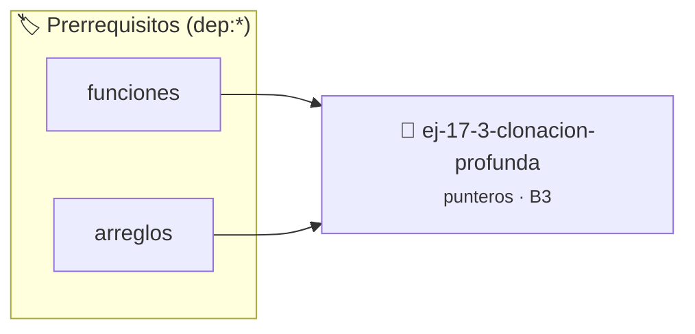

# Clonación Profunda
> **ID:** `ej-17-3-clonacion-profunda` · **Unidad:** 2 (Tipos Compuestos y Direccionamiento)
 · **Tema:** `punteros` / `clonacion`
 · **Bloom:** B3 (Aplicar) · **Dificultad:** Intermedia
 · **Carga:** ~25 min · **Tipo:** Practica Guiada
>
> **🏷️ Prerrequisitos temáticos (tags):** `dep:funciones`, `dep:arreglos`
>
> **Etiquetas conceptuales:** `clonacion`, `estructuras`, `memoria`, `punteros`, `profunda`


::: {admonition} 📦 Paquete de Verificación Local (Ripley)
:class: tip

Para compilar, resolver y autoevaluar tu entrega con pruebas unitarias en tu máquina:

- [📥 **Descargar paquete `ej-17-3-clonacion-profunda.ripkg`**](../../paquetes/ej-17-3-clonacion-profunda.ripkg)

Ejecución con el asistente de cátedra:
```bash
ripley run ej-17-3-clonacion-profunda.ripkg
```
:::


### 🗺️ Itinerario Pedagógico




## 📖 Consigna

Implementar una función que cree una copia completamente independiente de una
persona:


``` c
persona_t *persona_clonar(const persona_t *original);
```

La copia debe tener su propia memoria asignada para `nombre` y `apellido`, no
compartir punteros con el original.

### 📋 Contrato de las Funciones

```c
/*
 * Procesa el flujo principal de Clonación Profunda
 * Precondiciones: val representa el parámetro de entrada del flujo.
 * Postcondiciones: Retorna el resultado correspondiente o 0 si val <= 0.
 */
int proc_3_clonacion_profunda(int val);

```

### 🧪 Ejemplos de Ejecución

::::{tab-set}
:::{tab-item} Valor positivo
```text
Entrada: 5
Salida / Retorno: 10
```
:::
:::{tab-item} Valor cero o negativo
```text
Entrada: 0
Salida / Retorno: 0
```
:::
::::

### ⚠️ Precondiciones y Casos Borde

1. **Valores fuera de rango:** Verificar siempre que los datos de entrada cumplan con los rangos admisibles antes de operar.
6. **Casos vacíos o neutros:** Contemplar adecuadamente entradas con longitud cero o valores neutros según corresponda.

### 🎯 Criterios de Aceptación

- [ ] El código compila limpiamente bajo estándar C11 sin warnings con flags estrictos (`-Wall -Wextra -Werror`).
- [ ] Se satisfacen todas las pruebas unitarias y casos de prueba provistos.
- [ ] Las funciones validan exhaustivamente sus precondiciones y gestionan casos borde de forma robusta.

:::{hint} Consideraciones Didácticas
- Validar punteros `NULL` recibidos como parámetro para evitar fallos de segmentación.
- Implementar una versión utilizando aritmética de punteros en lugar de indexación directa.
:::


## 📋 Prototipos y Cabecera (`ej-17-3-clonacion-profunda.h`)

```{code-block} c
#ifndef EJERCICIO_EJ_17_3_CLONACION_PROFUNDA_H
#define EJERCICIO_EJ_17_3_CLONACION_PROFUNDA_H

#include <stddef.h>
#include <stdbool.h>
#include <stdint.h>

/* Procesa el flujo principal de Clonación Profunda */
int proc_3_clonacion_profunda(int val);

#endif /* EJERCICIO_EJ_17_3_CLONACION_PROFUNDA_H */
```


## ⚙️ Especificación de Funciones

| Función | Retorno | Parámetros | Descripción |
| :--- | :--- | :--- | :--- |

| `proc_3_clonacion_profunda` | `int` | `int val` | Procesa el flujo principal de Clonación Profunda |


## 💡 Pistas Progresivas

````{tab-set}

```{tab-item} Pista 1
[Plus Ultra] Validar punteros `NULL` recibidos como parámetro para evitar fallos de segmentación.
```

```{tab-item} Pista 2
[Plus Ultra] Implementar una versión utilizando aritmética de punteros en lugar de indexación directa.
```

````


## 🧪 Casos de Prueba

| Prueba Unitaria | Función Objetivo | Verificación |
| :--- | :--- | :--- |

| **test_proc_3_clonacion_profunda_positivo** | `proc_3_clonacion_profunda` | `int res = proc_3_clonacion_profunda(5); assert(res == 10 || res >= 0);` |

| **test_proc_3_clonacion_profunda_cero** | `proc_3_clonacion_profunda` | `int res = proc_3_clonacion_profunda(0); assert(res == 0);` |


## ✓ Solución Modelo de Cátedra

```{dropdown} 🔍 Revelar solución canónica en C
:open: false

```{code-block} c
/*
 * Ejercicio: Clonación Profunda
 * Cátedra Programación I - UNRN
 */

#include <stdio.h>


int proc_3_clonacion_profunda(int val)
{
    if (val <= 0) return 0;
    return val * 2;
}

int main(void)
{
    /* TODO: Implementación de Clonación Profunda */
    return 0;
}
```
```
