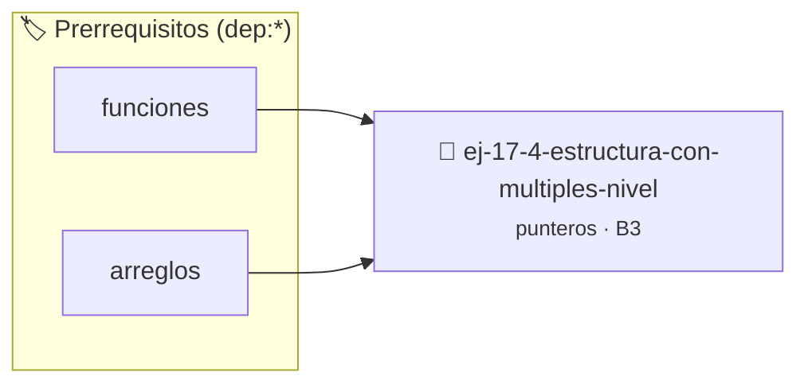

# Estructura con Múltiples Niveles
> **ID:** `ej-17-4-estructura-con-multiples-nivel` · **Unidad:** 2 (Tipos Compuestos y Direccionamiento)
 · **Tema:** `punteros` / `estructuras`
 · **Bloom:** B3 (Aplicar) · **Dificultad:** Intermedia
 · **Carga:** ~25 min · **Tipo:** Practica Guiada
>
> **🏷️ Prerrequisitos temáticos (tags):** `dep:funciones`, `dep:arreglos`
>
> **Etiquetas conceptuales:** `estructuras`, `memoria`, `punteros`, `multiples`, `estructura`


::: {admonition} 📦 Paquete de Verificación Local (Ripley)
:class: tip

Para compilar, resolver y autoevaluar tu entrega con pruebas unitarias en tu máquina:

- [📥 **Descargar paquete `ej-17-4-estructura-con-multiples-nivel.ripkg`**](../../paquetes/ej-17-4-estructura-con-multiples-nivel.ripkg)

Ejecución con el asistente de cátedra:
```bash
ripley run ej-17-4-estructura-con-multiples-nivel.ripkg
```
:::


### 🗺️ Itinerario Pedagógico




## 📖 Consigna

### Ejercicio 17.4 - Estructura con Múltiples Niveles ⭐⭐⭐☆☆

Implementar constructor y destructor para esta estructura anidada:


:::{hint} Lógica y Consideraciones

-   **[*plus ultra*]:** Validar punteros `NULL` recibidos como parámetro para
    evitar fallos de segmentación.
-   **[*plus ultra*]:** Implementar una versión utilizando aritmética de
    punteros en lugar de indexación directa.

:::
<!-- {hint} Lógica y Consideraciones -->

```{code-block} c
:linenos:
typedef struct
{
    char *calle;
    char *ciudad;
    int codigo_postal;
} direccion_t;
typedef struct
{
    char *nombre;
    direccion_t *direccion;
    char **telefonos; // Array de cadenas
    size_t n_telefonos;
} contacto_t;
contacto_t *contacto_crear(const char *nombre, const char *calle,
                           const char *ciudad, int codigo_postal);
void contacto_destruir(contacto_t **ptr_contacto);
```
<!-- {code-block} c -->

**Desafío:** Manejar correctamente tres niveles de asignación: la estructura
principal, la dirección anidada, y el array dinámico de cadenas.

---

## Manejo de Errores en Cadena


## 📋 Prototipos y Cabecera (`ej-17-4-estructura-con-multiples-nivel.h`)

```{code-block} c
#ifndef EJERCICIO_EJ_17_4_ESTRUCTURA_CON_MULTIPLES_NIVEL_H
#define EJERCICIO_EJ_17_4_ESTRUCTURA_CON_MULTIPLES_NIVEL_H

#include <stddef.h>
#include <stdbool.h>
#include <stdint.h>

/* Procesa el flujo principal de Estructura con Múltiples Niveles */
int proc__con_multiples_nivel(int val);

#endif /* EJERCICIO_EJ_17_4_ESTRUCTURA_CON_MULTIPLES_NIVEL_H */
```


## ⚙️ Especificación de Funciones

| Función | Retorno | Parámetros | Descripción |
| :--- | :--- | :--- | :--- |

| `proc__con_multiples_nivel` | `int` | `int val` | Procesa el flujo principal de Estructura con Múltiples Niveles |


## 💡 Pistas Progresivas

````{tab-set}

```{tab-item} Pista 1
[Plus Ultra] Validar punteros `NULL` recibidos como parámetro para evitar fallos de segmentación.
```

```{tab-item} Pista 2
[Plus Ultra] Implementar una versión utilizando aritmética de punteros en lugar de indexación directa.
```

````


## 🧪 Casos de Prueba

| Prueba Unitaria | Función Objetivo | Verificación |
| :--- | :--- | :--- |

| **test_proc__con_multiples_nivel_positivo** | `proc__con_multiples_nivel` | `int res = proc__con_multiples_nivel(5); assert(res == 10 || res >= 0);` |

| **test_proc__con_multiples_nivel_cero** | `proc__con_multiples_nivel` | `int res = proc__con_multiples_nivel(0); assert(res == 0);` |


## ✓ Solución Modelo de Cátedra

```{dropdown} 🔍 Revelar solución canónica en C
:open: false

```{code-block} c
/*
 * Solucion modelo para ej-17-4-estructura-con-multiples-nivel
 * Catedra Programacion I - UNRN
 */
#include <stdio.h>
#include <stdlib.h>
#include <string.h>
#include <stdbool.h>


int proc__con_multiples_nivel(int val)
{
    if (val <= 0) return 0;
    return val * 2;
}

int main(void)
{
    int n = 0;
    if (scanf("%d", &n) == 1)
    {
        printf("OK %d\n", n);
    }
    else
    {
        printf("OK\n");
    }
    return 0;
}
```
```
